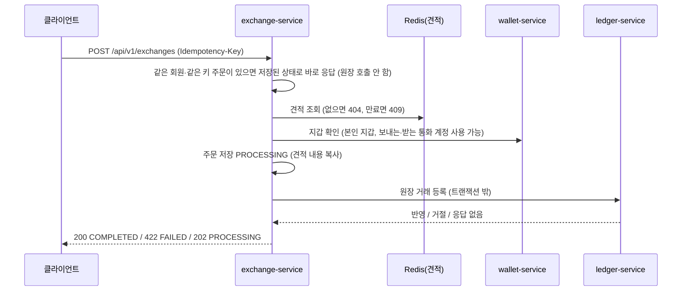
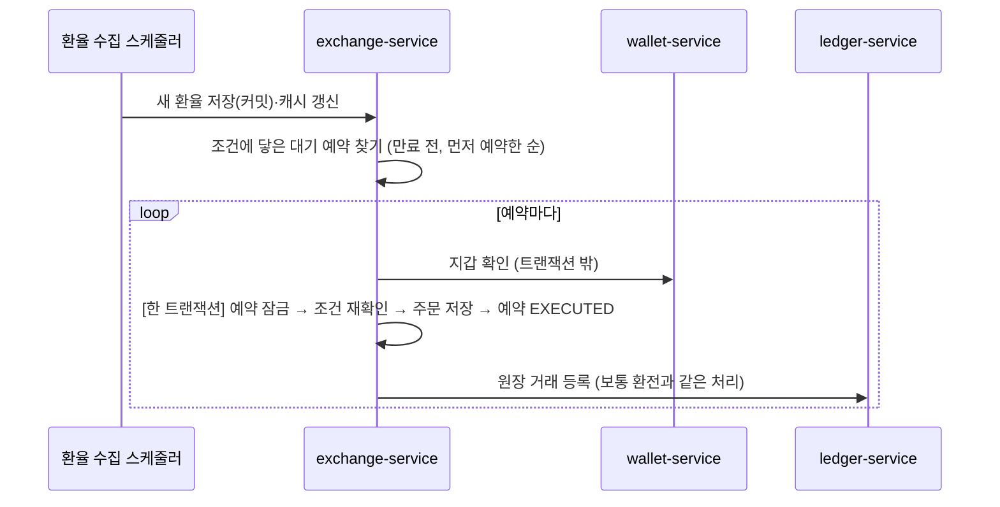

# 환전 서비스 실행·사용 가이드

exchange-service는 원화(KRW)와 외화(JPY·CNY) 사이의 환전을 맡습니다. 환율을 수집해 보여 주고, 환율로 **견적**(5분 동안 금액 보장)을 발급하고, 견적으로 **환전 신청**을 받으면 원장(ledger-service)에 거래를 등록해 실제로 지갑 잔액을 바꿉니다. 잔액은 환전 서비스가 직접 바꾸지 않고 원장이 한 거래로 처리합니다. 브라우저는 Gateway를 통해 호출합니다([Gateway 가이드](gateway.md)).

- 환전: 원화 → 외화 (`type: EXCHANGE`), 재환전: 외화 → 원화 (`type: RE_EXCHANGE`). 외화끼리(JPY ↔ CNY)는 지원하지 않습니다.
- 왜 이렇게 만들었는지는 [설계 결정](#설계-결정) 절에 모았습니다.

## 로컬 실행

필요한 것: JDK 21, Docker.

1. `.env.example`을 `.env`로 복사하고 비밀번호 값을 바꿉니다([로컬 환경 설정 가이드](local-settings.md)).
2. 인프라를 실행합니다. **환전에는 캐시 Redis(`redis-cache`)가 꼭 필요합니다.** 견적을 Redis에 저장하기 때문입니다.

   ```bash
   docker compose up -d postgres redis-session kafka redis-cache
   ```

3. 환전은 다른 서비스를 호출하므로 아래 서비스가 함께 떠 있어야 합니다. 모두 Eureka(`8761`)에 등록된 이름으로 찾습니다.

   | 서비스 | 포트 | 환전에서 쓰는 곳 |
   |---|---|---|
   | eureka-server | 8761 | 서비스 찾기 |
   | wallet-service | 8082 | 신청 전 지갑 확인, 한도 조회의 잔액 (`GET /internal/v1/wallets/balances`) |
   | ledger-service | 8085 | 원장 거래 등록·조회 (`/internal/v1/ledger/transactions`) |

   환율 조회와 견적 발급만 확인할 때는 지갑·원장 없이 환전 서비스만 있어도 됩니다.

4. 실행합니다. 로컬 포트는 `8084`입니다.

   ```bash
   set -a; source .env; set +a
   ./gradlew :exchange-service:bootRun
   ```

   - IntelliJ에서 "명령줄이 너무 깁니다"로 실행이 안 되면: Edit Configurations → Modify options → Shorten command line → `@argfile (Java 9+)`.
   - 상태 확인: `GET http://localhost:8084/actuator/health`
   - 배포 설정(`application-prod.yml`)은 `SPRING_CONFIG_NAME=application-prod`로 선택합니다.

5. 테이블은 앱이 시작할 때 Flyway가 만듭니다([DB 스키마](#db-스키마-flyway)).

### 주요 환경 변수

| 변수 | 기본값 | 설명 |
|---|---|---|
| `EXCHANGE_DB_URL`·`_USERNAME`·`_PASSWORD` | 없음 | PostgreSQL 연결 (`currentSchema=exchange_service`) |
| `REDIS_CACHE_HOST`·`_PORT`·`_PASSWORD` | `localhost`·`16380` | 캐시 Redis: 최신 환율 캐시 + 견적 저장소 |
| `EXCHANGE_RATE_MODE` | `koreaexim` | `koreaexim`(한국수출입은행 공식 환율) 또는 `mock`(5초마다 바뀌는 가짜 환율, 시연·부하 측정용) |
| `KOREAEXIM_API_KEY` | 없음 | `koreaexim` 모드에서 필수. 없으면 시작을 멈춥니다. `mock` 모드는 필요 없음 |
| `EXCHANGE_WALLET_URL`·`EXCHANGE_LEDGER_URL` | 비어 있음 | 지갑·원장을 Eureka 대신 직접 주소로 부를 때 (예: `http://localhost:8085`) |

API 문서는 로컬에서 Swagger UI `http://localhost:8084/swagger-ui.html`로 볼 수 있습니다. 그룹은 `exchange`(환전)와 `exchange-admin`(환전 관리)이고, 배포 설정에서는 꺼져 있습니다. Gateway 없이 직접 호출할 때는 Swagger에 표시된 `User-Id`·`User-Role` 헤더를 채웁니다(환율 조회는 필요 없음).

## API 목록

| API | 설명 | 로그인 | `Idempotency-Key` | 성공 |
|---|---|---|---|---|
| `GET /api/v1/exchange-rates` | 최신 환율 (`?currency=JPY`로 한 통화) | **불필요** | 없음 | 200 |
| `GET /api/v1/exchange-limits` | 보내는 통화별 1회 한도와 잔액 기준 환전 가능 금액 | 필요 | 없음 | 200 |
| `POST /api/v1/exchange-quotes` | 견적 발급 | 필요 | 없음 | 201 |
| `GET /api/v1/exchange-quotes/{quoteId}` | 본인 견적 조회 | 필요 | 없음 | 200 |
| `POST /api/v1/exchanges` | 환전 신청 | 필요 | **필수** | 200·202 |
| `GET /api/v1/exchanges` | 본인 환전 내역 (`status`, `type`, `page`, `size`) | 필요 | 없음 | 200 |
| `GET /api/v1/exchanges/{orderId}` | 본인 환전 상세 | 필요 | 없음 | 200 |
| `POST /api/v1/exchange-reservations` | 예약 환전 등록 | 필요 | **필수** | 201 |
| `GET /api/v1/exchange-reservations` | 본인 예약 목록 (`status`, `page`, `size`) | 필요 | 없음 | 200 |
| `GET /api/v1/exchange-reservations/{reservationId}` | 본인 예약 상세 (체결됐으면 주문 ID·주문 상태) | 필요 | 없음 | 200 |
| `POST /api/v1/exchange-reservations/{reservationId}/cancel` | 대기 중인 예약 취소 | 필요 | 없음 | 200 |

관리자(MASTER) API는 [관리자 처리](#관리자-처리-manual_review) 절에 있습니다.

- 응답 본문은 `success`·`data`·`error` 공통 형식입니다([common 가이드](common.md)).
- **금액과 환율은 통화 단위 문자열**입니다(예: KRW `"100000"`, CNY `"100.50"`, 환율 `"838.3"`). 부동소수점 오차 없이 주고받기 위해서입니다. 시각은 UTC ISO-8601입니다.
- 환율 값은 `unit` 단위 외화의 원화 가격입니다. JPY는 100엔당(`unit: 100`), CNY는 1위안당(`unit: 1`)입니다.
- 로그인은 Gateway가 확인하고, 환전 서비스는 Gateway가 넣어 준 `User-Id`·`User-Role` 헤더로 요청자를 정합니다. 환율 조회만 로그인 없이 쓸 수 있습니다(Gateway 공개 경로).

## 호출 순서

```txt
1. GET  /api/v1/exchange-rates        → 현재 환율 표시 (5초마다 다시 조회해도 됨, 캐시라 가벼움)
2. GET  /api/v1/exchange-limits       → 보낼 수 있는 최대 금액(availableAmount) 표시
3. POST /api/v1/exchange-quotes       → 견적 발급. 받을 금액·수수료를 5분 동안 보장
4. POST /api/v1/exchanges             → 견적 ID + 지갑 ID로 신청. Idempotency-Key 헤더 포함
   - 200 COMPLETED: 환전 완료
   - 202 PROCESSING: 원장 결과 확인 중. 서버가 자동으로 다시 처리하므로 5번으로 상태 확인
   - 409 EXCHANGE_QUOTE_EXPIRED: 견적 만료 → 3번부터 다시
   - 422: 잔액 부족 등으로 원장이 거절 (주문은 FAILED로 남음)
5. GET  /api/v1/exchanges/{orderId}   → 최종 상태 확인 (202였다면 몇 초 간격으로)
```

응답을 받지 못해 다시 보낼 때는 **같은 `Idempotency-Key`와 같은 본문**을 씁니다. 새 신청마다 새 키를 만듭니다(UUID 권장).

curl로 Gateway 없이 확인할 때는 회원 헤더를 직접 넣습니다. 아래 ID는 예시입니다.

```bash
BASE=http://localhost:8084
USER=550e8400-e29b-41d4-a716-446655440000
WALLET=<내 지갑 ID>

curl -s "$BASE/api/v1/exchange-rates"

curl -s -H "User-Id: $USER" -H 'User-Role: USER' -H 'Content-Type: application/json' \
  -d '{"fromCurrency":"KRW","toCurrency":"JPY","amount":"100000"}' \
  "$BASE/api/v1/exchange-quotes"

curl -s -H "User-Id: $USER" -H 'User-Role: USER' -H 'Content-Type: application/json' \
  -H "Idempotency-Key: $(uuidgen)" \
  -d "{\"quoteId\":\"<견적 ID>\",\"walletId\":\"$WALLET\"}" \
  "$BASE/api/v1/exchanges"
```

## 환율

### 수집

| 모드 | 출처 | 수집 주기 | 견적에 쓸 수 있는 기간 |
|---|---|---|---|
| `koreaexim` | 한국수출입은행 환율 API | 평일 11~13시 10분마다(`0 */10 11-13 * * MON-FRI`, 서울 시각). 오늘 고시분이 저장되면 그날은 더 수집하지 않음 | 고시일이 7일 이내 (연휴 대비) |
| `mock` | 공식 환율을 중심으로 한 가짜 환율 | 5초마다 | 수집 후 30초 이내 |

- 매매기준율(`midRate`), 살 때(`buyRate`), 팔 때(`sellRate`)를 저장합니다. **견적은 매매기준율만 씁니다**(살 때·팔 때 같은 환율 + 수수료 1%).
- 수출입은행 응답에서 한 통화의 값만 이상하면 그 통화만 건너뛰고 경고 로그를 남깁니다. 다음 주기에 그 통화만 다시 수집합니다.
- 환율이 없거나 위 기간보다 오래되면 견적 발급은 503 `EXCHANGE_RATE_UNAVAILABLE`입니다.

### 캐시

- 수집하면 DB에 저장(커밋)한 뒤, 통화별 최신 환율을 Redis(`exchange:rate:latest:{출처}:{통화}`, 30초)에 복사합니다.
- 환율 조회와 견적 발급은 Redis에서 먼저 읽고, 없거나 Redis가 응답하지 않으면(200ms) DB에서 읽습니다. **Redis가 꺼져도 환율 조회는 정상**입니다(대신 1분에 한 번 경고 로그).
- 효과(동시 300명, 같은 노트북): TPS 6,490 → 17,730, P95 124ms → 29ms, DB 연결 대기 184 → 0. 측정 방법은 `exchange-service/load-test/README.md`.

## 견적

### 발급 (`POST /api/v1/exchange-quotes`)

| 항목 | 규칙 |
|---|---|
| `fromCurrency`·`toCurrency` | 필수. 한쪽은 KRW, 다른 쪽은 JPY·CNY. 아니면 400 `EXCHANGE_UNSUPPORTED_PAIR`, 모르는 통화면 400 `EXCHANGE_UNSUPPORTED_CURRENCY` |
| `amount` | 필수. **보내는 금액**(통화 단위). 자릿수(KRW·JPY 정수, CNY 소수 2자리)를 넘거나 1회 한도 밖이면 400 `EXCHANGE_INVALID_AMOUNT` |

1회 한도(보내는 통화 기준, 포함): KRW 1,000 ~ 2,000,000 / JPY 100 ~ 200,000 / CNY 10.00 ~ 10,000.00 (팀 확정 전 임시값, `exchange.quote.limits`).

계산
- 받는 금액(**받는 통화 자릿수로 내림**, 0이 되면 400 `EXCHANGE_INVALID_AMOUNT`)
  - 원화 → 외화: 보내는 원화 ÷ 매매기준율 × 단위 (예: 100,000원 ÷ 838.3 × 100 = 11,928엔)
  - 외화 → 원화: 보내는 외화 × 매매기준율 ÷ 단위
- 수수료 = 보내는 금액 × 1%, **보내는 통화 자릿수로 올림**
- 지갑에서 빠지는 금액(`totalDebitAmount`) = 보내는 금액 + 수수료

견적에는 계산 근거(환율 행 ID, 적용 환율, 단위, 고시일, 수수료율)가 함께 저장되고, 환전 신청은 이 값을 그대로 복사합니다. 견적을 받은 뒤 환율이 바뀌어도 **5분 동안은 견적 금액 그대로** 환전됩니다.

### 저장과 상태

- 견적은 **Redis에 저장**합니다(`exchange:quote:{견적 ID}`, JSON). DB는 쓰지 않아 발급할 때 DB 연결을 빌리지 않습니다.
- 키 수명은 10분(유효 5분 + 만료 뒤 5분)입니다. 만료 직후 5분 동안은 "만료됨"으로 답하고, 그 뒤에는 사라져 404입니다.
- 조회(`GET /api/v1/exchange-quotes/{quoteId}`)의 `status`는 저장값이 아니라 그때 계산합니다.

| `status` | 조건 |
|---|---|
| `USED` | 이 견적으로 만든 환전 주문이 있음 (만료 시각이 지나도 USED) |
| `EXPIRED` | 주문이 없고 만료 시각이 지남 |
| `ISSUED` | 주문이 없고 만료 전 → 환전 신청에 쓸 수 있음 |

- 다른 회원의 견적은 없는 것과 같게 404 `EXCHANGE_QUOTE_NOT_FOUND`입니다.
- Redis에 닿지 못하면 견적 발급·조회는 503 `EXCHANGE_QUOTE_STORE_UNAVAILABLE`입니다. 견적은 Redis에만 있어 DB로 대신하지 않습니다.

## 환전 신청

### 요청 (`POST /api/v1/exchanges`)

| 항목 | 규칙 |
|---|---|
| `Idempotency-Key` 헤더 | 필수. 공백·제어 문자 없는 ASCII 1~100자. 없거나 형식이 틀리면 400 `EXCHANGE_INVALID_IDEMPOTENCY_KEY`. `reservation:`으로 시작하는 키는 예약 체결 주문 전용이라 같은 400 |
| `quoteId` | 필수. 본인 견적 |
| `walletId` | 필수. 본인 지갑 |

```json
{ "quoteId": "7c1e…", "walletId": "3b9a…" }
```

### 처리 순서



1. 같은 회원·같은 `Idempotency-Key`의 주문이 있으면 [멱등성](#멱등성) 규칙으로 응답합니다. 견적보다 먼저 보므로, 견적이 사라진 뒤의 재요청도 처음 주문으로 답합니다.
2. 견적을 찾습니다. 없거나 남의 견적이면 404 `EXCHANGE_QUOTE_NOT_FOUND`, 신청 시각이 만료 시각과 같거나 늦으면 409 `EXCHANGE_QUOTE_EXPIRED`.
3. 지갑을 확인합니다. 잔액은 보지 않습니다(잔액 판단은 원장이 거래를 기록할 때 합니다).
   - 본인 지갑이 아니거나 없음: 404 `EXCHANGE_WALLET_NOT_FOUND`
   - 보내는 통화를 쓸 수 없거나 받는 통화를 받을 수 없음: 409 `EXCHANGE_WALLET_NOT_AVAILABLE`
   - 원장 장애로 지갑이 잔액을 못 읽음: 503 `EXCHANGE_LEDGER_UNAVAILABLE` (주문을 만들지 않음)
   - 그 밖의 지갑 서비스 실패: 503 `EXCHANGE_WALLET_SERVICE_UNAVAILABLE`
4. 주문을 `PROCESSING`으로 저장합니다. 같은 견적은 한 번만 쓸 수 있어, 다른 키로 같은 견적을 쓰면 409 `EXCHANGE_QUOTE_ALREADY_USED`(주문 테이블 `UNIQUE(quote_id)`).
5. 원장에 거래를 등록하고 결과에 따라 응답합니다.

| 원장 결과 | 주문 | 응답 |
|---|---|---|
| 반영됨 | `COMPLETED` | 200 |
| 거절(잔액 부족, 계정 정지·없음) | `FAILED` | 422 `EXCHANGE_LEDGER_REJECTED_INSUFFICIENT_BALANCE` / `_WALLET_SUSPENDED` / `_ACCOUNT_NOT_FOUND` |
| 응답 없음·5xx·타임아웃 | `PROCESSING` | 202 → [복구](#원장-연동과-복구) |
| 400·409·해석 불가·모르는 거절 | `MANUAL_REVIEW` | 202 → [관리자 처리](#관리자-처리-manual_review) |

### 멱등성

- 같은 회원·같은 키·**같은 견적과 지갑**이면 처음 주문을 돌려줍니다. 견적이나 지갑이 다르면 409 `EXCHANGE_IDEMPOTENCY_KEY_REUSED`.
- 재요청은 **원장을 부르지 않고 저장된 상태로** 응답합니다(송금과 같은 방식). `PROCESSING`이면 202이고, 결과는 복구 스케줄러가 반영합니다. 원장이 느릴 때 사용자가 여러 번 눌러도 원장 호출이 늘지 않습니다.
- 응답 코드는 주문 상태로 정해, 재요청도 같은 상태면 처음과 같은 응답입니다(`FAILED`면 같은 422).

### 주문 상태

| 상태 | 뜻 |
|---|---|
| `PROCESSING` | 원장 결과를 아직 모름. 복구 스케줄러가 다시 보냄 |
| `COMPLETED` | 원장에 반영됨 (확정) |
| `FAILED` | 원장이 거절했거나 관리자가 취소로 확정 (확정) |
| `MANUAL_REVIEW` | 다시 보내도 풀리지 않거나 오래 확인하지 못해 관리자 확인 필요 |

상태가 바뀔 때마다 이력(`exchange_order_status_histories`)에 누가(`USER`·`SYSTEM`·`MASTER`) 왜 바꿨는지 남깁니다.

## 원장 연동과 복구

### 원장 거래 등록

`referenceType=EXCHANGE`, `referenceId=주문 ID`로 등록합니다. 원장은 같은 reference를 한 번만 기록하므로, 결과를 모를 때 같은 내용을 다시 보내도 돈이 두 번 움직이지 않습니다.

| 항목 | 차변(DEBIT) | 대변(CREDIT) | 금액 |
|---|---|---|---|
| `EXCHANGE_OUT` | 사용자 지갑(보내는 통화) | 시스템 `FX_POSITION`(보내는 통화) | 보내는 금액 |
| `EXCHANGE_FEE` | 사용자 지갑(보내는 통화) | 시스템 `FEE_REVENUE`(보내는 통화) | 수수료 (0이면 생략) |
| `EXCHANGE_IN` | 시스템 `FX_POSITION`(받는 통화) | 사용자 지갑(받는 통화) | 받는 금액 |

사용자 계정은 지갑 ID + 통화로 지정합니다. 시스템 계정은 원장 마이그레이션이 만들어 둡니다([원장 가이드](ledger-service.md#시스템-계정)).

### 복구 스케줄러

- 30초마다 결과를 모르는 `PROCESSING` 주문을 최대 50건 골라 원장에 같은 내용을 다시 보냅니다.
- 같은 주문을 다시 보내는 간격은 `30초 × 2^min(확인 횟수, 5)`로 늘어납니다(30초, 1분, 2분 … 최대 16분).
- 여러 서버가 같은 주문을 동시에 보내지 않도록, 확인 횟수 비교로 한 흐름만 원장 호출을 맡습니다(선점, 10초 유효).
- 신청 후 **24시간**이 지나도 결과를 모르면 `MANUAL_REVIEW`(`LEDGER_UNCONFIRMED_TOO_LONG`)로 보냅니다.
- 끄려면 `exchange.order.recovery.enabled=false`. 이때 아래 정체·대기 지표도 갱신되지 않습니다.

### 지표

`/actuator/prometheus`로 내보냅니다.

| 지표 | 뜻 |
|---|---|
| `exchange_order_processing_stuck` | 신청 후 30분 넘게 `PROCESSING`인 주문 수 (원장 장애 신호). 1건 이상이면 오래된 주문 ID 5개를 ERROR 로그로 남김 |
| `exchange_order_manual_review` | 관리자 처리를 기다리는 주문 수 |
| `exchange_rate_cache_lookups_total{result=hit/miss/error}` | 환율 캐시 조회 결과 |
| `hikaricp_connections_*` | DB 커넥션 풀 (사용 중·대기·획득 시간) |

정체·대기 수는 복구 스케줄러가 30초마다 세어 두고, 지표는 그 값만 읽습니다. 세기에 실패하면 0이 아니라 이전 값을 유지합니다.

## 예약 환전

목표 환율(매매기준율)을 걸어 두면, 환율이 그 값에 닿았을 때 서버가 자동으로 환전 주문을 만듭니다. **예약할 때는 돈이 움직이지 않고**(잔액을 묶어 두지 않음), 체결할 때 보통 환전과 같은 주문·원장 처리를 거칩니다.

### 등록 (`POST /api/v1/exchange-reservations`)

| 항목 | 규칙 |
|---|---|
| `Idempotency-Key` 헤더 | 필수. 환전 신청과 같은 형식. 같은 키·같은 내용이면 처음 예약을 201로 다시 돌려주고, 내용이 다르면 409 `EXCHANGE_RESERVATION_IDEMPOTENCY_KEY_REUSED` |
| `walletId` | 필수. 본인 지갑 (등록할 때 확인) |
| `fromCurrency`·`toCurrency` | 원화 ↔ 외화 (JPY·CNY) |
| `amount` | 보내는 금액. 견적과 같은 1회 한도 |
| `targetRate` | 목표 매매기준율. 환율 조회와 같은 단위(JPY 100엔당, CNY 1위안당), 소수 둘째 자리까지 |
| `expiresAt` | 만료 시각(UTC). 지금 이후, 최대 30일(`exchange.reservation.max-period`) |

```json
{ "walletId": "3b9a…", "fromCurrency": "KRW", "toCurrency": "JPY", "amount": "100000",
  "targetRate": "830.00", "expiresAt": "2026-11-17T03:00:00Z" }
```

- 체결 조건은 통화쌍으로 정해지며 응답의 `condition`으로 보여 줍니다.
  - 원화 → 외화(외화를 삼): 환율이 목표 **이하**가 되면 체결 (`AT_OR_BELOW`)
  - 외화 → 원화(외화를 팖): 환율이 목표 **이상**이 되면 체결 (`AT_OR_ABOVE`)
- 회원당 대기 예약은 최대 10건(`exchange.reservation.max-waiting-per-user`)입니다. 넘으면 409 `EXCHANGE_RESERVATION_TOO_MANY_WAITING`. 동시에 몰린 요청은 한도를 조금 넘을 수 있습니다(저장 전에 세기 때문).

### 상태

| 상태 | 뜻 |
|---|---|
| `WAITING` | 조건을 기다리는 중. 취소 가능 |
| `EXECUTED` | 체결됨. `orderId`의 주문이 만들어졌고, 결과(완료·실패)는 `orderStatus`로 확인 |
| `CANCELED` | 취소됨. `cancelReason`: `USER_REQUESTED`(사용자), `WALLET_UNAVAILABLE`(체결 때 지갑 해지·사용 불가), `EXECUTION_REJECTED`(체결 때 한도 변경 등으로 주문 불가) |
| `EXPIRED` | 만료 시각까지 체결되지 않음 |

`EXECUTED`는 "주문을 만들었다"는 뜻입니다. 잔액 부족 같은 이유로 원장이 거절하면 예약은 `EXECUTED`, 주문은 `FAILED`입니다.

### 체결 흐름



1. 환율 수집기가 새 환율을 저장하면 그 환율로 조건에 닿은 대기 예약을 찾습니다. 환율은 수집할 때만 바뀌므로 주기적으로 전체를 훑지 않습니다. 새로 저장한 서버만 알림을 받아, 서버가 여러 대여도 한 곳에서 찾습니다.
2. 예약마다 지갑을 확인합니다.
3. 한 트랜잭션에서 예약을 `FOR UPDATE SKIP LOCKED`로 잠그고 조건·만료를 다시 확인한 뒤, **조건을 충족시킨 그 환율**로 체결용 견적(`QuoteType.RESERVATION`)을 메모리에서 만들어 주문에 복사합니다. 주문과 예약 상태(주문 ID·체결 시각)를 함께 커밋해, 주문만 있거나 체결만 기록되는 일이 없습니다.
   - 주문 멱등 키는 `reservation:{예약 ID}`라 같은 예약으로 주문을 두 번 만들 수 없습니다. 이 접두어는 환전 신청에서 받지 않습니다.
   - 주문 생성 이력은 `SYSTEM`으로 남습니다.
4. 커밋 뒤 원장에 보냅니다. 결과를 모르면 주문은 `PROCESSING`으로 남고 [복구 스케줄러](#복구-스케줄러)가 이어서 처리합니다.

| 체결 중 실패 | 결과 |
|---|---|
| 지갑 서비스·원장 장애 | `WAITING` 유지. 다음 새 환율 때 조건이 맞으면 다시 체결 |
| 지갑 없음(해지)·통화 사용 불가 | `CANCELED` (`WALLET_UNAVAILABLE`) |
| 체결 시점 1회 한도 밖 | `CANCELED` (`EXECUTION_REJECTED`) |
| 사용자 취소·다른 서버의 체결과 겹침 | 먼저 잠근 쪽만 반영. 체결이 먼저면 취소는 409 `EXCHANGE_RESERVATION_NOT_WAITING` |
| DB 장애 등 예상 밖 오류 | 롤백되어 `WAITING`. 다른 예약은 계속 체결 |

- 지금은 수집 스레드에서 바로 체결합니다(`SynchronousReservationDispatcher`). 체결할 예약이 많으면 그만큼 다음 수집이 늦어지므로, 이후 Kafka로 넘기는 구현으로 바꿀 수 있게 `ReservationDispatcher`로 나눠 두었습니다.
- `koreaexim` 모드는 하루 한 번 고시라 체결 판단도 하루 한 번입니다. 시연은 5초마다 환율이 바뀌는 `mock` 모드로 확인합니다.

### 만료 스케줄러

- 1분마다(`exchange.reservation.expiry.fixed-delay`) 만료 시각이 지난 대기 예약을 500건씩(`batch-size`) `EXPIRED`로 바꿉니다. 한 번에 최대 20배치, 남으면 다음 주기에 처리합니다.
- 체결·취소 중이라 잠긴 예약은 건너뜁니다(SKIP LOCKED). 만료된 예약은 매칭·체결에서 이미 빠지므로, 상태 변경이 몇 분 늦어도 체결은 잘못되지 않습니다.
- 끄려면 `exchange.reservation.expiry.enabled=false`.

## 관리자 처리 (MANUAL_REVIEW)

`User-Role`이 `MASTER`가 아니면 403 `COMMON_FORBIDDEN`입니다. Gateway 경로는 `/api/v1/admin/exchanges/**`입니다.

| API | 설명 |
|---|---|
| `GET /api/v1/admin/exchanges/manual-reviews` | `MANUAL_REVIEW` 주문 목록, 오래된 순 (`reviewReason`, `page`, `size`) |
| `GET /api/v1/admin/exchanges/{orderId}` | 주문 + 원장 조회 결과 + 처리하면 어떻게 될지(예상 결과) |
| `POST /api/v1/admin/exchanges/{orderId}/resolve` | 처리. 본문 `{"memo": "..."}`는 선택(255자 이하) |
| `GET /api/v1/admin/exchanges/resolutions` | 관리자 처리 이력, 최신순 (`actorId`, `orderId`, `from`·`to`(ISO-8601, to 제외), `page`, `size`) |

**처리 결과는 관리자가 고르지 않고, 서버가 원장을 조회해 정합니다.** 처리 버튼은 하나입니다.

| 원장 조회 결과 | 주문 | 실패 사유 |
|---|---|---|
| 반영됨 + 항목이 주문과 같음 | `COMPLETED` | 없음 |
| 거절 + 아는 사유 | `FAILED` | 원장 거절 사유 (잔액 부족 등) |
| 거절 + 모르는 사유, 또는 `LEDGER_CONFLICT` 주문 | `FAILED` | `PROCESSING_ERROR` ("처리 중 오류로 취소되었습니다.") |
| 기록 없음 (404 + `LEDGER_TRANSACTION_NOT_FOUND`) | `FAILED` | `NOT_PROCESSED` ("처리 시간이 초과되어 취소되었습니다.") |
| 반영됐는데 항목이 다름 | 그대로 | 409 `EXCHANGE_LEDGER_CORRECTION_REQUIRED` (원장 보정 필요) |
| 원장 조회 실패 (코드 없는 404, 5xx, 타임아웃) | 그대로 | 503 `EXCHANGE_LEDGER_LOOKUP_UNAVAILABLE` |

- 이미 처리됐거나 `MANUAL_REVIEW`가 아니면 409 `EXCHANGE_NOT_MANUAL_REVIEW`. 두 관리자가 동시에 눌러도 한 번만 반영됩니다.
- 기록 없음은 다시 보내지 않고 취소합니다. 견적은 5분짜리라, 오래 멈춘 주문을 뒤늦게 보내면 사용자가 예상하지 못한 때 환전되기 때문입니다.
- 코드 없는 404는 "주소가 없다"(경로 오류·설정 실수)일 수 있어 기록 없음으로 보지 않습니다.
- 처리하면 이력에 관리자 ID·근거(`LEDGER_POSTED` 등)·원장 거래 ID·메모가 남고, 처리 이력 API로 모아 볼 수 있습니다. 조회는 DB에 남지 않아 INFO 로그로 남깁니다.

## 오류 응답

| 상태 | 코드 | 상황 |
|---|---|---|
| 400 | `COMMON_INVALID_REQUEST` | 본문 검증 실패, 잘못된 `page`·`size`·`status`·`type`, 처리 이력 기간(from ≥ to) |
| 400 | `EXCHANGE_UNSUPPORTED_CURRENCY` | KRW·JPY·CNY가 아닌 통화 |
| 400 | `EXCHANGE_UNSUPPORTED_PAIR` | 원화 ↔ 외화가 아닌 통화쌍 |
| 400 | `EXCHANGE_INVALID_AMOUNT` | 자릿수 초과, 1회 한도 밖, 받는 금액이 0 |
| 400 | `EXCHANGE_INVALID_IDEMPOTENCY_KEY` | `Idempotency-Key` 없음·형식 오류, 환전 신청에 `reservation:` 키 |
| 400 | `EXCHANGE_RESERVATION_INVALID_TARGET_RATE` | 목표 환율이 0 이하이거나 소수 셋째 자리 이상 |
| 400 | `EXCHANGE_RESERVATION_INVALID_EXPIRY` | 만료 시각이 지금 이전이거나 최대 예약 기간 밖 |
| 401 | `COMMON_UNAUTHORIZED` | 회원 헤더 없음(Gateway 경유 시 세션 없음) |
| 403 | `COMMON_FORBIDDEN` | 관리자 API를 MASTER가 아닌 회원이 호출 |
| 404 | `EXCHANGE_QUOTE_NOT_FOUND` | 견적 없음·남의 견적·키 수명(10분) 지남 |
| 404 | `EXCHANGE_ORDER_NOT_FOUND` | 주문 없음·남의 주문 |
| 404 | `EXCHANGE_WALLET_NOT_FOUND` | 지갑 없음·남의 지갑 |
| 404 | `EXCHANGE_RESERVATION_NOT_FOUND` | 예약 없음·남의 예약 |
| 409 | `EXCHANGE_QUOTE_EXPIRED` | 견적 만료 |
| 409 | `EXCHANGE_QUOTE_ALREADY_USED` | 다른 신청에 이미 쓴 견적 |
| 409 | `EXCHANGE_IDEMPOTENCY_KEY_REUSED` | 같은 키로 다른 견적·지갑 |
| 409 | `EXCHANGE_WALLET_NOT_AVAILABLE` | 지갑·통화 계정을 쓸 수 없음 |
| 409 | `EXCHANGE_RESERVATION_TOO_MANY_WAITING` | 대기 예약이 회원당 한도(10건) |
| 409 | `EXCHANGE_RESERVATION_IDEMPOTENCY_KEY_REUSED` | 같은 키로 다른 내용의 예약 |
| 409 | `EXCHANGE_RESERVATION_NOT_WAITING` | 이미 체결·취소·만료된 예약을 취소 |
| 409 | `EXCHANGE_NOT_MANUAL_REVIEW` | 관리자 처리 대상이 아니거나 이미 처리됨 |
| 409 | `EXCHANGE_LEDGER_CORRECTION_REQUIRED` | 원장 항목이 주문과 달라 처리 불가 |
| 422 | `EXCHANGE_LEDGER_REJECTED_*` | 원장 거절 (주문 `FAILED`) |
| 422 | `EXCHANGE_NOT_PROCESSED`·`EXCHANGE_PROCESSING_ERROR` | 관리자가 취소로 처리한 주문의 같은 키 재요청 |
| 503 | `EXCHANGE_RATE_UNAVAILABLE` | 견적에 쓸 환율이 없거나 오래됨 |
| 503 | `EXCHANGE_QUOTE_STORE_UNAVAILABLE` | 견적 저장소(Redis)에 닿지 못함 |
| 503 | `EXCHANGE_WALLET_SERVICE_UNAVAILABLE`·`EXCHANGE_LEDGER_UNAVAILABLE` | 지갑 확인 실패 (주문을 만들지 않음) |
| 503 | `EXCHANGE_LEDGER_LOOKUP_UNAVAILABLE` | 관리자 처리 중 원장 조회 실패 |

원장 등록 결과를 모르는 경우는 오류가 아니라 202 `PROCESSING`으로 응답합니다.

## DB 스키마 (Flyway)

스키마는 `exchange_service`, 마이그레이션은 `exchange-service/src/main/resources/db/migration`입니다.

| 테이블 | 내용 |
|---|---|
| `exchange_rates` | 수집한 환율 이력. 출처·통화별 최신 행이 현재 환율. 수출입은행은 통화·고시일당 1건(`uk_exchange_rates_koreaexim_daily`) |
| `exchange_orders` | 환전 주문. 견적 내용을 복사한 스냅샷이라 이 행만으로 어떤 환율·수수료로 얼마를 주고받았는지 증빙. 상태 변경은 조건부 UPDATE로만 |
| `exchange_order_status_histories` | 주문 상태 이력 (INSERT만). 관리자 처리면 관리자 ID·원장 거래 ID·메모 |
| `exchange_reservations` | 예약 환전. 체결되면 만든 주문 ID(`UNIQUE`)를 남김. 상태 변경은 조건부 UPDATE로만, 매칭·만료 조회는 대기 예약만 담은 부분 인덱스 |
| `exchange_quotes` | **사용하지 않음.** 견적은 Redis로 옮겼고(#223), 비교 측정 뒤 지울 예정 |

| 버전 | 내용 |
|---|---|
| V1 | 환율 테이블, 최신 환율 인덱스 |
| V2 | 견적 테이블 (지금은 사용 안 함) |
| V3 | 주문·상태 이력, 복구 대상 부분 인덱스(`status = 'PROCESSING'`) |
| V4 | `MANUAL_REVIEW` 상태 |
| V5 | 관리자 처리 컬럼, `MANUAL_REVIEW` 목록 부분 인덱스 |
| V6 | 관리자 처리 이력 부분 인덱스(`changed_by_type = 'MASTER'`) |
| V7 | 예약 환전 테이블, 매칭·만료 부분 인덱스(`status = 'WAITING'`) |
| V8 | 예약 취소 사유(`cancel_reason`) |

Redis 키

| 키 | 값 | 수명 |
|---|---|---|
| `exchange:rate:latest:{출처}:{통화}` | 최신 환율 JSON (DB 행의 복사본) | 30초 |
| `exchange:quote:{견적 ID}` | 견적 JSON (원본) | 10분 |

캐시 Redis는 메모리가 차도 키를 지우지 않는 `noeviction` 정책입니다(`infra/redis/cache/redis.conf`). 견적은 원본이라 조용히 지워지면 안 되기 때문입니다.

## 설계 결정

| 결정 | 이유 | 감수한 점 |
|---|---|---|
| 주문은 견적의 스냅샷 | 견적이 사라져도 주문만으로 금액·환율 근거를 증빙 | 주문 행이 넓음 |
| 원장 호출은 트랜잭션 밖 | 원장 응답(최대 수 초)을 기다리는 동안 DB 연결을 잡지 않음 | 주문 저장과 원장 반영 사이에 `PROCESSING` 상태가 생김 → 복구 스케줄러 |
| 결과 모름은 재전송, 다시 보내도 안 풀리면 `MANUAL_REVIEW` | 원장이 reference로 멱등이라 재전송이 안전. 장애가 풀리면 자동으로 끝남 | 24시간 넘게 모르면 사람이 확인 |
| 같은 키 재요청은 원장을 부르지 않음 | 원장 호출을 첫 신청과 복구 스케줄러 두 곳으로 줄여 경쟁과 부하를 막음 | 재요청한 사용자는 스케줄러 확정까지 202 |
| 관리자 처리 결과는 서버가 원장 조회로 정함 | 돈의 원본은 원장. 사람이 상태를 고르면 원장과 어긋날 수 있음 | 원장 항목이 다르면 처리 못 함(원장 보정 필요) |
| 최신 환율 Redis 캐시 | DB 연결 대기가 병목이었음(쿼리를 줄인 v0.5도 대기 159) | 캐시 장애 시 DB로 읽어 느려짐 |
| 예약 체결은 메모리 견적 → 보통 주문 | 주문 테이블·원장 처리·복구·관리자 처리를 그대로 재사용 | 체결 견적은 따로 저장하지 않음(주문에 값이 복사됨) |
| 예약 매칭은 수집 직후 한 번 | 환율은 수집할 때만 바뀜. 주기적으로 전체를 훑지 않고 부분 인덱스로 조건에 닿은 예약만 읽음 | `koreaexim`은 하루 한 번만 판단 |
| 예약할 때 잔액을 묶지 않음 | 잔액 홀드는 지갑·원장 변경이 필요 | 체결 때 잔액이 부족하면 주문이 `FAILED` |
| 견적 Redis 저장 | 5분짜리 데이터에 DB INSERT·커밋이 연결을 잡음 | Redis 장애·재시작 시 아직 안 쓴 견적은 다시 받아야 함. 배포 때 옛·새 버전을 함께 띄우면 서로 견적을 못 찾아 옛 인스턴스를 내린 뒤 새 버전을 띄움 |

## 테스트

```bash
./gradlew :exchange-service:test
```

- 단위 테스트는 DB 없이 돕니다. 원장·지갑은 가짜 객체로 바꿔 응답별 주문 상태, 재요청, 복구 대기 시간, 관리자 처리 규칙을 확인합니다.
- 통합 테스트(`*IntegrationTest`)는 Testcontainers로 PostgreSQL(`postgres:18.6-bookworm`)과 Redis(`redis:8.2.11-bookworm`)를 띄웁니다. Docker만 실행 중이면 되고, 없으면 건너뜁니다.
  - 견적을 쓰는 테스트는 공용 Redis 컨테이너(`TestRedis`)를 함께 씁니다.
- 2026-11-10 기준(#240 예약 환전 브랜치) 644건이 모두 통과합니다.

| 확인 대상 | 테스트 |
|---|---|
| 금액 계산·통화·견적 규칙 | `MoneyTest`, `ExchangeQuoteTest`, `QuotePolicyTest`, `FeeRateTest`, `QuoteCurrenciesTest` |
| 환전 신청·재요청·원장 결과별 상태 | `ExchangeOrderServiceTest`, `ExchangeOrderLedgerProcessorTest`, `ExchangeOrderIntegrationTest` |
| 원장 HTTP 응답 해석, 실제 Feign | `LedgerClientAdapterTest`, `ExchangeOrderLedgerHttpIntegrationTest` |
| 복구 스케줄러·정체 지표 | `ExchangeOrderRecoveryServiceTest`, `ExchangeOrderBacklogMonitorTest`, `ExchangeOrderPersistenceIntegrationTest` |
| 관리자 처리 (원장 흉내 HTTP 서버) | `ManualReviewResolutionTest`, `ExchangeAdminServiceTest`, `AdminExchangeManualReviewHttpIntegrationTest` |
| 환율 수집·캐시·Redis 장애 | `ExchangeRateCollectorTest`, `KoreaEximRateProviderTest`, `ExchangeRateCacheIntegrationTest`, `ExchangeRateCacheOutageIntegrationTest`, `ExchangeRatePartialCollectionIntegrationTest` |
| 견적 Redis 저장·상태 | `ExchangeQuoteServiceTest`, `ExchangeQuoteIntegrationTest` |
| 예약 등록·매칭·체결·실패·만료 | `ExchangeReservationTest`, `ExchangeReservationServiceTest`, `ExchangeReservationExecutorTest`, `ExchangeReservationPersistenceIntegrationTest`, `ExchangeReservationIntegrationTest` |
| 계층 규칙, API 문서 | `ArchitectureTest`, `ApiDocsProfileTest` |

부하 측정 도구(k6, 버전 비교)는 `exchange-service/load-test/README.md`에 있습니다.
