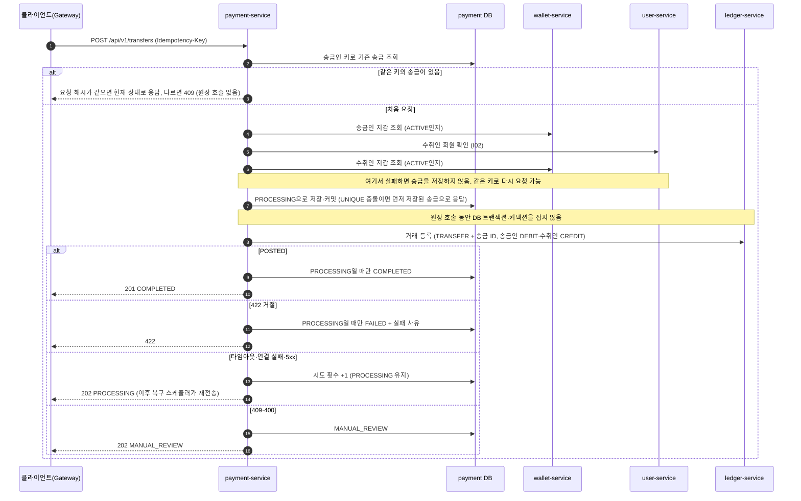
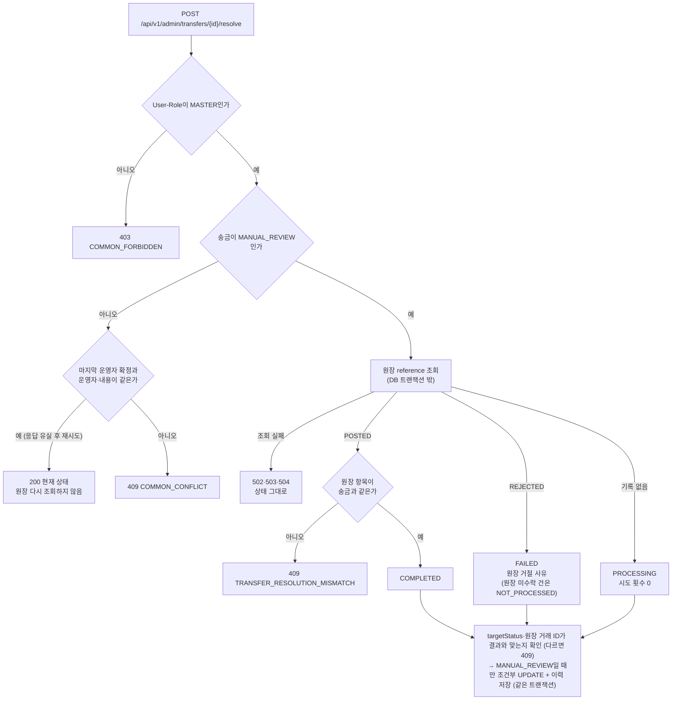
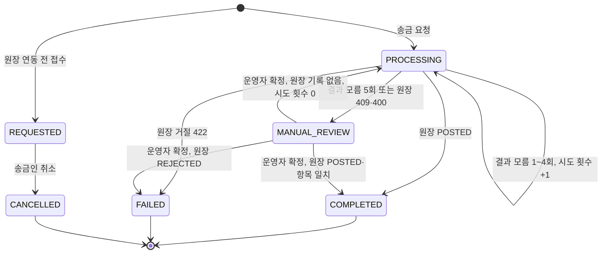
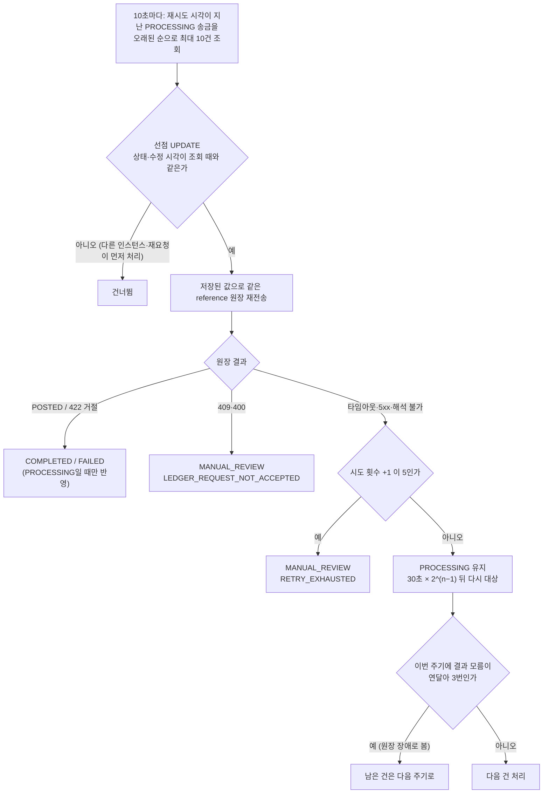
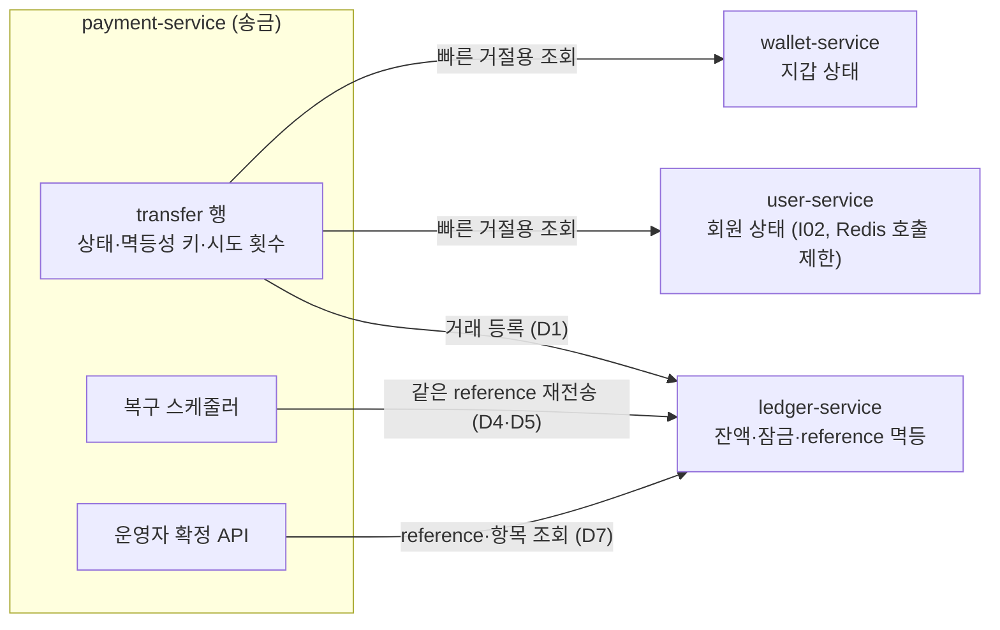

# 송금 실행·사용 가이드

송금은 별도 서비스가 아니라 payment-service 안의 기능입니다(`com.travelpay.payment.transfer`). 회원 사이의 같은 통화 지갑 송금을 접수하고, 원장(ledger-service)에 거래를 등록해 실제 자금을 옮기며, 송금 상태와 내역을 관리합니다. 잔액은 송금이 직접 바꾸지 않고 원장이 차감·입금을 한 거래로 처리합니다. 브라우저는 Gateway를 통해 호출합니다([Gateway 가이드](gateway.md)).

왜 이렇게 만들었는지(검토한 대안과 감수한 점)는 [설계 결정](#설계-결정) 절에 있습니다. 처리 흐름은 [송금 요청 처리 순서](#처리-순서), [송금 상태](#송금-상태), [복구 스케줄러](#복구-스케줄러), [MANUAL_REVIEW 확정](#manual_review-확정)의 다이어그램으로 볼 수 있습니다.

## 로컬 실행

필요한 것: JDK 21, Docker.

1. `.env.example`을 `.env`로 복사하고 비밀번호 값을 바꿉니다. 실제 값은 저장소에 올리지 않습니다.
2. DB를 실행합니다.

   ```bash
   docker compose up -d postgres
   ```

3. 송금은 다른 서비스를 호출하므로 아래 서비스가 함께 떠 있어야 합니다. 모두 Eureka(`8761`)에 등록된 이름으로 찾습니다.

   | 서비스 | 포트 | 송금에서 쓰는 곳 |
   |---|---|---|
   | eureka-server | 8761 | 서비스 찾기 |
   | user-service | 8081 | 수취인 회원 확인(I02) |
   | wallet-service | 8082 | 송금인·수취인 지갑 조회 |
   | ledger-service | 8085 | 원장 거래 등록(실제 자금 이동) |

4. Spring Boot는 `.env`를 직접 읽지 않으므로 환경 변수로 넘겨 실행합니다.

   ```bash
   set -a; source .env; set +a
   ./gradlew :payment-service:bootRun
   ```

   - 로컬 포트는 `8083`입니다. `GET http://localhost:8083/actuator/health`로 상태를 확인합니다.
   - `PAYMENT_DB_URL`이 비어 있으면 `'url' must start with "jdbc"`로 시작을 멈춥니다. `.env`를 불러오지 않은 터미널에서 실행한 경우입니다.
   - Eureka 대신 원장·회원 서비스를 직접 주소로 부를 때는 `LEDGER_SERVICE_URL`·`USER_SERVICE_URL`을 지정합니다(예: `http://localhost:8085`). 비우면 Eureka에서 찾습니다.
   - 배포 설정(`application-prod.yml`)은 `SPRING_CONFIG_NAME=application-prod`로 선택합니다.

5. 테이블은 앱이 시작할 때 Flyway가 만듭니다([DB 스키마](#db-스키마-flyway)).

API 문서는 로컬에서 Swagger UI `http://localhost:8083/swagger-ui.html`의 `transfer` 그룹(JSON `/v3/api-docs/transfer`)으로 볼 수 있습니다. 배포 설정에서는 꺼져 있습니다. Gateway 없이 직접 호출할 때는 Swagger에 표시된 `User-Id`·`User-Role` 헤더를 채웁니다.

## API 목록

| API | 설명 | 로그인 | CSRF 헤더 | `Idempotency-Key` | 성공 |
|---|---|---|---|---|---|
| `POST /api/v1/transfers` | 송금 요청 | 필요 | 필요 | 필수 | 201·202 |
| `GET /api/v1/transfers/{transferId}` | 송금 상세 조회 | 필요 | 불필요 | 없음 | 200 |
| `GET /api/v1/transfers` | 송금 내역 조회 | 필요 | 불필요 | 없음 | 200 |
| `GET /api/v1/transfers/recipients/{receiverId}` | 수취인 확인 | 필요 | 불필요 | 없음 | 200 |
| `POST /api/v1/transfers/{transferId}/cancel` | 송금 취소 | 필요 | 필요 | 없음 | 200 |

응답 본문은 `success`·`data`·`error` 공통 형식입니다([error-contract.md](error-contract.md)). ID는 모두 UUID이고, 금액은 통화별 최소 단위 정수(KRW 원, JPY 엔, CNY 펀)이며, 시각은 UTC ISO-8601입니다.

로그인·CSRF는 Gateway가 확인하고, payment-service는 Gateway가 넣어 준 `User-Id`·`User-Role` 헤더로 요청자를 정합니다. 요청 본문에 송금인 ID를 넣어도 쓰지 않습니다. 헤더가 없거나 일부만 있거나 형식이 잘못되면 `401 COMMON_UNAUTHORIZED`입니다.

## 호출 순서

로그인과 CSRF 토큰 받기는 [User 가이드](user-service.md#호출-순서)와 같습니다. 송금 화면에서는 아래 순서로 호출합니다.

```txt
1. GET  /api/v1/transfers/recipients/{receiverId} → 마스킹 이름과 송금 가능 여부 확인
2. POST /api/v1/transfers                         → Csrf-Token·Idempotency-Key 헤더 포함
   - 201 COMPLETED: 송금 완료
   - 202 PROCESSING: 결과 확인 중. 서버가 자동으로 다시 처리하므로 3번으로 상태 확인
   - 422: 잔액 부족 등으로 거절(송금은 FAILED로 기록)
3. GET  /api/v1/transfers/{transferId}            → 최종 상태 확인
4. GET  /api/v1/transfers?direction=SENT          → 보낸 내역
```

응답을 받지 못해 다시 보낼 때는 **같은 `Idempotency-Key`와 같은 본문**을 사용합니다. 그래야 송금이 두 번 되지 않습니다. 새 송금마다 새 키를 만듭니다(UUID 권장).

curl로 Gateway 없이 확인할 때는 회원 헤더를 직접 넣습니다. 아래 ID는 예시입니다.

```bash
BASE=http://localhost:8083
SENDER=550e8400-e29b-41d4-a716-446655440000
RECEIVER=4c6a0178-266b-4f1e-b811-a2767026be70

curl -s -H "User-Id: $SENDER" -H 'User-Role: USER' \
  "$BASE/api/v1/transfers/recipients/$RECEIVER"

curl -s -H "User-Id: $SENDER" -H 'User-Role: USER' \
  -H "Idempotency-Key: $(uuidgen)" -H 'Content-Type: application/json' \
  -d "{\"receiverId\":\"$RECEIVER\",\"amount\":10000,\"currency\":\"KRW\",\"memo\":\"저녁값\"}" \
  "$BASE/api/v1/transfers"

curl -s -H "User-Id: $SENDER" -H 'User-Role: USER' \
  "$BASE/api/v1/transfers?direction=SENT&page=0&size=20"
```

Git Bash에서 한글이 든 본문을 인자로 넘기면 글자가 깨져 400이 날 수 있습니다. 이때는 UTF-8 파일로 저장해 `--data-binary @body.json`으로 보냅니다.

## 송금 요청

### 요청

| 항목 | 규칙 |
|---|---|
| `Idempotency-Key` 헤더 | 필수. 공백 없는 ASCII 1~100자. 없거나 형식이 틀리면 400 `TRANSFER_INVALID_IDEMPOTENCY_KEY` |
| `receiverId` | 필수, UUID. 본인이면 400 `TRANSFER_SELF_TRANSFER` |
| `amount` | 필수, 0보다 큰 정수(통화별 최소 단위) |
| `currency` | 필수, `KRW`·`JPY`·`CNY`. 형식이 틀리면 400 `COMMON_INVALID_REQUEST`, 지원하지 않는 통화면 400 `TRANSFER_UNSUPPORTED_CURRENCY` |
| `memo` | 선택, 100자 이하. 앞뒤 공백은 지우고 빈 값은 없는 것으로 봅니다 |

```json
{
  "receiverId": "4c6a0178-266b-4f1e-b811-a2767026be70",
  "amount": 10000,
  "currency": "KRW",
  "memo": "저녁값"
}
```

### 처리 순서

1. 같은 송금인·같은 키의 송금이 이미 있으면 아래 [멱등성](#멱등성) 규칙으로 응답합니다.
2. 본인 송금·지원 통화를 확인합니다.
3. 송금인 지갑이 `ACTIVE`인지 확인합니다. 아니면 422 `TRANSFER_SENDER_WALLET_UNAVAILABLE`.
4. 수취인이 `ACTIVE` 회원인지(user-service I02), 수취인 지갑이 `ACTIVE`인지 확인합니다. 아니면 422 `TRANSFER_RECEIVER_UNAVAILABLE`.
5. 송금을 `PROCESSING`으로 저장(커밋)한 뒤 원장에 거래를 등록합니다. 원장 호출 중에는 DB 트랜잭션을 잡지 않습니다.
6. 원장 결과로 상태를 정하고 응답합니다([원장 연동](#원장-연동과-복구)).



회원당 지갑은 하나이고, 통화별 계정은 원장이 `walletId + currency`로 찾습니다. 지갑·회원 확인은 빠른 거절용이며 최종 판단(잔액, 계정 상태)은 원장 거래 등록 결과입니다.

### 응답

| 상태 | HTTP | 의미 |
|---|---|---|
| `COMPLETED` | 201 | 원장 반영 완료, 송금인 차감·수취인 입금 끝 |
| `PROCESSING` | 202 | 원장 결과를 확인하지 못함. 서버가 자동으로 다시 처리 |
| `MANUAL_REVIEW` | 202 | 자동 처리를 멈춤. 운영자 확인 필요 |
| `FAILED` | 422 | 원장이 거절(잔액 부족·계정 사용 불가). 오류 응답으로 반환되며 송금은 기록에 남음 |

```json
{
  "success": true,
  "data": {
    "transferId": "6dda1ae2-a470-4f32-84f9-8edaa4404ec5",
    "direction": "SENT",
    "senderId": "550e8400-e29b-41d4-a716-446655440000",
    "receiverId": "4c6a0178-266b-4f1e-b811-a2767026be70",
    "amount": 10000,
    "currency": "KRW",
    "status": "COMPLETED",
    "memo": "저녁값",
    "createdAt": "2026-11-02T01:02:03.123456Z"
  },
  "error": null
}
```

응답에는 지갑 ID·멱등성 키·실패 사유·수정 시각을 담지 않습니다. `direction`은 요청자 기준으로 `SENT`(보낸 송금) 또는 `RECEIVED`(받은 송금)입니다.

### 멱등성

| 상황 | 결과 |
|---|---|
| 같은 키·같은 본문, 송금 `COMPLETED` | 201, 같은 `transferId` |
| 같은 키·같은 본문, 송금 `FAILED` | 처음과 같은 422 |
| 같은 키·같은 본문, 송금 `PROCESSING`·`MANUAL_REVIEW` | 202, 현재 상태 |
| 같은 키·다른 본문 | 409 `TRANSFER_IDEMPOTENCY_KEY_REUSED` |
| 같은 키 동시 요청 | 하나만 저장되고 나머지는 위 규칙으로 응답 |

- 같은 본문인지는 `receiverId`·`amount`·`currency`·정규화한 `memo`의 SHA-256으로 비교합니다.
- 재요청은 원장을 다시 호출하지 않고 지갑·회원도 다시 조회하지 않습니다. 결과 모름 송금의 재전송은 [복구 스케줄러](#복구-스케줄러)만 합니다.
- 중복 방지는 DB `UNIQUE(sender_id, idempotency_key)`로 보장합니다. 키는 송금인별로 구분합니다.

## 조회·취소

상세 조회와 취소의 `data`는 송금 요청 응답과 같은 송금 객체이고, 내역 조회의 `data`는 송금 객체 목록을 담은 페이지입니다.

### 상세 조회

송금인 또는 수취인만 조회할 수 있습니다. 그 밖의 사용자에게는 송금이 없는 것과 같이 404 `TRANSFER_NOT_FOUND`를 반환해 존재 여부를 알리지 않습니다.

### 내역 조회

| 파라미터 | 규칙 |
|---|---|
| `direction` | `SENT` 보낸 내역, `RECEIVED` 받은 내역, 생략하면 둘 다. 그 밖의 값은 400 |
| `page` | 0부터, 기본 0. 0 미만은 400 |
| `size` | 기본 20, 1 미만은 400, 100을 넘으면 100으로 조회 |

정렬은 `createdAt desc, id desc`로 고정이며 요청자가 보내거나 받은 송금만 반환합니다. 응답은 common `PageResponse`입니다.

| 필드 | 내용 |
|---|---|
| `items` | 송금 객체 목록 |
| `page` | 현재 페이지(0부터) |
| `size` | 실제 조회한 페이지 크기(100을 넘겨 요청하면 100) |
| `totalElements` | 전체 건수 |
| `totalPages` | 전체 페이지 수 |

### 수취인 확인

송금 전 화면에서 수취인을 확인하는 용도입니다. 마스킹한 이름과 송금 가능 여부만 반환하고, 지갑 ID·지갑 상태 원문은 반환하지 않습니다.

```json
{
  "success": true,
  "data": {
    "receiverId": "4c6a0178-266b-4f1e-b811-a2767026be70",
    "receiverName": "홍*동",
    "transferable": true
  },
  "error": null
}
```

| 상황 | 결과 |
|---|---|
| 본인 ID | 400 `TRANSFER_SELF_TRANSFER` |
| 회원 없음·정지·종료 | 404 `TRANSFER_RECEIVER_NOT_FOUND` (지갑은 조회하지 않음) |
| 지갑 없음 | 404 `TRANSFER_RECEIVER_NOT_FOUND` |
| 지갑이 `ACTIVE`가 아님 | 200 `transferable: false` |
| 지갑 `ACTIVE` | 200 `transferable: true` |
| user-service 조회 한도 초과 | 429 `COMMON_TOO_MANY_REQUESTS` |

이름 마스킹은 1자 `*`, 2자 `홍*`, 3자 이상은 첫 글자와 끝 글자만 남깁니다(`홍*동`, `남**수`). 가운데 띄어쓰기도 가립니다. 확인 결과는 참고용이며 실제 송금 때 다시 검증합니다.

user-service I02는 요청자별 호출 한도(기본 60초 60회)가 있습니다. 송금 요청과 수취인 확인이 같은 한도를 씁니다([User 가이드](user-service.md#i02-요청자별-호출-제한)).

### 취소

| 상황 | 결과 |
|---|---|
| 송금인이 `REQUESTED` 송금 취소 | 200 `CANCELLED` |
| 이미 `CANCELLED` | 200, 현재 상태 그대로 |
| `PROCESSING`·`COMPLETED`·`FAILED`·`MANUAL_REVIEW` | 409 `COMMON_CONFLICT` |
| 수취인·제3자·없는 송금 | 404 `TRANSFER_NOT_FOUND` |

원장 연동 후 새 송금은 `PROCESSING`으로 시작하므로 취소할 수 있는 송금은 연동 전에 접수된 `REQUESTED` 송금뿐입니다. 취소는 조건부 UPDATE로 처리해 동시 요청에도 한 번만 바뀝니다.

## 관리자 조회

| API | 설명 | 성공 |
|---|---|---|
| `GET /api/v1/admin/transfers` | 모든 사용자의 송금 목록 | 200 |
| `GET /api/v1/admin/transfers/{transferId}` | 송금 상세(당사자 제한 없음) | 200 |
| `GET /api/v1/admin/transfers/{transferId}/resolution` | `MANUAL_REVIEW` 송금 확정 미리보기(상태 변경 없음) | 200 |
| `POST /api/v1/admin/transfers/{transferId}/resolve` | `MANUAL_REVIEW` 송금 확정 | 200 |
| `GET /api/v1/admin/transfers/{transferId}/history` | 상태 변경 이력 | 200 |

- 권한: `User-Role`이 `MASTER`가 아니면 `403 COMMON_FORBIDDEN`. 경로의 `admin`은 관리 기능 영역, `MASTER`는 허용 역할입니다.
- 목록 조건(모두 선택): `from`(포함)·`to`(미포함, ISO-8601, `from`이 `to`보다 앞서야 함), `currency`(KRW·JPY·CNY, 그 밖은 `400 TRANSFER_UNSUPPORTED_CURRENCY`), `status`, `userId`(송금인 또는 수취인), `orderType`(`LATEST` 기본 = 생성 시각 내림차순, `OLDEST` = 오름차순, 같은 시각은 ID로 같은 방향), `page`(0부터)·`size`(기본 20, 최대 100). 잘못된 값은 `400 COMMON_INVALID_REQUEST`
- 응답: `transferId`, `senderId`, `receiverId`, `sourceWalletId`, `targetWalletId`, `amount`, `currency`, `status`, `failureReason`(`FAILED`만), `reviewReason`(`MANUAL_REVIEW`만), `attemptCount`, `memo`, `createdAt`, `updatedAt`. `direction`·멱등성 키는 없음. 없는 송금은 `404 TRANSFER_NOT_FOUND`
- 조회 기록: 관리자 ID와 조건(목록)·송금 ID(상세)를 INFO 로그로 남깁니다.
- Swagger 그룹: `transfer-admin`(`/v3/api-docs/transfer-admin`)

### MANUAL_REVIEW 확정

운영 순서: 미리보기(`GET …/resolution`)로 원장 결과와 확정할 상태를 확인한 뒤, 그 값을 넣어 확정(`POST …/resolve`)합니다. 원장 조회는 내부 API(`/internal/v1`)라 운영자가 직접 원장 거래 ID를 얻을 수 없으므로 미리보기가 그 값을 알려 줍니다.

#### 미리보기

`GET /api/v1/admin/transfers/{transferId}/resolution`은 서버가 원장을 조회해 아래 확정 표를 적용한 결과를 돌려줍니다. 상태·이력은 바뀌지 않습니다.

```json
{
  "transferId": "…",
  "reviewReason": "RETRY_EXHAUSTED",
  "ledger": { "found": true, "transactionId": "…", "status": "POSTED", "rejectReason": null, "entriesMatch": true },
  "resolvable": true,
  "expectedStatus": "COMPLETED",
  "expectedFailureReason": null,
  "ledgerTransactionId": "…"
}
```

| 필드 | 의미 |
|---|---|
| `ledger.found` | 원장 거래가 있는지. 없으면 `transactionId`·`status`·`rejectReason`·`entriesMatch`도 없음 |
| `ledger.status`·`rejectReason` | 원장 거래 상태(`POSTED`·`REJECTED`)와 거절 사유(`REJECTED`만) |
| `ledger.entriesMatch` | 원장 항목이 송금과 같은지. `POSTED`일 때만 값이 있음 |
| `resolvable` | 확정할 수 있는지. `POSTED`인데 항목이 다르면 `false`(이때 `expectedStatus`·`ledgerTransactionId` 없음) |
| `expectedStatus`·`expectedFailureReason` | 확정할 상태와 `FAILED`일 때의 실패 사유 |
| `ledgerTransactionId` | 확정 요청에 넣을 원장 거래 ID(`COMPLETED`·`FAILED`만, `PROCESSING`은 없음) |

- `resolvable=true`이면 `expectedStatus`·`ledgerTransactionId`를 그대로 확정 요청에 넣습니다. 판단은 확정과 같은 코드(`TransferResolution`)를 씁니다
- 확정 때 서버가 원장을 다시 조회해 확인합니다. 미리보기 뒤 원장 결과가 바뀌었으면(예: 기록 없음 → POSTED) 확정은 `409 TRANSFER_RESOLUTION_MISMATCH`이며, 미리보기를 다시 봅니다
- `MANUAL_REVIEW`가 아니면 원장을 조회하지 않고 `409 COMMON_CONFLICT`. 권한·없는 송금·원장 조회 실패는 확정과 같음(`403`, `404 TRANSFER_NOT_FOUND`, `502`·`503`·`504`)
- 조회 기록은 INFO 로그(관리자 ID·송금 ID·예상 상태·원장 거래 ID)로만 남깁니다

#### 확정

요청 본문 `{targetStatus, reason(필수, ≤255자), ledgerTransactionId}`. 운영자 입력을 그대로 믿지 않고, 서버가 원장 `GET /internal/v1/ledger/transactions?referenceType=TRANSFER&referenceId={송금 ID}`로 결과를 조회해 맞는 확정만 반영합니다.

| 원장 결과 | 허용하는 `targetStatus` | 결과 |
|---|---|---|
| `POSTED` + 원장 항목이 송금과 같음 | `COMPLETED`(`ledgerTransactionId` = 원장 거래 ID) | `COMPLETED` |
| `REJECTED` | `FAILED`(`ledgerTransactionId` = 원장 거래 ID) | `FAILED`, 실패 사유는 원장 거절 사유(`INSUFFICIENT_BALANCE` / 그 밖 `ACCOUNT_UNAVAILABLE`). 원장 미수락 송금은 `NOT_PROCESSED` |
| 기록 없음(404 `LEDGER_TRANSACTION_NOT_FOUND`) | `PROCESSING`(`ledgerTransactionId` 없음) | 시도 횟수 0으로 되돌려 복구 스케줄러가 약 30초 뒤 같은 reference로 재전송 |



- `reason`에는 확정 판단 근거를 적습니다. 원장 조회 결과(상태·거래 ID), 거절 사유, `NOT_PROCESSED`로 확정한 이유처럼 나중에 이력만 보고도 판단을 다시 확인할 수 있는 내용을 씁니다(예: `원장 POSTED(c92b2030-…), 항목 일치 확인`, `원장 REJECTED(INSUFFICIENT_BALANCE), 원장 409로 미수락된 요청이라 NOT_PROCESSED로 확정`). 실패 사유는 `transfer.failure_reason`에만 저장되고 이력에는 별도 컬럼이 없으므로, 근거는 이 문장으로 남깁니다
- 맞지 않으면 `409 TRANSFER_RESOLUTION_MISMATCH`, `MANUAL_REVIEW`가 아니면 `409 COMMON_CONFLICT`. 형식 오류는 `400 COMMON_INVALID_REQUEST`
- 이미 확정된 송금에 같은 운영자가 같은 본문(`targetStatus`·`reason`·`ledgerTransactionId`)으로 다시 요청하면(응답 유실 후 재시도) 원장을 다시 조회하지 않고 현재 송금 상태를 200으로 돌려줍니다. 마지막 운영자 확정 이력과 비교하며, 다른 운영자·다른 내용이면 `409 COMMON_CONFLICT`입니다. `Idempotency-Key`는 받지 않습니다(자금을 직접 옮기지 않고 조건부 UPDATE로 한 번만 반영됨)
- 원장 `POSTED`이면 원장 조회 응답의 `entries`를 이 송금의 원장 요청 항목(송금인 지갑 DEBIT `TRANSFER_OUT`, 수취인 지갑 CREDIT `TRANSFER_IN`, 같은 통화·금액)과 비교합니다. 순서는 보지 않고, 항목이 빠지거나 더 있거나 값이 하나라도 다르면 `409 TRANSFER_RESOLUTION_MISMATCH`입니다(`reviewReason`과 관계없이). `POSTED`인데 항목이 없거나 값이 비어 있으면 `502`
- `reviewReason=LEDGER_REQUEST_NOT_ACCEPTED`(원장 409·400) 송금도 원장 `POSTED`이고 항목이 같으면 `COMPLETED`로 확정합니다(409는 `userId` 등 항목 밖의 값 차이로도 나며, 잔액은 항목으로만 바뀜). 원장 `REJECTED`이면 `FAILED`로 확정합니다. 자금은 이동하지 않았고 다시 보내도 계속 409라서입니다. 다만 원장 거절 기록은 이전에 들어온 다른 요청의 것일 수 있어 그 거절 사유를 쓰지 않고, 실패 사유를 `NOT_PROCESSED`로 정해 확정 이력과 같은 트랜잭션에 저장합니다
- 원장 조회 실패는 상태를 바꾸지 않고 503·504·502로 응답합니다
- 상태 변경은 `MANUAL_REVIEW`일 때만 바꾸는 조건부 UPDATE이며, 같은 트랜잭션에서 이력(`transfer_status_history`: 이전·이후 상태, 사유, 운영자 ID, 원장 거래 ID, 시각)을 저장합니다. 동시에 확정하면 한 건만 성공합니다
- 확정 뒤 송금인의 같은 키 재요청은 확정된 상태로 응답합니다(`COMPLETED` 201, `FAILED` 처음과 같은 사유의 422)
- Gateway `/api/v1/admin/transfers/**`는 payment-service로 라우팅됩니다(#155). 외부 호출은 MASTER 세션 쿠키, 확정(POST)은 CSRF가 필요합니다.

## 송금 상태



- 상태를 바꾸는 경로는 조건부 UPDATE뿐이고, 각 UPDATE의 시작 상태 조건이 위 전이만 허용합니다. DB CHECK는 상태와 사유 컬럼의 조합만 검사합니다.
- `COMPLETED`·`FAILED`·`CANCELLED`는 종료 상태로, 재요청·복구·취소·운영자 확정 어느 경로로도 바뀌지 않습니다.
- 전이표는 `TransferStatusTransitionIntegrationTest`(모든 조건부 UPDATE × 모든 시작 상태)로 고정되어 있습니다.

| 상태 | 의미 |
|---|---|
| `REQUESTED` | 원장 연동 전에 접수만 된 송금. 자금 이동 없음, 취소 가능 |
| `PROCESSING` | 원장 처리 결과 미확정. 복구 스케줄러가 다시 요청 |
| `COMPLETED` | 자금 이동 완료 |
| `FAILED` | 원장 거절. 실패 사유(`INSUFFICIENT_BALANCE`·`ACCOUNT_UNAVAILABLE`, 운영자 확정의 `NOT_PROCESSED`)를 DB에 저장 |
| `CANCELLED` | 접수 취소 |
| `MANUAL_REVIEW` | 자동 처리 중단. 사유(`RETRY_EXHAUSTED`·`LEDGER_REQUEST_NOT_ACCEPTED`)를 DB에 저장 |

## 원장 연동과 복구

### 원장 거래 등록

`POST /internal/v1/ledger/transactions`에 송금 하나를 한 거래로 보냅니다. 원장이 두 줄을 함께 반영하거나 함께 거절하므로 한쪽만 반영되지 않습니다.

| 항목 | 값 |
|---|---|
| reference | `referenceType=TRANSFER`, `referenceId=송금 ID`. 원장의 중복 처리 방지 기준 |
| `userId` | 송금인 ID(기록용, 계정 조회에 쓰지 않음) |
| 송금인 줄 | `USER`, 송금인 `walletId`, 통화, `DEBIT`, 금액, `TRANSFER_OUT` |
| 수취인 줄 | `USER`, 수취인 `walletId`, 통화, `CREDIT`, 금액, `TRANSFER_IN` |

`TRANSFER_OUT`·`TRANSFER_IN`은 원장 entry_type 허용 목록에 있는 값입니다.

요청은 저장된 송금 값으로만 만들기 때문에 재전송도 처음과 같은 내용입니다. 원장은 같은 reference를 한 번만 처리하므로 재전송해도 잔액은 한 번만 바뀝니다. `memo`는 원장에 보내지 않습니다.

| 원장 응답 | 송금 상태 | 클라이언트 응답 |
|---|---|---|
| 201·200 `POSTED` | `COMPLETED` | 201 |
| 422 `LEDGER_REJECTED_INSUFFICIENT_BALANCE` | `FAILED` | 422 `TRANSFER_INSUFFICIENT_BALANCE` |
| 422 `LEDGER_REJECTED_WALLET_SUSPENDED`·`_ACCOUNT_NOT_FOUND` | `FAILED` | 422 `TRANSFER_ACCOUNT_UNAVAILABLE` |
| 읽기 타임아웃·연결 실패·Eureka 미등록·5xx·해석 불가 응답 | `PROCESSING` 유지(결과 모름) | 202 |
| 409·400·알 수 없는 422 코드·그 밖의 4xx | `MANUAL_REVIEW` | 202 |

- 타임아웃이나 5xx는 원장이 이미 처리했을 수 있으므로 실패로 단정하지 않습니다.
- 원장이 바쁠 때(커넥션 대기 2초 초과, 거래 트랜잭션 3초 초과, 잠금 대기 중 교착·잠금 실패)는 원장이 트랜잭션을 롤백하고 503 `COMMON_SERVICE_UNAVAILABLE`(드물게 500)로 응답합니다. 원장에 아무것도 남지 않으므로 송금은 결과 모름(202 `PROCESSING`)으로 두고 복구 스케줄러가 같은 reference로 다시 보내도 안전합니다(원장 담당 확인, 2026-11-06).
- 409는 같은 reference의 원장 거래가 이미 있다는 뜻일 수 있어 `FAILED`로 끝내지 않습니다. 400·409는 송금 요청을 잘못 만든 버그나 계약 불일치로 보고 ERROR 로그를 남깁니다.
- 원장 Feign 호출은 자동 재시도를 끕니다. 타임아웃은 연결 1초, 읽기 6초입니다(원장 최대 응답 약 5초).

### 복구 스케줄러

`TransferRecoveryScheduler`가 결과 모름으로 남은 `PROCESSING` 송금을 같은 reference로 원장에 다시 보냅니다. 지갑 충전 복구와 같은 방식입니다.

| 항목 | 값 |
|---|---|
| 주기 | 10초마다(시작 10초 후부터) |
| 한 주기 처리량 | 재시도 시각이 지난 송금을 수정 시각 오래된 순으로 최대 10건 |
| 재시도 간격 | 결과 모름 횟수가 n이면 30초 × 2^(n−1) → 30초, 1분, 2분, 4분 |
| 한도 | 결과 모름 5회(첫 요청 포함)면 `MANUAL_REVIEW`(`RETRY_EXHAUSTED`) |
| 원장 장애 판단 | 한 주기에서 결과 모름이 연달아 3번이면 남은 건은 다음 주기로 |
| 끄기 | `transfer.recovery.enabled=false` (테스트·수동 확인용) |



원장 결과별 처리(팀 확정 복구 정책, 2026-11-09):

| 원장 상태 | 복구 결과 | 방법 |
|---|---|---|
| 같은 reference가 `POSTED` | `COMPLETED` | 재전송하면 원장이 기존 거래를 200 `POSTED`로 돌려줌 |
| 같은 reference가 `REJECTED` | `FAILED` + 실패 사유 | 재전송하면 원장이 기존 거절을 같은 422로 돌려줌 |
| 기록 없음 | 같은 내용으로 처음 처리 | 저장된 값(`LedgerTransactionRequest.of`)으로 재전송 |
| 응답 없음(타임아웃·연결 실패·5xx·해석 불가) | `PROCESSING` 유지, 대기 후 재시도 | 시도 횟수 +1, 30초 × 2^(n−1) 뒤 다시 대상 |
| 재시도 5회 소진 | `MANUAL_REVIEW`(`RETRY_EXHAUSTED`) | 자동 처리 중단 |
| 원장 400·409 등 요청 미수락 | `MANUAL_REVIEW`(`LEDGER_REQUEST_NOT_ACCEPTED`) | 다시 보내도 같으므로 바로 중단 |

- 원장을 먼저 조회(GET)하지 않고 같은 reference로 바로 다시 보냅니다. 원장은 같은 reference면 잔액을 확인하기 전에 기존 결과를 돌려주므로 조회 후 분기한 것과 결과가 같고, 호출은 한 번 적습니다. 같은 reference에 내용이 다른 거래가 있으면 재전송은 409로 드러나 `MANUAL_REVIEW`가 되지만, 조회만 하면 항목을 따로 대조하지 않는 한 `COMPLETED`로 잘못 확정할 수 있습니다([D5](#d5-복구는-선점-update-지수-백오프-시도-한도로)).
- 시간 제한(예: 24시간)은 두지 않지만 무한정 재시도하지도 않습니다. 결과 모름 5회를 소진하면 `MANUAL_REVIEW`로 넘깁니다. 정상이면 대기 합계 약 7.5분 안에 끝나므로, 오래 `PROCESSING`에 머무는 송금은 아래 `transfer.processing.stuck` 지표로 감지합니다.

- 선점: 조회한 송금의 상태·수정 시각이 그대로일 때만 조건부 UPDATE로 가져갑니다. 여러 인스턴스가 함께 돌아도 같은 송금을 동시에 처리하지 않고, 결과 반영도 `PROCESSING`일 때만 하므로 잔액·상태는 한 번만 바뀝니다. 분산 락은 쓰지 않습니다.
- 한 건의 오류는 로그만 남기고 다음 건을 계속 처리합니다.
- payment-service의 스케줄러 스레드는 2개입니다(`spring.task.scheduling.pool.size`). 결제 정산 복구와 서로의 원장 호출을 기다리지 않게 하기 위함입니다.

| 지표 | 의미 |
|---|---|
| `transfer.processing.stuck` | 생성 후 30분이 지나도 `PROCESSING`인 송금 수. 재시도 5회가 약 7.5분 안에 끝나므로 0보다 크면 복구가 돌지 않는 것(스케줄러 정지, 결과 모름 기록 실패 등)이고, ERROR 로그(오래된 순 ID 10개)도 남김 |
| `transfer.manual_review` | 운영자 확인을 기다리는 `MANUAL_REVIEW` 송금 수 |

두 지표는 복구 스케줄러가 10초마다 DB를 세어 갱신합니다(Prometheus 이름 `transfer_processing_stuck`, `transfer_manual_review`). Grafana `TRAVELPAY | Local Performance`의 **서비스 처리 지연 현황** 표에 `송금 / 30분 초과`, `송금 / 관리자 확인 대기` 행으로 나옵니다(메트릭 환경 `local`, 서비스 `payment-service`).

2026-11-10에 로컬에서 원장을 멈추고 확인했습니다(코드 변경 없음, DB 직접 수정 없음).

| 시각 (KST) | 일 | 송금 상태 | `transfer_manual_review` (앱 / Prometheus / 대시보드) |
|---|---|---|---|
| 13:59:54 | 원장 정지 중 송금 1건 → 202 | `PROCESSING` (시도 1) | 0 / 0 / 0 |
| 14:00~14:03 | 복구 재시도 30초 → 1분 → 2분 간격으로 실패 | `PROCESSING` (시도 2~4) | 0 / 0 / 0 |
| 14:07:32 | 4분 뒤 5번째도 실패 | `MANUAL_REVIEW` (`RETRY_EXHAUSTED`) | 1 / 1(14:08 수집) / 1 |
| 14:14:20 | 원장 재기동 → 확정 미리보기(원장 기록 없음, 예상 `PROCESSING`) → 재처리 확정 | `PROCESSING` (시도 0), 운영자 이력 1건 | — |
| 14:14:51 | 복구 스케줄러가 재전송 | `COMPLETED` | 0 / 0(14:15 수집) / 0 |

- 생성부터 `MANUAL_REVIEW`까지 7분 38초로, 백오프 합계(약 7분 30초)와 맞았습니다.
- 대시보드 값은 표 패널의 쿼리를 Grafana 데이터소스 API로 실행해 확인했습니다(화면 캡처는 하지 않음).
- `transfer_processing_stuck`은 계속 0이었습니다. 복구가 정상으로 돌면 30분 전에 `MANUAL_REVIEW`로 넘어가기 때문입니다. 값이 올라가는 경우는 2026-11-11 알림 확인 때 DB로 만들어 확인했습니다(아래).

#### 알림 규칙 (2026-11-11, 로컬, 인프라 담당 확인 필요)

`infra/monitoring/grafana/provisioning/alerting/transfer-alerts.yml`(Grafana 파일 프로비저닝, `compose.monitoring.yaml`에 마운트)에 두 규칙을 둡니다.

| 규칙 | 조건 | 등급 | 대응 |
|---|---|---|---|
| 송금 MANUAL_REVIEW 발생 | `max by (environment, service) (transfer_manual_review) > 0` | warning | 확정 미리보기 → resolve([MANUAL_REVIEW 확정](#manual_review-확정)) |
| 송금 30분 넘게 PROCESSING | `max by (environment, service) (transfer_processing_stuck) > 0` | critical | 복구 스케줄러 동작·payment DB 쓰기 오류·원장 장애 확인, ERROR 로그의 송금 ID |

- 30초마다 평가하고 `for`는 0초입니다. 두 게이지가 이미 "운영자 확인 필요"·"30분 경과"를 담고 있어 더 기다릴 이유가 없습니다.
- 게이지가 DB 값이라 인스턴스마다 같으므로 `max`로 묶습니다. 지표가 없으면(서비스 다운) 이 규칙은 OK로 둡니다. 서비스 다운은 별도 규칙의 몫입니다.
- 알림 채널(contact point)은 정하지 않았습니다. 로컬은 Grafana 기본 채널(SMTP 없음)이라 발송되지 않고, Alerting 화면·API에서 상태만 봅니다. 실제 채널은 인프라 담당과 정합니다.

로컬 확인 (원장 정지 중 송금 2건, 그중 1건의 `created_at`을 31분 앞당김. 시각은 KST):

| 시각 | 일 | 게이지 (manual_review / stuck) | MANUAL_REVIEW 알림 | 30분 PROCESSING 알림 |
|---|---|---|---|---|
| 15:13:24 | 송금 2건 202 `PROCESSING`, 1건 `created_at` 31분 앞당김 | 0 / 0 | Normal | Normal |
| 15:13:40 | 스케줄러 갱신(10초) → Prometheus 수집 → 평가 | 0 / 1 | Normal | **Alerting** (16초 뒤) |
| 15:21:10 | 결과 모름 5회 → 두 건 `MANUAL_REVIEW`(`RETRY_EXHAUSTED`) | 2 / 0 | **Alerting** | Normal |
| 15:21:56 | 원장 재기동, 미리보기(원장 기록 없음, 예상 `PROCESSING`) → 재처리 확정 | | | |
| 15:22:10 | 앞당긴 건이 다시 `PROCESSING`이라 stuck 1 | 0 / 1 | Normal | Alerting |
| 15:22:40 | 복구 스케줄러가 두 건 `COMPLETED` | 0 / 0 | Normal | Normal |

- 게이지 1→0, 알림 발동→해소가 모두 확인됐습니다(Grafana 상태 이력 API `/api/v1/rules/history`).
- 오래된 송금을 재처리로 확정하면 완료될 때까지 stuck 알림이 잠깐 다시 뜹니다. 재처리 중인 건이 실제로 30분 넘게 끝나지 않은 송금이라 의도와 맞는 동작입니다.

`MANUAL_REVIEW` 송금은 원장 reference 조회(`GET /internal/v1/ledger/transactions?referenceType=TRANSFER&referenceId=송금ID`)로 반영 여부를 확인해야 합니다. 특히 `RETRY_EXHAUSTED`는 원장에 이미 반영됐을 수 있습니다.

## 다른 서비스 호출

| 대상 | API | 송금 쪽 처리 |
|---|---|---|
| wallet-service | `GET /internal/v1/wallets?userId=` | `{walletId, status}`. `ACTIVE`만 송금 가능. 404 + `WALLET_NOT_FOUND`일 때만 지갑 없음 |
| user-service | `GET /internal/v1/users/{userId}/real-name` (I02) | 200이면 `ACTIVE` 회원. 404 + `USER_RECIPIENT_NOT_FOUND`일 때만 회원 아님. 응답 `userId`가 요청과 다르면 502 |
| ledger-service | `POST /internal/v1/ledger/transactions` | [원장 거래 등록](#원장-거래-등록) |

지갑·회원 호출은 결제와 같은 Feign 클라이언트(`WalletFeignApi`·`UserFeignApi`)를 쓰며 타임아웃은 연결 2초, 읽기 3초입니다. 사용자 요청 중의 호출에는 common `InternalHeaderRelayInterceptor`가 요청자의 `User-Id`·`User-Role`을 붙입니다. 지갑·회원 호출 실패는 common `FeignErrors.toCommonException()` 규칙을 따릅니다.

| 지갑·회원 호출 실패 | 송금 응답 |
|---|---|
| 연결 실패, Eureka 미등록, 상대 503 | 503 `COMMON_SERVICE_UNAVAILABLE` |
| 읽기 타임아웃, 상대 504 | 504 `COMMON_GATEWAY_TIMEOUT` |
| 상대 429 + `COMMON_TOO_MANY_REQUESTS` | 429 `COMMON_TOO_MANY_REQUESTS` |
| 위 목록에 없는 404·5xx, 해석할 수 없는 응답 | 502 `COMMON_BAD_GATEWAY` |

지갑·회원 확인 단계에서 실패하면 송금은 저장되지 않고 키도 사용되지 않습니다. 같은 키로 다시 요청할 수 있습니다.

## 오류 응답

| 상태 | 코드 | 상황 |
|---|---|---|
| 400 | `COMMON_INVALID_REQUEST` | 본문 검증 실패, 잘못된 `page`·`size`·`direction` |
| 400 | `TRANSFER_INVALID_IDEMPOTENCY_KEY` | `Idempotency-Key` 없음·형식 오류 |
| 400 | `TRANSFER_SELF_TRANSFER` | 본인에게 송금, 본인 수취인 확인 |
| 400 | `TRANSFER_UNSUPPORTED_CURRENCY` | KRW·JPY·CNY가 아닌 통화 |
| 401 | `COMMON_UNAUTHORIZED` | 회원 헤더 없음(Gateway 경유 시 세션 없음) |
| 403 | `COMMON_CSRF_INVALID` | Gateway 경유 변경 요청의 CSRF 토큰 없음·불일치 |
| 404 | `TRANSFER_NOT_FOUND` | 송금이 없거나 당사자가 아님(취소는 송금인이 아님) |
| 404 | `TRANSFER_RECEIVER_NOT_FOUND` | 수취인 확인에서 활성 회원이 아니거나 지갑 없음 |
| 409 | `TRANSFER_IDEMPOTENCY_KEY_REUSED` | 같은 키로 다른 본문 |
| 409 | `COMMON_CONFLICT` | 취소할 수 없는 상태 |
| 422 | `TRANSFER_SENDER_WALLET_UNAVAILABLE` | 송금인 지갑 없음·비활성 |
| 422 | `TRANSFER_RECEIVER_UNAVAILABLE` | 수취인이 활성 회원이 아니거나 지갑 없음·비활성 |
| 422 | `TRANSFER_INSUFFICIENT_BALANCE` | 원장 잔액 부족 거절(송금 `FAILED`) |
| 422 | `TRANSFER_ACCOUNT_UNAVAILABLE` | 원장 계정 정지·없음 거절(송금 `FAILED`) |
| 422 | `TRANSFER_NOT_PROCESSED` | 원장 미수락 송금을 운영자가 `FAILED`로 확정한 뒤의 같은 키 재요청 |
| 429 | `COMMON_TOO_MANY_REQUESTS` | user-service 수취인 조회 한도 초과 |
| 502 | `COMMON_BAD_GATEWAY` | 지갑·회원 서비스 응답 해석 불가 |
| 503 | `COMMON_SERVICE_UNAVAILABLE` | 지갑·회원 서비스 연결 불가 |
| 504 | `COMMON_GATEWAY_TIMEOUT` | 지갑·회원 서비스 응답 시간 초과 |

원장 장애는 오류가 아니라 202 `PROCESSING`으로 응답합니다. 장애 메시지나 상대 응답 본문은 클라이언트에 내보내지 않습니다.

## DB 스키마 (Flyway)

송금 테이블은 `payment_service.transfer`이며, 결제와 같은 `payment-service/src/main/resources/db/migration` 폴더를 씁니다. 파일 이름은 `V{yyyyMMdd}_{순번}__{설명}.sql`입니다. Hibernate는 검사만 합니다(`ddl-auto: validate`).

| 파일 | 내용 |
|---|---|
| `V20261028_1__create_transfer.sql` | 송금 테이블, 멱등성 UNIQUE, 금액·통화·당사자 CHECK, 목록 인덱스 |
| `V20261029_1__add_transfer_cancelled_status.sql` | `CANCELLED` 상태 |
| `V20261030_2__add_transfer_ledger_status.sql` | `PROCESSING`·`COMPLETED`·`FAILED`, `failure_reason` |
| `V20261102_1__add_transfer_manual_review.sql` | `MANUAL_REVIEW`, `attempt_count`, `review_reason`, 복구 대상 부분 인덱스 |
| `V20261104_1__create_transfer_status_history.sql` | 운영자 확정 이력 테이블 `transfer_status_history` |
| `V20261105_1__add_transfer_failure_reason_not_processed.sql` | 실패 사유 `NOT_PROCESSED` |

| 제약·인덱스 | 내용 |
|---|---|
| `uk_transfer_sender_id_idempotency_key` | `UNIQUE(sender_id, idempotency_key)` 중복 송금 방지 |
| `ck_transfer_amount` | `amount > 0` |
| `ck_transfer_currency` | 대문자 3자리 형식만 검사. 지원 통화(KRW·JPY·CNY)는 앱에서 검사 |
| `ck_transfer_sender_receiver`, `ck_transfer_source_target_wallet` | 송금인·수취인, 두 지갑이 서로 달라야 함 |
| `ck_transfer_failed_has_reason` | `FAILED`일 때만 `failure_reason`이 있음 |
| `ck_transfer_manual_review_has_reason` | `MANUAL_REVIEW`일 때만 `review_reason`이 있음 |
| `ix_transfer_sender_id_created_at`, `ix_transfer_receiver_id_created_at` | 보낸·받은 내역 목록 |
| `ix_transfer_processing_updated_at` | `PROCESSING` 송금 복구 대상 조회(부분 인덱스) |
| `fk_transfer_status_history_transfer` | 이력은 존재하는 송금에만 |
| `ck_transfer_status_history_actor_type`, `ck_transfer_status_history_reason` | 이력 작성자는 `OPERATOR`만, 사유는 공백일 수 없음 |
| `ix_transfer_status_history_transfer_id` | 송금별 이력 조회(`transfer_id, created_at, id`) |

- 회원·지갑은 다른 서비스 소유라 FK 없이 ID만 저장합니다. 송금인·수취인 ID와 두 지갑 ID를 모두 저장해 재전송 요청을 저장된 값만으로 만듭니다.
- 이미 적용한 파일은 고치지 않고 다음 날짜·순번의 새 파일을 추가합니다. 결제 쪽과 같은 날짜를 쓰면 순번이 겹치지 않게 맞춥니다.
- Flyway는 순서를 벗어난 적용을 허용하지 않습니다(`outOfOrder` 꺼짐). 다른 브랜치에서 나중 버전을 먼저 적용한 로컬 DB는 `Detected resolved migration not applied to database`로 시작을 멈춥니다. 이때 로컬에서만 한 번 `SPRING_FLYWAY_OUT_OF_ORDER=true`로 실행해 빠진 파일을 적용합니다. 설정 파일은 바꾸지 않습니다.

## 테스트

```bash
./gradlew :payment-service:test --tests "com.travelpay.payment.transfer.*"
```

- 단위 테스트는 DB 없이 실행됩니다. 원장은 테스트 안의 Mock으로 연결해 응답별 상태 처리, 재전송 때 잔액이 한 번만 바뀌는지, 복구 스케줄러 동작을 확인합니다.
- DB 통합 테스트(`TransferRepositoryIntegrationTest`, `TransferApiDocsIntegrationTest`, `integration` 패키지 등)는 Testcontainers로 PostgreSQL 컨테이너(`postgres:18.6-bookworm`)를 띄우고 Flyway 마이그레이션을 적용해 실행합니다. `.env`나 로컬 compose DB는 필요 없고 Docker만 실행 중이면 됩니다. Docker가 없으면 건너뜁니다.
  - 컨테이너는 테스트 실행마다 한 번만 띄워 여러 테스트 클래스가 함께 씁니다(`com.travelpay.payment.support.PostgresContainerSupport`). 새 DB 통합 테스트는 이 클래스를 상속합니다.
  - 테스트마다 롤백하고 복구·정산 스케줄러는 끈 상태로 돕니다. 예외는 `TransferConsistencyIntegrationTest`로, 동시 요청끼리 서로의 커밋을 봐야 해서 트랜잭션 없이 실행하고 테스트가 끝나면 만든 송금·이력을 지웁니다.
  - Gradle은 환경 변수를 테스트 입력으로 보지 않아 이전 결과를 재사용할 수 있습니다. 다시 실행하려면 `--rerun`을 붙입니다.
- 커버리지 리포트(JaCoCo)는 테스트 후 `payment-service/build/reports/jacoco/test/html/index.html`에 생성됩니다.
- 2026-11-10 기준(dev `6a407bc`) `transfer.*` 23개 클래스 371건이 모두 통과합니다(실패·건너뜀 0, Testcontainers 포함, `--rerun`). 2026-11-06(dev `9145ba9`)에는 362건이었습니다.

### 테스트 구성

| 확인 대상 | 테스트 |
|---|---|
| 요청 검증, 멱등성(같은 키·다른 본문), 조회·취소 권한 | `TransferServiceTest`, `TransferControllerTest`, `TransferRequestHasherTest`, `RecipientNameMaskerTest` |
| 원장 응답별 상태, 재전송 시 잔액 1회 변경, 복구 백오프·한도 | `TransferLedgerFlowTest`, `TransferRecoverySchedulerTest` |
| 다른 서비스 응답 해석(오류 코드·5xx·타임아웃·429 매핑) | `TransferLedgerClientAdapterTest`, `TransferWalletReaderTest`, `TransferUserReaderTest` |
| 쿼리·DB 제약(UNIQUE, CHECK, 페이지 정렬, 복구 대상 선정) | `TransferRepositoryIntegrationTest` |
| 상태 전이 전체(조건부 UPDATE 10종 × 시작 상태 6개) | `TransferStatusTransitionIntegrationTest` |
| 동시 요청 정합성(아래 불변식) | `TransferConsistencyIntegrationTest` |
| 원장 장애·응답 유실·계정 정지, `MANUAL_REVIEW` 전환 | `TransferLedgerOutageIntegrationTest`, `TransferLedgerResponseLossIntegrationTest`, `TransferAccountSuspendedIntegrationTest`, `TransferManualReviewIntegrationTest`, `TransferRecoverySchedulerIntegrationTest` |
| 회원 헤더 인증, 목록 파라미터, I02 429 전달 | `TransferAuthHeaderIntegrationTest`, `TransferListApiIntegrationTest`, `TransferRateLimitIntegrationTest` |
| 관리자 조회·확정 미리보기·확정(원장 대조, 미리보기 → 확정 연계, 재요청, 동시 확정) | `AdminTransferApiIntegrationTest`, `AdminTransferResolveIntegrationTest` |
| Swagger 문서 | `TransferApiDocsIntegrationTest` |

`integration` 패키지 테스트는 실제 PostgreSQL·서비스·컨트롤러를 쓰고 Feign 인터페이스(`LedgerFeignApi`·`WalletFeignApi`·`UserFeignApi`)만 바꿔 끼웁니다(`TransferApiIntegrationSupport`).

### 정합성 불변식

정합성 테스트와 부하 측정 후 대사는 같은 기준으로 확인합니다.

1. `COMPLETED` 송금마다 원장 반영이 정확히 1번 있고, 항목은 송금인 지갑 DEBIT `TRANSFER_OUT`·수취인 지갑 CREDIT `TRANSFER_IN`·같은 통화·금액입니다.
2. `FAILED` 송금은 원장에 반영되지 않았습니다.
3. 같은 송금인·같은 `Idempotency-Key`의 송금은 1건입니다.
4. 지갑별 잔액은 시작 잔액에 완료 송금만 더하고 뺀 값이고, 음수가 없고, 합계가 보존됩니다.
5. 복구가 끝나면 `PROCESSING` 송금이 없습니다.
6. 상태와 사유 컬럼 조합이 DB CHECK를 어기지 않습니다.

`TransferConsistencyIntegrationTest`는 실제 스레드로 동시에 요청하고, 원장 자리에는 테스트용 원장을 둡니다(지갑별 잔액, 같은 reference는 처음 결과 반환, 잔액 부족이면 두 줄 모두 미반영, 등록 직렬화). 실제 원장의 잠금·멱등성은 아래 로컬 E2E와 부하 측정으로 확인했습니다.

| 시나리오 | 결과 |
|---|---|
| 같은 키·같은 본문 20건 동시 | 송금 1건, 원장 호출 1번, 모든 응답이 같은 `transferId` |
| 잔액 10,000에 1,000 × 20건(키 모두 다름) 동시 | `COMPLETED` 10·`FAILED`(잔액 부족) 10, 잔액 0 |
| A↔B 양방향 20건 동시 | 합계 보존, 지갑별 잔액 = 완료 송금 |
| 응답 유실된 `PROCESSING`에 복구 4번 + 같은 키 재요청 4번 동시 | 원장 재전송 1번, 반영 1번, `COMPLETED` |
| 같은 운영자·같은 내용 확정 8건 동시 | 모두 200 `COMPLETED`, 이력 1건 |
| 다른 운영자 확정 8건 동시 | 1건 성공·7건 409, 이력 1건 |
| 지갑 503 / 회원 503 / 수취인 지갑 시간 초과 | 503 / 503 / 504, 송금 미저장·원장 미호출, 장애 해소 후 같은 키로 `COMPLETED` |

### 장애 시나리오 검증 결과

단위·통합 테스트에 더해, 로컬에 전체 서비스를 띄우고 실제 원장·지갑·회원 서비스로 확인한 결과입니다(E2E). 모두 payment-service를 회원 헤더로 직접 호출했습니다.

| 장애 | 송금 동작 | 확인 |
|---|---|---|
| 원장 정지 | 202 `PROCESSING`, 같은 키 재요청도 202·원장 미호출, 취소 409. 원장 재기동 후 재요청 없이 약 30초 뒤 `COMPLETED`, 잔액 1회 변경 | 2026-11-04 E2E, `TransferLedgerOutageIntegrationTest` |
| 원장은 반영했는데 응답 유실(읽기 타임아웃 1ms로 재현) | 202 `PROCESSING` → 복구 스케줄러가 같은 reference로 재전송, 원장이 기존 거래를 돌려줘 `COMPLETED`, 잔액 1회 변경 | 2026-11-04 E2E, `TransferLedgerResponseLossIntegrationTest` |
| 원장 계정 정지 | 422 `TRANSFER_ACCOUNT_UNAVAILABLE`, `FAILED`, 같은 키 같은 422, 잔액 불변 | 2026-11-04 E2E, `TransferAccountSuspendedIntegrationTest` |
| 결과 모름 5번 / 원장 409·400 | `MANUAL_REVIEW`(`RETRY_EXHAUSTED` / `LEDGER_REQUEST_NOT_ACCEPTED`), 이후 자동 재전송 없음 | `TransferManualReviewIntegrationTest`, `TransferLedgerFlowTest` |
| 지갑·회원 서비스 장애 | 503·504, 송금 미저장, 같은 키로 다시 요청 가능 | 2026-10-29 E2E(지갑 정지), `TransferConsistencyIntegrationTest` |
| I02 호출 한도 초과 | 429 `COMMON_TOO_MANY_REQUESTS`, 송금 미저장, 한도 해제 후 같은 키로 201 | 2026-11-04·11-06 E2E, `TransferRateLimitIntegrationTest` |
| Redis 정지 | 수취인 확인·송금 요청 503 `COMMON_SERVICE_UNAVAILABLE`, 송금 미저장. 이미 `PROCESSING`인 송금은 복구 스케줄러가 계속 확정(I02를 부르지 않음). Redis 복구 후 같은 키로 201 | 2026-11-06 E2E |
| 잔액보다 많은 동시 송금(20건) / 양방향 동시 송금 | 잔액 음수 없음, 교착·결과 모름 없음 | 2026-11-02 E2E, 2026-11-11 부하(아래) |
| 같은 `Idempotency-Key` 동시 요청(실제 원장) | 송금 1건, 원장 반영 1번, 다른 본문은 409 | 2026-11-11 E2E(아래) |
| 부하 중 원장 응답 유실(읽기 타임아웃 25ms) | 202 → 복구로 모두 `COMPLETED`, 원장 거래 1:1, 중복 차감 없음 | 2026-11-11 부하(아래) |

#### 실제 원장 동시성·응답 유실 (2026-11-11)

로컬 전체 스택(payment 직접 호출), 측정 데이터 송금인 20명·수취인 20명. 대사는 `measure.py`가 부하 뒤 복구를 기다리고 원장 기간 목록·관리자 목록·잔액으로 [정합성 불변식](#정합성-불변식)을 확인한 것입니다.

| 검증 | 방법 | 결과 |
|---|---|---|
| 양방향 동시 송금 교착 | `measure.py --mode bidirectional`, 동시 20 = 10쌍이 같은 두 지갑 사이에서 A→B·B→A를 동시에, 120초 | 20,515건 모두 201(171 TPS, P95 172ms, 최대 354ms). 교착 0(`pg_stat_database.deadlocks` 측정 전후 차이), 원장 잠금 대기 평균 0.1·최대 2세션·최대 43ms. 대사 22,714건(예열 포함) 위반 0, 잔액 합계 820,000원 보존 |
| 같은 키 동시 요청 | `same_key_check.py`, 20라운드 × 동시 20건(배리어로 맞춤). 짝수 라운드는 같은 본문, 홀수 라운드는 절반씩 다른 금액 | 400건 → 송금 20건. 같은 본문 200건은 모두 같은 `transferId`(201 39·처리 중 202 161), 다른 본문 100건은 이긴 쪽 100건과 같은 ID, 진 쪽 100건은 409 `TRANSFER_IDEMPOTENCY_KEY_REUSED`. 20건 모두 `COMPLETED`, 송금인 −160원·수취인 +160원 = 완료 금액 |
| 원장 처리 중 응답 유실 | payment를 `paymentLedgerApi` 읽기 타임아웃 25ms로 재기동, 동시 5·40초 분산 부하 | 2,026건 중 202 175건(8.6%), 5xx·응답 없음 0. 예열 포함 202 184건은 원장 거래 생성 시각이 송금 생성 2초 안 → 모두 원장이 첫 호출에서 이미 반영한 진짜 응답 유실. 복구 스케줄러가 같은 reference로 재전송해 130초 안에 모두 `COMPLETED`(최대 시도 2회), `MANUAL_REVIEW` 0. 송금 2,664건 = 원장 거래 2,664건, 위반 0 |

- 202 응답이 많았던 것은 같은 키 요청 대부분이 첫 요청이 원장 결과를 받기 전에 도착했기 때문입니다. 이 요청들은 원장을 부르지 않고 현재 상태(`PROCESSING`)로 응답합니다([D4](#d4-결과-모름은-실패로-보지-않는다)).
- 응답 유실 측정은 일부러 짧은 타임아웃을 쓴 것이라 TPS·지연은 의미가 없습니다. 복구 속도는 스케줄러 처리량(10초에 10건)에 묶여 있어, 결과 모름이 수천 건 쌓이면 복구에 수 분~수십 분 걸립니다.

Redis 정지 시 503은 user-service의 의도된 정책입니다. 호출 횟수를 확인할 수 없으면 조회를 막습니다(fail-closed). Redis가 멈추면 Gateway 세션 인증도 같이 멈추므로 이 정책으로 추가로 잃는 가용성은 작습니다. Redis 장애 E2E는 Gateway를 빼고 payment-service를 직접 호출한 user-service I02 연동 장애 테스트이며, Gateway 경유 인증 확인(2026-11-03, 47건)과는 별개입니다.

## 부하 측정

테스트(기능·정합성 검증)와 별도로 k6로 처리량·지연을 잰 결과입니다. 스크립트 기본 실행 방법과 첫 측정(2026-11-06) 결과는 [`payment-service/load-test/README.md`](../../payment-service/load-test/README.md)에 있고, 그 뒤에 추가한 측정 방식·실행 조건·결과는 이 절에 쌓습니다.

### 측정 조건

- 2026-11-06, 노트북 한 대에 전체 서비스(eureka·user·wallet·payment·ledger, Postgres·Redis 컨테이너), k6만 컨테이너. 2026-11-10에 모니터링을 켜고 같은 조건으로 다시 쟀습니다([재측정](#재측정-2026-11-10-모니터링-연결))
- Gateway 제외(payment 직접 호출), 측정 동안만 I02 호출 제한을 올림
- 동시 요청 20, 예열 15초 + 측정 60초, 각 1번 측정(중앙값 아님)
- 분산: 송금인 20명이 각자 다른 수취인에게 / 집중: 송금인 20명이 수취인 한 명에게

### 실행 방법 (README 이후 추가분)

README의 기본 절차(서비스 기동 → `prepare.py` → `measure.py`)에 더해, 2026-11-10·11 측정에서 확인한 실행 조건입니다. 스크립트는 `payment-service/load-test`에서 `python -X utf8`로 실행합니다(Windows 한글 출력).

서비스 기동:

- 서비스는 `bootJar`로 만든 jar를 `java -jar`로 띄우는 것을 권장합니다. `bootRun`은 `-XX:TieredStopAtLevel=1`(C1만)을 붙여 집중 송금에서 약 11% 느렸습니다([원인 분리 측정](#원인-분리-측정-2026-11-10)). 실행 인자는 jar 뒤에 붙이고, 적용 여부는 프로세스 명령줄(`Get-CimInstance Win32_Process`)로 확인합니다. Gradle 데몬을 거친 `bootRun`에는 터미널 환경 변수가 전달되지 않을 수 있습니다.
- user-service I02 한도 상향: `java -jar user-service/build/libs/user-service-0.0.1-SNAPSHOT.jar --travelpay.user.recipient-lookup.limit=100000`. 측정 뒤 인자 없이 다시 띄워 기본값(60)으로 돌립니다.
- wallet-service 은행 주소(충전 준비용): `MOCK_BANK_URL=http://localhost:8090` 또는 실행 인자 `--travelpay.client.bank.url=http://localhost:8090`. `.env.example`에는 있지만 각자 `.env`에는 없을 수 있고, 없으면 충전이 `MANUAL_REVIEW`로 끝납니다.
- 고 TPS 조회 측정에서 `dial: i/o timeout`이 몰리면 payment를 `--server.tomcat.max-keep-alive-requests=-1`로 띄웁니다(측정 전용, 앱 설정은 바꾸지 않음, [원인](#조회-측정의-dial-io-timeout-원인)).

측정 순서:

- 재시작 직후는 JIT 예열이 덜 돼 첫 측정이 약 30% 낮습니다. 재시작 뒤 첫 측정은 버리고, 비교할 측정끼리 순서를 같게 합니다.
- 모니터링(`compose.monitoring.yaml`)을 켜면 CPU를 나눠 써 분산 송금이 최대 약 11% 낮습니다. 켰는지 함께 기록합니다.

측정 방식(`measure.py --mode`):

| 모드 | 송금인 → 수취인 | 보는 것 |
|---|---|---|
| `spread` (기본) | 가상 사용자마다 다른 쌍 | 잠금이 겹치지 않을 때의 기준값. VUS ≤ 쌍 수 |
| `hot` | 모두 집중 수취인 한 명에게 | 수취인 원장 계정 잠금 직렬화 |
| `sender-hot` | 첫 번째 송금인 한 명이 가상 사용자마다 다른 수취인에게 | 송금인 원장 계정 잠금 직렬화. 첫 송금인 잔액을 먼저 확인 |
| `bidirectional` | 가상 사용자 두 명이 한 쌍을 맡아 A→B·B→A 동시 | 반대 방향 잠금의 교착 여부. VUS 짝수, 수취인도 잔액 필요, Gateway 미지원 |
| `mixed` | 앞의 `--hot-vus`명(기본 VUS/2)은 집중 수취인에게, 나머지는 각자 다른 수취인에게 | 집중 계정 대기가 다른 계정으로 번지는지. spread 그룹은 마지막 쌍부터 거꾸로 써서 `--hot-vus 0`으로 같은 회원 기준값. 결과 JSON `groups`에 그룹별 지연. Gateway 미지원 |

그 밖의 옵션(`--gateway`, `--extra-service`, `--duration`)과 `same_key_check.py`, 응답 유실 재현 방법, 결과 JSON의 새 지표 항목은 [단계별 심화 측정](#단계별-심화-측정-2026-11-10)에 있습니다. 수십만 건 규모의 대사는 [장시간 측정 30분](#장시간-측정-30분-2026-11-11)처럼 DB 읽기 전용 SQL로 합니다.

### 측정 한계

이 측정은 병목 위치와 정합성을 확인하기 위한 것입니다. 절대 TPS·P95는 운영 성능 기준으로 쓰지 않습니다.

- **Windows 포트 전달:** 서비스는 PC에서, Postgres·Redis·k6는 Docker Desktop(WSL2)에서 실행했습니다. 그래서 k6 → payment 구간과 서비스 → DB·Redis 구간이 모두 Windows 호스트 포트 전달을 거칩니다.
  - 송금 요청(약 160 TPS)에서는 k6 P50과 서버 평균이 거의 같아(118.7ms / 119.3ms) 클라이언트 쪽 지연은 작았습니다.
  - 조회(약 1,000 TPS)에서는 새 연결 실패(`dial: i/o timeout`)가 몰려 나서 TPS를 깎았습니다. 원인은 Tomcat이 요청 100건마다 연결을 닫아 새 연결이 많이 생기는 것이고, 측정할 때만 이 제한을 없애면 사라집니다([원인](#조회-측정의-dial-io-timeout-원인)).
  - 서버 처리 시간에도 DB 구간의 전달 지연이 일부 섞여 있습니다.
- **PC CPU 포화:** 분산 송금과 목록 조회에서 CPU가 97~98%까지 찼습니다. 그래서 처리량 상한은 앱이 아니라 PC의 한계입니다. 전부 Docker로 옮겨도 같은 PC라면 이 제약은 남습니다.
- **실행 방식·JIT 예열·함께 도는 프로세스:** 같은 코드에서도 분산 송금 TPS가 125~207로 달라졌습니다. 재시작 직후 JIT 예열이 덜 된 측정은 예열된 측정보다 약 30% 낮았고, `bootRun`(C1만 사용)은 집중 송금에서 전체 JIT보다 11% 낮았으며, 모니터링을 켜면 분산 송금이 최대 약 11% 낮았습니다([원인 분리 측정](#원인-분리-측정-2026-11-10)). 측정끼리 비교할 때는 이 조건을 맞춥니다.
- **측정 범위:** 서비스마다 인스턴스 1개(5단계만 2개), Gateway 제외(4·5단계만 경유), 동시 요청 4~20, 측정마다 1~2번(중앙값 아님)입니다. 목표 수치(SLO)를 먼저 정하지 않았으므로 합격·불합격 판단은 하지 않습니다.
- **네트워크와 무관한 결론:** 수취인 집중 병목(원장 커넥션 10개 중 평균 8.3개 잠금 대기)은 `pg_stat_activity`·Hikari 같은 서버 지표로 확인했습니다. 대사 결과(위반 0)도 측정 환경과 관계없이 유효합니다.

실무 성능 검증과 비교하면 이렇습니다.

| 항목 | 실무 | 이 측정 |
|---|---|---|
| 환경 | 운영과 같은 사양의 별도 성능 환경 | 노트북 1대(Windows + Docker Desktop) |
| 부하 발생기 | 대상과 다른 머신, 필요하면 분산 | 같은 PC의 k6 컨테이너 |
| 인스턴스 | 운영과 같은 개수, Gateway·LB 포함 | 서비스별 1개, Gateway 제외 |
| 목표 | 먼저 정함(예: 100 TPS에서 P95 300ms 이하) | 없음 |
| 시나리오 | 부하·한계·장시간·급증 | 동시 20명 고정 60초~30분. 분산·집중·양방향·혼합, 응답 유실 주입 |
| 반복 | 여러 번, 릴리스마다 기준값과 비교 | 각 1번 |
| 결과 검증 | 오류율 중심 | 부하 뒤 원장·송금 상태·잔액 전수 대사 |

#### 이 장비에서 하지 않은 측정

측정 장비가 노트북 한 대라서, 더 재도 절대 수치만 바뀌고 결론(병목 위치·정합성)은 바뀌지 않는 측정은 하지 않았습니다. 대신 이 장비로 판단할 수 있는 것과 없는 것을 나눠 둡니다.

| 측정 | 하지 않은 이유 | 지금 근거로 말할 수 있는 것 | 하려면 |
|---|---|---|---|
| 앱 처리량 상한·수평 확장 효과 | 분산 송금에서 PC CPU가 97% 이상 포화. 인스턴스를 2개씩 늘려도 같은 CPU를 나눠 써 +5%에 그침([5단계](#5단계-확장성-paymentledger-2개씩)) | Eureka·로드밸런서로 부하가 반씩 나뉘어 확장 구성은 동작함. 집중 계정 병목은 원장 증설로 풀리지 않음(대기가 DB 행 잠금으로 이동) | 서비스·DB·k6를 다른 머신에 나누거나 컨테이너별 CPU 제한을 건 측정 환경 |
| 원장 2개일 때의 혼합 부하 | 원장 1개 혼합 부하로 번짐 경로(원장 커넥션 풀)를 확인했고, 원장 2개는 5단계에서 풀 대기가 사라짐을 이미 확인. 같은 PC에서는 CPU 경합이 섞여 차이를 가르기 어려움 | 풀 대기가 사라지면 번짐은 줄고, 대신 DB 커넥션 소비가 늘어남(최대 17개) | 위와 같음 |
| 몇 시간 단위 장시간 측정 | 30분에 약 32만 건이 쌓이고 노트북 자원(RAM 여유 약 2GB)을 계속 점유. 느린 누수를 보려면 수 시간~수 일 필요 | 10분·30분 모두 GC 후 남는 메모리·스레드·커넥션이 평탄해 누수 신호 없음([장시간 측정 30분](#장시간-측정-30분-2026-11-11)) | 별도 장비에서 수 시간 실행 + 대시보드로 GC 후 메모리 추세 확인 |
| 반복 측정 중앙값·목표 수치(SLO) 판정 | 절대 수치를 기준값으로 쓰지 않으므로 반복으로 얻는 이득이 작음. 같은 조건 2번 반복(혼합 부하)에서 TPS 차이는 5% 이내 | 조건 간 상대 비교(분산·집중·혼합)와 서버 지표로 원인을 확인 | 목표 수치를 정하고 CPU가 포화되지 않는 부하에서 3번 이상 측정 |
| k6를 다른 머신·PC 직접 실행 | k6 쪽 포트 전달 영향은 송금 요청에서 작음(k6 P50 ≈ 서버 평균). 연결 실패는 원인을 확인함 | 응답 없음은 서버에 닿지 않은 요청이라 정합성에 영향 없음 | k6 설치 또는 별도 머신 |

### 송금 요청

| 항목 | 송금인·수취인 분산 | 수취인 1명에 집중 |
|---|---|---|
| 성공 TPS | 161.3 | 93.5 |
| P95 / P99 (ms) | 163.8 / 210.0 | 631.4 / 837.0 |
| 오류 | 0 | 0 |
| 원장 잠금 대기 세션(평균) | 0 | 8.3 |
| 대사 위반 | 0 | 0 |

- 송금 요청 한 건의 서버 시간(분산, 평균 119.3ms): 원장 41.5(35%), 지갑 조회 2번 21.0(18%), I02 12.0(10%), payment 자체 약 45(38%, 송금 저장·결과 반영 커밋 2번, Feign, CPU 경합). 외부 호출이 약 62%입니다.
- 최대 응답은 분산 319ms(1초 초과 0건), 집중 2,271ms(1초 초과 33건)였습니다.
- 분산 측정은 PC CPU가 97.5%로 포화돼, TPS는 앱이 아니라 측정 환경의 한계입니다.
- payment 커넥션 풀은 분산 측정에서 순간 10개를 다 썼지만 대기는 최대 2였습니다. 원장 호출 동안 커넥션을 잡지 않으므로(D3) 지금은 문제가 아닙니다.
- 수취인 집중 시에는 원장이 거래마다 수취인 계정 행을 잠가(`FOR UPDATE`) 처리가 한 줄로 늘어섭니다. CPU 여유가 있는데도 TPS가 42% 줄고 P95가 3.9배가 됐습니다. 원장 커넥션 풀을 늘려도 대기만 늘어 효과가 없고, 개선은 원장 설계 변경 사항입니다.
- 집중 계정의 잠금 대기가 원장 커넥션 풀을 차지하므로, 몰리지 않은 다른 계정의 거래도 함께 느려집니다(결제에서 가맹점 집중으로 같은 현상 확인). 송금·결제·충전이 같은 원장 구조라 공통 과제로 보류했습니다. 송금은 개인 간 송금이라 한 수취인에 몰릴 가능성이 낮습니다.
- 대기가 원장 한도(커넥션 대기 2초, 트랜잭션 3초)를 넘으면 원장은 롤백 후 503으로 응답하고, 송금은 202 `PROCESSING` 뒤 복구 스케줄러가 확정합니다. 정합성은 유지되고 응답 의미만 바뀝니다.
- 두 측정 모두 송금·원장·잔액 대사가 맞았습니다([정합성 불변식](#정합성-불변식) 기준).

### 재측정 (2026-11-10, 모니터링 연결)

공용 모니터링(Prometheus·Grafana·Loki·Alloy, [로컬 설정 가이드](local-settings.md))을 켠 상태에서 송금 요청을 같은 조건(동시 요청 20, 예열 15초 + 측정 60초, 각 1번, 11-06 준비 데이터 재사용)으로 다시 쟀습니다. Grafana `TRAVELPAY | Local Performance`(메트릭 환경 `local`)에서 측정 구간을 같이 볼 수 있습니다.

11-06과 달라진 조건은 다음과 같습니다.

- 코드: dev `6a407bc`
- 서비스를 빌드한 jar로 `java -jar` 실행. 11-06은 IntelliJ에서 `bootRun`으로 띄웠는데, `bootRun`은 기본으로 `-XX:TieredStopAtLevel=1`(C1 컴파일러만 사용)을 붙입니다.
- 같은 PC에서 모니터링 컨테이너 4개, Grafana를 띄운 브라우저, 다른 Redis 컨테이너 1개가 함께 돌았습니다.
- 측정 구간(KST): 분산 11:05:18~11:06:18, 집중 11:08:35~11:09:35

| 항목 | 분산 11-06 | 분산 11-10 | 집중 11-06 | 집중 11-10 |
|---|---|---|---|---|
| 성공 TPS | 161.3 | 130.4 | 93.5 | 115.5 |
| P50 / P95 / P99 (ms) | 118.7 / 163.8 / 210.0 | 136.1 / 283.2 / 394.7 | 145.1 / 631.4 / 837.0 | 126.3 / 351.3 / 458.5 |
| 최대 (ms) / 1초 초과 | 319 / 0 | 534 / 0 | 2,271 / 33 | 753 / 0 |
| 오류(202·422·429·5xx·응답 없음) | 0 | 0 | 0 | 0 |
| 서버 평균 (ms): payment / 원장 / 지갑 / I02 | 119 / 41 / 10 / 12 | 147 / 53 / 13 / 15 | 212 / 166 / 5 / 6 | 171 / 138 / 4 / 4 |
| 원장 커넥션 사용 평균 / 대기 평균 | 5.8 / 0.07 | 7.1 / 0.05 | 9.9 / 5.5 | 10.0 / 6.2 |
| 원장 잠금 대기 세션 평균 / 교착 | 0 / 0 | 0 / 0 | 8.3 / 0 | 8.2 / 0 |
| PC CPU 평균 | 97.5% | 99.5% | 78.0% | 77.2% |
| 대사(송금 건수 / 위반) | 12,128 / 0 | 8,802 / 0 | 7,005 / 0 | 8,395 / 0 |

- 정합성과 병목 구조는 11-06과 같습니다. 두 측정 모두 오류·교착·`PROCESSING` 잔여가 없었고, 송금·원장·잔액 대사가 맞았습니다. 집중 측정에서는 원장 커넥션 10개가 모두 차고 평균 8.2개가 잠금을 기다려, 수취인 계정 잠금 병목이 그대로 재현됐습니다.
- 분산은 TPS가 19% 낮고 P95가 1.7배입니다. PC CPU가 측정 내내 포화됐고 모든 서비스의 서버 시간이 20~30% 함께 늘었습니다. 원인은 JIT 예열 상태와 모니터링 동시 실행입니다([원인 분리 측정](#원인-분리-측정-2026-11-10)).
- 집중은 반대로 11-06보다 좋아졌습니다(TPS +23%, 최대 2,271 → 753ms). 원장 처리 시간이 166 → 138ms로 줄어 잠금을 잡는 시간이 짧아진 영향입니다. 11-06의 `bootRun`(C1 컴파일러만 사용)과 같은 조건으로 다시 재자 11-06과 거의 같은 수치(95.7 TPS, P95 552ms)가 나와, 차이는 실행 방식 때문으로 확인했습니다.
- 그래서 분산·집중 TPS 차이도 측정일마다 다릅니다(11-06 −42%, 11-10 −11%). 분산 쪽이 PC CPU 한계에 묶여 있어 차이의 크기는 비교 기준으로 쓰지 않습니다. 결론은 "집중 시 원장 잠금 대기가 커넥션 풀을 채운다"는 점입니다.
- 앞으로 측정끼리 비교할 때는 서비스 실행 방식(`java -jar` 권장), 재시작 후 버리는 측정 여부, 모니터링을 켰는지를 맞추고 결과에 함께 적습니다.

조회도 같은 조건으로 다시 쟀습니다(측정 구간 KST: 목록 11:15:01~11:16:01, 상세 11:17:15~11:18:15, 반반 11:19:29~11:20:29).

| 항목 | 목록 11-06 | 목록 11-10 | 상세 11-06 | 상세 11-10 | 반반 11-06 | 반반 11-10 |
|---|---|---|---|---|---|---|
| 성공 TPS | 859.4 | 1,081.4 | 667.5 | 1,472.5 | 1,147.3 | 1,227.0 |
| P95 / P99 (ms) | 34.9 / 50.2 | 27.6 / 35.8 | 12.0 / 17.7 | 11.5 / 15.7 | 23.1 / 31.9 | 27.6 / 40.9 |
| 서버 평균 (ms) | 16.1 | 14.3 | 4.0 | 4.2 | 목록 11.4 / 상세 7.0 | 목록 14.7 / 상세 9.3 |
| 응답 없음(`dial: i/o timeout`) | 5 | 0 | 36 | 37 | 10 | 0 |
| 4xx·5xx | 0 | 0 | 0 | 0 | 0 | 0 |
| PC CPU 평균 | 98.2% | 97.6% | 49.2% | 72.1% | 97.7% | 98.0% |

- 상세의 서버 처리 시간은 두 날이 같습니다(4.0 / 4.2ms). TPS가 두 배 차이 나는 이유는 서버가 아니라, 아래 연결 실패로 k6 가상 사용자가 멈춘 시간이 측정마다 달랐기 때문입니다. 그래서 상세는 TPS가 아니라 서버 평균으로 봅니다.
- 목록과 반반은 두 날 모두 PC CPU가 포화됐습니다. 목록은 11-10이 조금 빠르고 반반은 조금 느려, 실행 방식과 함께 돈 프로세스의 영향이 엇갈립니다. 쿼리·인덱스 쪽 결론(첫 페이지 0.15ms, 건수 0.7ms)은 그대로입니다.

#### 조회 측정의 `dial: i/o timeout` 원인

송금 요청 측정(최대 약 160 TPS)에서는 한 번도 나지 않았고, 조회 측정(700~1,500 TPS)에서만 났습니다. 확인한 사실은 다음과 같습니다.

1. **실패는 모두 새 연결을 맺는 단계입니다.** k6 오류가 전부 `dial`(TCP 연결 시도) 단계이고, 4xx·5xx는 0건입니다. 요청이 서버에 닿지 않았습니다.
2. **Tomcat이 요청 100건마다 연결을 닫습니다.** payment-service에는 Tomcat keep-alive 설정이 없어 기본값(`max-keep-alive-requests` 100)으로 동작합니다. 같은 연결로 205번 요청하자 100번째 응답마다 `Connection: close`가 오고 새 연결이 3개 생겼습니다(curl로 확인). 그래서 k6는 요청 100건마다 새 연결을 맺습니다. 1,000 TPS면 초당 약 10개, 160 TPS면 초당 약 1.6개입니다.
3. **실패는 몰려서 납니다.** 11-10 상세에서는 37건이 02:17:48~52(UTC)에 17건, 02:18:36~43에 20건으로 두 번 몰렸습니다. 11-06 상세도 같은 모양이었습니다.
4. **실패 직전 약 30초 동안 처리량이 떨어졌습니다.** Prometheus의 상세 조회 처리율이 평소 초당 약 2,000건에서, 첫 묶음 전 구간은 880~1,200건, 둘째 묶음 전 구간은 430건으로 내려갔습니다. 연결을 시도한 가상 사용자가 약 30초 동안 응답 없이 기다리다 실패한 것으로 보입니다.

**확인 측정 (2026-11-10):** payment를 측정할 때만 `--server.tomcat.max-keep-alive-requests=-1`(연결당 요청 수 제한 없음) 실행 인자로 띄우고, 같은 조건으로 상세 조회를 3번 쟀습니다. 설정 파일은 바꾸지 않았습니다. 인자를 준 뒤 curl로 205번 요청해 연결 하나로 모두 처리되는 것을 먼저 확인했습니다. 측정 중에는 PC의 `TIME_WAIT` 연결 수를 2초마다 셌습니다.

| 항목 | 기본값(100) 1회 / 2회 / 3회 | 제한 없음 1회 / 2회 / 3회 |
|---|---|---|
| 응답 없음(`dial: i/o timeout`) | 37 / 25 / 20 | 0 / 0 / 0 |
| 성공 TPS | 1,472 / 1,202 / 1,309 | 2,240 / 2,034 / 2,114 |
| P95 (ms) | 11.5 / 13.2 / 12.9 | 15.2 / 17.2 / 15.5 |
| 서버 평균 (ms) | 4.2 / 5.2 / 5.2 | 6.1 / 6.8 / 6.5 |
| PC CPU 평균 | 72% / 63% / 60% | 97% / 98% / 97% |
| 8083 포트 `TIME_WAIT` 최대 | 측정 안 함 / 1,096 / 1,150 | 21 / 21 / 21 |

결론:

- **원인은 Tomcat의 연결당 요청 100건 제한으로 생기는 새 연결입니다.** 제한을 없애 새 연결이 거의 생기지 않게 하자 3번 모두 실패가 0건이었고, 기본값에서는 3번 모두 실패가 났습니다. 새 연결 일부가 k6 컨테이너 → `host.docker.internal`(Docker Desktop이 PC로 넘겨 주는 경로)에서 응답을 받지 못하고, 그동안 가상 사용자가 약 30초 멈춥니다. 서버와 앱 코드 문제는 아닙니다.
- **PC 포트 고갈은 아닙니다.** 기본값에서도 `TIME_WAIT`는 최대 약 1,150개로, Windows 임시 포트 범위(약 16,000개)보다 훨씬 적었습니다.
- **상세 조회의 실제 처리량은 이 PC에서 약 2,100 TPS(3회 중앙값 2,114)입니다.** 이때는 PC CPU가 97%로 포화돼 다시 PC가 한계가 됩니다. 서버 평균이 4~5ms에서 6.5ms로 늘어난 것도 CPU 경합 때문입니다. 기본값에서 CPU가 60~72%에 머문 것은 가상 사용자가 멈춰 부하가 덜 걸렸기 때문입니다.
- 앞으로 고 TPS 조회를 잴 때는 payment에 같은 실행 인자를 주고 잽니다. 앱 설정(`application.yml`)은 바꾸지 않습니다. 기본값 100은 운영에서 연결 하나가 스레드를 오래 차지하지 않게 하는 Tomcat 기본 정책이고, 운영 앞단(Gateway·LB)의 연결 방식도 다르기 때문입니다. 바꿀지는 측정 문제가 아니라 운영 설정 문제라 결제 담당자와 따로 정합니다.

확인하지 못한 것:

- Docker Desktop의 포트 전달 중 어느 층에서 연결을 놓치는지는 확인하지 못했습니다. 새 연결 수만으로 결정되지도 않습니다. 11-10 목록은 초당 약 11개를 맺고도 실패가 0건이었습니다.
- PC에 k6가 설치돼 있지 않아, k6를 PC에서 직접 실행해 Docker Desktop 경로를 빼는 비교는 하지 않았습니다.
- 송금 요청 측정에서도 한 번 났습니다(아래 원인 분리 측정의 C 집중, 약 96 TPS에서 1건). 새 연결이 초당 1개 정도여도 드물게 실패할 수 있습니다. 해당 송금은 서버에 닿지 않아 만들어지지 않았고 대사 위반은 없었습니다.

#### 원인 분리 측정 (2026-11-10)

재측정에서 11-06과 수치가 달라진 원인을 나누려고, 송금 요청(동시 요청 20, 예열 15초 + 측정 60초)을 세 조건으로 다시 쟀습니다. 11-06의 `bootRun`과 같은 JIT 조건은 Gradle을 거치지 않고 `java -jar`에 `-XX:TieredStopAtLevel=1`을 붙여 맞췄습니다. 서비스 구성은 모두 같습니다(eureka·mock-bank·user·wallet·ledger·payment·gateway, payment keep-alive 기본값).

| 조건 | JIT | 모니터링 | 실행 순서 |
|---|---|---|---|
| A | 전체(C1 + C2) | 켬 | 앞의 재측정 + 재시작 뒤 분산 → 집중 → 분산 → 집중 |
| B | 전체 | 끔 | A에 이어 재시작 없이 분산 → 집중 |
| C | C1만 | 끔 | 재시작 뒤 분산 → 집중 |

분산(송금인·수취인 분산):

| 측정 | 재시작 뒤 몇 번째 측정 | 성공 TPS | P95 (ms) | 서버 평균 payment / 원장 (ms) | PC CPU |
|---|---|---|---|---|---|
| A-1 (앞의 재측정) | 1 | 130.4 | 283.2 | 147 / 53 | 99.5% |
| A-2 | 1 | 124.9 | 273.3 | 153 / 55 | 98.9% |
| A-3 | 3 | 184.7 | 169.8 | 104 / 38 | 97.6% |
| B | 5 | 206.8 | 129.7 | 93 / 33 | 97.2% |
| C | 1 | 152.1 | 185.1 | 127 / 45 | 99.1% |
| 참고: 11-06 (`bootRun`) | — | 161.3 | 163.8 | 119 / 41 | 97.5% |

집중(수취인 1명):

| 측정 | 성공 TPS | P95 / 최대 (ms) | 1초 초과 | 원장 처리 (ms) | 원장 잠금 대기 평균 |
|---|---|---|---|---|---|
| A-1 / A-2 / A-3 | 115.5 / 107.6 / 106.9 | 351 / 753, 364 / 990, 362 / 963 | 0 / 0 / 0 | 138 / 148 / 150 | 8.2 / 8.2 / 8.3 |
| B | 110.5 | 355 / 817 | 0 | 144 | 8.3 |
| C | 95.7 | 552 / 1,088 | 6 | 157 | 8.2 |
| 참고: 11-06 (`bootRun`) | 93.5 | 631 / 2,271 | 33 | 166 | 8.3 |

모든 측정에서 오류 응답은 0건이었습니다(C 집중의 연결 실패 1건 제외). 교착 0, `PROCESSING` 잔여 0, 송금·원장·잔액 대사 위반 0입니다.

결론:

- **JIT 예열이 분산 수치를 가장 크게 바꿉니다.** 전체 JIT는 재시작 뒤 첫 측정에서 125~130 TPS였고, 앞에서 두 번 잰 뒤(약 1만 5천 건 처리 뒤)에는 185 TPS로 42~48% 높았습니다. 예열 15초로는 C2 컴파일이 끝나지 않아, 재시작 직후 측정에는 컴파일 비용이 섞입니다. 분산 3회 중앙값(130.4)도 이 때문에 의미가 약합니다.
- **C1만 쓰면 빨리 안정되지만 상한이 낮습니다.** C는 재시작 직후인데도 152 TPS로 전체 JIT 첫 측정보다 빨랐습니다. 대신 집중에서는 원장 처리가 느려(157ms) 전체 JIT보다 TPS가 11% 낮고 P95가 1.5배였습니다. 11-06 수치와 거의 같으므로, 재측정에서 집중이 좋아진 것은 실행 방식 차이입니다.
- **모니터링은 CPU가 포화된 분산에서만 영향이 보입니다.** 예열된 상태끼리 비교하면 켰을 때 184.7, 껐을 때 206.8 TPS로 약 11% 차이입니다. B가 더 늦게 쟀으므로 예열이 더 된 상태였고, 그래서 이 차이는 모니터링 영향의 상한으로 봅니다. 집중(CPU 약 78%)에서는 107~116 대 110.5로 측정 간 편차 안이었습니다.
- **병목 결론은 모든 조건에서 같습니다.** 집중에서는 매번 원장 커넥션 10개가 모두 차고 평균 8.2~8.3개가 잠금을 기다렸습니다. 절대 TPS는 같은 날 같은 코드에서도 조건에 따라 분산 125~207, 집중 96~116으로 달라집니다.

앞으로 측정할 때는 이렇게 합니다.

- 서비스는 `java -jar`(전체 JIT)로 띄웁니다. 정확한 비교가 필요하면 `bootRun`도 이 방식으로 바꿉니다.
- 재시작 뒤 첫 측정은 버리거나 예열을 2분 이상으로 늘립니다. 조건을 비교할 때는 조건마다 재시작하고 같은 순서로 잽니다.
- 모니터링을 켰는지, 같이 돈 프로그램을 결과에 적습니다.

### 단계별 심화 측정 (2026-11-10)

원장 병목을 수치로 나누고, 지속 부하·잠금 패턴·실제 요청 경로·인스턴스 증설을 차례로 확인했습니다.

| 단계 | 확인할 것 | 측정 |
|---|---|---|
| 1 | 원장 병목 계측: 잠금 대기 시간, 커넥션 획득·점유 시간 | 분산, 수취인 집중 |
| 2 | 지속 부하: Heap·GC·커넥션 추이, 최종 대사 | 분산 10분 |
| 3 | 잠금 패턴 비교 | 분산, 수취인 집중, 송금인 집중 |
| 4 | 실제 요청 경로 | Gateway 경유 분산, 수취인 집중 |
| 5 | 확장성 | payment·ledger 2개씩, Gateway 경유 분산·집중 + 직접 집중 |

조건은 다음과 같습니다.

- 코드: dev `6a407bc` + 아래 측정 도구 변경
- 서비스는 `java -jar`(전체 JIT)로 띄우고 모니터링은 켰습니다.
- 예열용 측정 1번을 버린 뒤, 재시작 없이 1·3 → 2 → 4단계 순서로 쟀습니다.
- 5단계는 payment(8086)·ledger(8087)를 하나씩 더 띄웠습니다. Eureka 목록과 로드밸런서 캐시가 바뀌도록 90초 기다린 뒤, 예열 측정 1번을 버리고 쟀습니다.
- 동시 요청 20, 예열 15초 + 측정 60초(2단계는 600초), 각 1번
- 측정 구간(KST): 1단계 분산 12:44, 수취인 집중 12:47 / 3단계 12:49 / 2단계 12:51~13:02 / 4단계 13:07·13:09 / 5단계 13:16·13:18·13:21 시작

측정 도구 변경(`payment-service/load-test`, 측정 전용):

| 파일 | 변경 |
|---|---|
| `measure.py`, `lt_common.py` | 서비스별 Hikari 커넥션 획득·점유 시간(평균·최대)·시간 초과 수, Heap(측정 구간 처음·마지막 1/3 평균), GC 정지 횟수·합계·최대를 수집합니다. DB 표본 간격을 1초에서 0.5초로 줄이고, 잠금을 기다리는 원장 세션의 경과 시간을 기록합니다. `--mode sender-hot`, `--gateway`, `--extra-service`(추가 인스턴스 지표)를 추가했습니다. |
| `transfer-request.js` | `MODE=sender-hot`(송금인 한 명이 가상 사용자마다 다른 수취인에게), `GATEWAY=1`(가상 사용자마다 처음에 CSRF 발급 → 로그인 → CSRF 재발급, 이후 세션 쿠키와 `Csrf-Token`으로 송금)을 추가했습니다. |
| `k6-common.js` | `noCookiesReset: true`. k6는 기본으로 반복마다 쿠키를 지워서 Gateway 경유 측정의 두 번째 요청부터 401이 났습니다. |
| `prepare.py` | 준비 데이터에 송금인 로그인 이메일(`senderEmail`)을 저장합니다. 기존 데이터는 회원 DB에서 읽기 전용으로 조회해 채웠습니다. |

새 옵션은 이렇게 씁니다(`payment-service/load-test`에서, `python -X utf8`로 실행).

```bash
python -X utf8 measure.py sender 20 --mode sender-hot          # 송금인 한 명에게 몰기
python -X utf8 measure.py gw 20 --gateway                      # Gateway(8080) 경유, 세션 로그인
python -X utf8 measure.py long 20 --duration 600               # 10분 지속 부하
python -X utf8 measure.py scale 20 --gateway --extra-service payment2=http://localhost:8086 --extra-service ledger2=http://localhost:8087   # 추가 인스턴스 지표도 수집
```

- `--gateway`를 쓰려면 Gateway(API 8080, 관리 포트 18080)가 떠 있어야 하고, `data/users.json`의 모든 쌍에 `senderEmail`이 있어야 합니다(`prepare.py`로 새로 준비하면 들어감).
- `--extra-service`는 지표만 함께 읽습니다. 추가 인스턴스는 직접 띄웁니다(예: `java -jar … --server.port=8086`). 띄운 뒤 Eureka 목록과 로드밸런서 캐시가 바뀌도록 90초 정도 기다리고, 예열 측정을 1번 버립니다.
- 송금인 집중은 첫 번째 송금인 한 명이 모든 요청을 보내므로 그 송금인 잔액을 먼저 확인합니다.
- 결과 JSON(`results/<LABEL>-vus<VUS>-metrics.json`)의 서비스별 항목에 `hikariAcquireAvgMs`, `hikariUsageAvgMs`, `hikariTimeouts`, `heapMb`, `gcPauses`가, `db`에 `ledgerLockWaitAgeMs`, `ledgerLockWaitPerTxMsEstimate`가 추가됩니다.

2026-11-11에 추가한 측정 방식과 검증 스크립트입니다.

```bash
python -X utf8 measure.py bidi 20 --mode bidirectional --duration 120   # 10쌍이 A→B·B→A를 동시에 (교착 확인)
python -X utf8 measure.py mix 20 --mode mixed --hot-vus 16              # hot 16명 + spread 4명, 그룹별 지연
python -X utf8 measure.py mixbase 4 --mode mixed --hot-vus 0            # 같은 spread 회원만으로 기준값
python -X utf8 same_key_check.py --rounds 20 --threads 20 --pair 5      # 같은 키 동시 요청 (실제 원장)
```

- `bidirectional`은 가상 사용자 두 명이 한 쌍을 맡아 서로 반대 방향으로 보냅니다. VUS는 짝수여야 하고, 수취인도 잔액이 있어야 하며, Gateway 경유는 지원하지 않습니다.
- `mixed`의 spread 그룹은 마지막 쌍부터 거꾸로 쓰므로 `--hot-vus 0`으로 같은 회원의 기준값을 잴 수 있습니다. k6 결과 JSON의 `groups`에 그룹별 요청 수·성공 TPS·지연이 남습니다.
- `same_key_check.py`는 라운드마다 같은 키로 동시 요청을 보내고(짝수 라운드는 같은 본문, 홀수 라운드는 절반씩 다른 금액), 송금 수·응답·잔액 변화를 확인해 위반이 있으면 종료 코드 1을 돌려줍니다.
- 응답 유실 재현은 payment를 `--spring.cloud.openfeign.client.config.paymentLedgerApi.read-timeout=25`로 띄우고 낮은 부하(동시 5)로 잽니다. 복구가 10초에 10건씩이라 결과 모름이 많으면 `--recovery-timeout`을 늘립니다. 측정 뒤 기본값으로 다시 띄웁니다.

모든 측정에서 4xx·5xx·202는 0건이었습니다. 교착 0, `PROCESSING` 잔여 0, 송금·원장·잔액 대사 위반 0(잔액 합계 420,000 유지)입니다. 응답 없음(`dial: i/o timeout`)은 payment를 직접 부른 측정에서만 났습니다(분산 7, 10분 지속 5, 직접 집중 2건). Gateway 경유 측정에서는 0건이었습니다. Tomcat의 연결당 요청 100건 제한이 원인이라는 [앞의 결론](#조회-측정의-dial-io-timeout-원인)과 맞습니다(Gateway는 다른 서버 구현을 씀).

#### 1단계: 원장 병목 계측

| 항목 (원장, ms) | 분산 | 수취인 집중 |
|---|---|---|
| 성공 TPS | 193.1 | 107.5 |
| 원장 거래 등록 처리 평균 | 31.8 | 149.1 |
| 커넥션 획득 평균 / 최대 | 0.6 / 128 | 55.3 / 446 |
| 커넥션 점유 평균 | 30.1 | 92.6 |
| 커넥션 획득 시간 초과 | 0 | 0 |
| 잠금 대기 세션 평균 | 0 | 8.2 |
| 거래 한 건의 잠금 대기 추정 | 0 | 77.7 |
| 표본 시점 진행 중 대기 평균 / 최대 | 0 | 84 / 693 |

잠금 대기 시간은 원장 코드와 DB 설정을 바꾸지 않고 두 가지로 근사했습니다.

- **거래 한 건의 잠금 대기 추정:** 리틀 법칙(L = λW)을 썼습니다. 평균 대기 세션 수(L, 0.5초 표본 평균)를 초당 원장 거래 수(λ)로 나눈 값입니다.
- **진행 중 대기:** 잠금을 기다리는 세션의 현재 쿼리 경과 시간(`now() - query_start`)입니다. 표본 시점까지 기다린 시간이라 실제 대기 시간보다 짧게 잡힙니다.

해석:

- 수취인 집중 시 원장 처리 149ms는 **커넥션을 기다린 55ms + 커넥션을 잡고 있던 93ms**입니다. 잡고 있던 93ms 중 약 78ms는 행 잠금 대기입니다. 실제 처리는 약 15ms로, 원장 시간의 약 90%가 대기입니다.
- 잠금을 기다리는 세션이 커넥션을 잡고 있어서 다른 요청이 커넥션 풀에서 줄을 섭니다. 커넥션 대기는 원장 한도 2초에 한참 못 미쳤습니다(최대 446ms, 시간 초과 0).
- 분산에서는 커넥션 대기와 잠금 대기가 모두 사실상 0입니다. 원장 30ms는 PC CPU 포화(96%) 아래의 처리 시간입니다.

#### 2단계: 지속 부하 (분산 10분)

| 항목 | 값 |
|---|---|
| 성공 TPS / 성공 건수 | 208.4 / 125,026 |
| P50 / P95 / P99 / 최대 (ms) | 90.8 / 127.6 / 158.8 / 360.7 (1초 초과 0) |
| 응답 없음 | 5 (`dial: i/o timeout`) |
| Heap 처음 1/3 → 마지막 1/3 평균 (MB) | payment 98.9 → 100.7, 원장 68.9 → 69.0, 지갑 112.0 → 113.9, user 87.3 → 87.9 (최대 Heap 약 3.9GB) |
| GC 정지 (10분) | payment 550번·합계 1.4초(시간의 0.23%)·최대 14ms, 원장 435번·0.9초·최대 12ms |
| 커넥션 | 획득 시간 초과 전 서비스 0. 원장 획득 평균 0.7ms·최대 300ms, payment 사용 최대 10/10·대기 최대 4 |
| 대사 | 송금 128,016건(예열 포함) 모두 `COMPLETED` ↔ 원장 `POSTED`, 위반 0, 복구 대기 0초 |
| PC CPU 평균 | 97% |

- 10분 동안 Heap이 오르지 않았고, GC 정지는 무시할 수준이며, 커넥션 시간 초과도 없었습니다.
- 처리량과 응답 시간이 측정 내내 안정적이었고, 12만 건이 넘는 송금이 원장과 모두 맞았습니다.
- 10분은 느린 메모리 누수를 배제하기에는 짧습니다. 2026-11-11에 30분으로 늘려 다시 확인했습니다([장시간 측정 30분](#장시간-측정-30분-2026-11-11)). 몇 시간 단위 측정은 하지 않았습니다.

#### 3단계: 잠금 패턴 비교

| 항목 | 분산 | 수취인 집중 | 송금인 집중 |
|---|---|---|---|
| 성공 TPS | 193.1 | 107.5 | 102.8 |
| P50 / P95 / P99 (ms) | 89.8 / 136.9 / 187.3 | 139.0 / 359.0 / 445.4 | 186.6 / 281.3 / 405.9 |
| 원장 처리 평균 (ms) | 31.8 | 149.1 | 156.3 |
| 원장 커넥션 획득 평균 (ms) | 0.6 | 55.3 | 58.3 |
| 잠금 대기 세션 평균 | 0 | 8.2 | 8.3 |
| 거래 한 건의 잠금 대기 추정 (ms) | 0 | 77.7 | 81.2 |

- 송금인에게 몰리든 수취인에게 몰리든 결과가 거의 같습니다. 원장은 거래마다 두 계정을 모두 `FOR UPDATE`로 잠그므로, 어느 쪽이든 한 계정에 몰리면 같은 방식으로 한 줄로 처리됩니다.
- 응답 시간 분포 모양은 다릅니다. 송금인 집중은 P50이 높고 P95가 낮아 분포가 좁습니다. 원인은 분석하지 않았습니다.
- 송금인 집중은 한 회원이 동시에 많은 송금을 보내는 경우(대량 지급 등)이고, 수취인 집중은 한 회원에게 송금이 몰리는 경우입니다. 개인 간 송금에서는 둘 다 드뭅니다.

#### 4단계: 실제 요청 경로 (Gateway 경유)

| 항목 | 직접 분산 | Gateway 분산 | 직접 수취인 집중 | Gateway 수취인 집중 |
|---|---|---|---|---|
| 성공 TPS | 193.1 | 149.1 | 107.5 | 98.5 |
| P95 (ms) | 136.9 | 190.2 | 359.0 | 380.6 |
| Gateway 처리 평균 (ms) | — | 130.2 | — | 200.4 |
| payment 처리 평균 (ms) | 89.7 | 107.3 | 184.4 | 189.0 |
| PC CPU 평균 | 96.3% | 98.3% | 76.2% | 86.1% |

- Gateway를 거치면 요청마다 세션 확인(I01, user-service와 Redis)과 라우팅이 더해집니다. 분산에서는 Gateway 처리 시간이 payment보다 약 23ms 깁니다.
- 분산 TPS는 23% 줄었습니다. CPU가 포화된 상태에서 요청마다 일이 늘어 payment 처리 시간도 90ms에서 107ms로 늘었습니다.
- 수취인 집중은 원장 잠금이 한계라서 TPS가 8%만 줄었습니다. 병목은 그대로입니다(잠금 대기 세션 8.3).
- Gateway의 HTTP 지표는 URI가 `UNKNOWN`으로 기록됩니다([로컬 설정 가이드](local-settings.md)). 세션 확인 시간만 따로 떼어 재지는 않았습니다.

#### 5단계: 확장성 (payment·ledger 2개씩)

| 항목 | Gateway 분산 1+1 | Gateway 분산 2+2 | Gateway 집중 1+1 | Gateway 집중 2+2 | 직접 집중 1+1 → 원장 2 |
|---|---|---|---|---|---|
| 성공 TPS | 149.1 | 157.0 | 98.5 | 100.2 | 107.5 → 113.9 |
| P95 (ms) | 190.2 | 168.1 | 380.6 | 363.4 | 359.0 → 340.1 |
| 인스턴스별 처리 건수 (payment / 원장) | — | 4,673·4,646 / 4,661·4,620 | — | 2,970·2,956 / 2,963·2,942 | — / 3,378·3,364 |
| 원장 커넥션 대기 평균 | 0.08 | 0 · 0 | 4.9 | 0 · 0 | 6.0 → 0 · 0.02 |
| 원장 커넥션 획득 평균 (ms) | 0.3 | 0.001 · 0.002 | 49.5 | 0.20 · 0.17 | 55.3 → 0.03 · 0.07 |
| DB 잠금 대기 세션 평균 | 0 | 0 | 8.3 | 13.2 | 8.2 → 13.9 |
| 거래 한 건의 잠금 대기 추정 (ms) | 0 | 0 | 85.1 | 134.3 | 77.7 → 123.9 |
| PC CPU 평균 | 98.3% | 97.8% | 86.1% | 82.8% | 76.2% → 72.8% |

"1+1"은 payment 1개 + ledger 1개, "2+2"는 2개씩입니다. 직접 집중은 payment 하나(8083)를 직접 부르고 원장만 2개로 늘렸습니다.

- **부하는 고르게 나뉘었습니다.** Gateway는 payment 두 개로, payment는 원장 두 개로 거의 반씩 보냈습니다(Eureka + 로드밸런서). 인스턴스를 늘리는 구성 자체는 문제없이 동작합니다.
- **분산은 5%만 늘었습니다.** PC CPU가 포화된 상태라 인스턴스가 같은 CPU를 나눠 쓰기 때문입니다. 이 PC로는 수평 확장 효과를 잴 수 없습니다.
- **수취인 집중은 원장을 늘려도 처리량이 그대로입니다(+2~6%).** 원장 커넥션 대기는 사라졌지만(획득 50~55ms → 0.2ms 이하), DB 잠금 대기 세션이 8에서 13~14로 늘고 거래당 잠금 대기도 78~85ms에서 124~134ms로 늘었습니다. 줄 서는 위치가 커넥션 풀에서 DB 행 잠금으로 옮겨 갔을 뿐입니다. 한 계정에 몰리는 문제는 원장 인스턴스 증설로 풀리지 않고, 원장 설계(잠금 범위, 계정 분할 등)를 바꿔야 합니다.
- **커넥션 소비가 늘었습니다.** 원장 인스턴스마다 커넥션 풀(10개)이 있어서, 집중 시 잠금을 기다리며 잡혀 있는 DB 커넥션이 최대 17개로 늘었습니다. 인스턴스를 늘리면 DB `max_connections` 여유도 함께 봐야 합니다.
- 커넥션 대기가 사라지면 같은 원장의 다른 계정 거래가 커넥션 풀에서 밀리는 현상(결제 담당자가 확인한, 다른 가맹점으로 번지는 지연)은 줄 것으로 보입니다. 원장 하나일 때 번지는 정도는 [혼합 부하](#혼합-부하-2026-11-11)에서 쟀습니다(원장 2개 조건은 재지 않음).

### 혼합 부하 (2026-11-11)

한 계정에 몰린 송금이 같은 원장을 쓰는 다른 계정 송금까지 늦추는지(지연 전파) 확인했습니다.

- 조건: 서비스 `java -jar`(전체 JIT), 모니터링 켬, 원장 1개, payment 직접 호출, 예열 15초 + 측정 60초. 재기동 뒤 첫 측정은 버림
- `measure.py --mode mixed --hot-vus N`: 앞의 N명은 집중 수취인 한 명에게(hot 그룹), 나머지는 각자 다른 수취인에게(spread 그룹) 동시에 보내고, 그룹별 지연을 따로 집계합니다. `--hot-vus 0`이면 같은 회원으로 spread 그룹만 돌려 기준값을 잽니다.

| 조건 (동시 요청) | spread 그룹 TPS | spread P50 / P95 / P99 (ms) | hot 그룹 TPS | 원장 커넥션 획득 평균 | 원장 커넥션 대기 평균 / 최대 | 잠금 대기 세션 평균 / 최대 | PC CPU |
|---|---|---|---|---|---|---|---|
| spread 4만 (2회) | 75.7 · 75.8 | 47.5 / 71 / 94~97 | — | 0ms | 0 / 0 | 0 / 0 | 61% |
| hot 16 + spread 4 (2회) | 38.7 · 37.4 | 97~100 / 149~159 / 195~221 | 82.5 · 79.7 | 36.5~38.2ms | 4.4~4.5 / 6~7 | 7.4 / 9 | 89~91% |
| spread 10만 (2회) | 142.0 · 135.0 | 65~67 / 109~110 / 142~165 | — | 0ms | 0 / 0 | 0 / 0 | 90% |
| hot 10 + spread 10 (2회) | 102.9 · 101.9 | 86~92 / 141~142 / 173~189 | 54.3 · 56.1 | 2.8~3.7ms | 0.5~0.9 / 4 | 3.6~4.7 / 6 | 97% |
| hot 10만 | — | — | 98.3 | 0ms | 0 / 0 | 4.4 / 6 | 78% |

- **풀이 고갈되면 지연이 번집니다.** hot 16명이면 원장 커넥션 10개 중 평균 7.4개가 집중 계정 행 잠금을 기다리며 잡혀 있고, 남는 커넥션을 spread 그룹이 기다립니다(획득 평균 0 → 37ms). spread 그룹은 자기 계정끼리 잠금이 겹치지 않는데도 P50·P95가 약 2배, TPS가 절반이 됐습니다. 결제 담당자가 확인한 "다른 가맹점으로 번지는 지연"과 같은 현상입니다.
- **CPU 경합만으로는 설명되지 않습니다.** hot 16 + spread 4는 PC CPU 89~91%로 hot 10 + spread 10(97%)보다 낮은데 spread 그룹이 더 느립니다(P50 97~100 vs 86~92ms). 차이는 원장 커넥션 획득 시간(37ms vs 3ms)으로 설명됩니다.
- **풀에 여유가 있으면 번짐은 작습니다.** hot 10명은 잠금 대기가 최대 6세션이라 풀(10)을 다 채우지 않습니다. 이때 spread 그룹의 증가(P50 +20~27ms)는 대부분 CPU 경합이고, 커넥션 획득 대기는 평균 3~4ms였습니다.
- hot 그룹 자체는 hot 10만일 때 98 TPS에서 hot 16일 때 80~83 TPS로 거의 같습니다. 한 계정 처리량은 잠금 직렬화로 정해지고, 동시 요청을 늘리면 대기만 늘어납니다.
- 교착 0, 대사 위반 0(모든 조건). 응답 없음 3·6건(spread 10·hot 10 + spread 10 각 1회)은 [`dial: i/o timeout`](#조회-측정의-dial-io-timeout-원인)이고 송금은 생기지 않았습니다.
- 정리: 번짐의 경로는 원장 커넥션 풀입니다. 원장을 2개로 늘리면 풀 대기는 사라지지만(5단계) DB 커넥션 소비가 늘어납니다. 근본 대응은 집중 계정 잠금 구조이며 원장 담당 과제로 보류 중입니다([개선 후보](#개선-후보)).

### 장시간 측정 30분 (2026-11-11)

[2단계](#2단계-지속-부하-분산-10분)(10분)를 30분으로 늘려 메모리 안정성을 다시 봤습니다. 분산, 동시 20, 예열 60초 + 측정 30분, 서비스 `java -jar`(전체 JIT), 모니터링 켬.

| 항목 | 값 |
|---|---|
| 성공 건수 / 성공 TPS | 318,334 / 176.9 (5분 구간별 157~194) |
| P50 / P95 / P99 / 최대 (ms) | 101.5 / 166.1 / 307.5 / 1,023.5 (1초 초과 1건) |
| 202·422·429·5xx | 0 |
| 응답 없음 | 15 (0.005%, [`dial: i/o timeout`](#조회-측정의-dial-io-timeout-원인), 송금 미생성) |
| GC 후 남는 메모리(live data, MB) 처음 → 끝 | payment 63.9 → 63.1, 원장 51.3 → 51.3, 지갑 64.7 → 61.6, user 56.8 → 52.5 |
| Heap 사용량(MB, 5분 간격) | payment 73~145, 원장 57~139, 지갑 71~165, user 54~105 (GC 주기에 따라 오르내림, 최대 Heap 약 3.9GB) |
| GC 정지 | 시간 비율 0.2% 이하, 최대 18ms |
| 스레드 수 | payment 55~58, 원장 49, 지갑 60~62, user 52~53 (변화 없음) |
| 커넥션 | 획득 시간 초과 전 서비스 0, 원장·지갑·user 대기 0, payment 대기 최대 4(순간) |
| 대사 (DB 직접, 아래) | 송금 325,266건(예열 포함) 모두 `COMPLETED` ↔ 원장 `POSTED` 1:1, 항목 불일치 0, 지갑 40개 순변동 일치, 같은 키 중복 0, 사용자 계정 음수 0, 차변≠대변 거래 0 |

- **메모리 누수 신호는 없습니다.** Heap 사용량은 GC 때마다 오르내리지만, GC 뒤 남는 메모리(`jvm_gc_live_data_size_bytes`)가 30분 내내 평탄하거나 오히려 조금 줄었습니다. 스레드 수와 커넥션도 변하지 않았습니다.
- 처리량은 PC CPU 포화 아래에서 5분 구간별로 157~194 TPS 사이를 오갔고, 시간이 지나며 떨어지는 경향은 없었습니다.
- 지표는 Prometheus 시계열(5분 간격)로 확인했습니다. 30분도 느린 누수(수 시간~수 일)를 배제하기에는 짧습니다.
- 대사는 `measure.py`의 API 대사 대신 DB에서 읽기 전용 SQL로 했습니다. 송금·원장 테이블을 조인해 [정합성 불변식](#정합성-불변식)을 같은 기준으로 확인했고, 14초 걸렸습니다. 음수 잔액 계정 3개는 원장 시스템 계정(`CHARGE_SOURCE` KRW, `FX_POSITION` JPY·CNY)으로 설계상 음수가 되는 계정입니다.
- `measure.py`의 API 대사는 관리자 목록을 100건씩 페이지 번호로 읽어서, 32만 건이면 약 3,200페이지를 읽고 뒤로 갈수록 느려집니다(측정 직후 페이지당 0.6초에서 계속 증가). 수십만 건 규모의 장시간 측정은 DB 대사가 현실적입니다.

### 조회

송금 요청 측정 뒤 같은 데이터(송금 21,314건, 측정 송금인 한 명당 보낸 송금 약 1,400건)로 같은 조건에서 쟀습니다.

| 항목 | 목록(보낸 내역 첫 페이지) | 상세 | 반반 |
|---|---|---|---|
| 성공 TPS | 859.4 | 667.5 | 1,147.3 |
| P95 / P99 (ms) | 34.9 / 50.2 | 12.0 / 17.7 | 23.1 / 31.9 |
| 서버 평균 (ms) | 16.1 | 4.0 | 목록 11.4 / 상세 7.0 |
| 4xx·5xx | 0 | 0 | 0 |

- 응답 없음이 0.01~0.09% 있었는데, 모두 k6 컨테이너에서 PC로 새 연결을 맺다 실패한 것(`dial: i/o timeout`)이라 서버에 닿지 않은 요청입니다. 이 실패로 상세 측정은 가상 사용자가 몇 초씩 멈춰 TPS가 낮게 나왔으므로 상세는 서버 평균(4.0ms)으로 봅니다. 원인 분석은 [조회 측정의 `dial: i/o timeout` 원인](#조회-측정의-dial-io-timeout-원인)에 있습니다.
- 목록·반반 측정도 PC CPU가 98%로 포화됐습니다. payment 커넥션 풀이 찼지만 DB에서 실행 중인 쿼리는 평균 1개 미만이었습니다. 원인은 CPU이고 풀이 아닙니다.
- 쿼리 자체는 빠릅니다. 보낸 내역 첫 페이지 0.15ms, 건수 0.7ms(인덱스만 읽음). `direction`을 생략한 전체 조회는 두 인덱스를 합쳐 회원 송금을 모두 읽고 정렬해 6.2ms이며(부하 측정은 하지 않음), 건수 조회와 함께 회원 송금 수에 비례해 느려집니다.

### 개선 후보

측정에서 나온 후보입니다. 아직 구현한 것은 없습니다. 이 장비로 하지 않은 측정(처리량 상한, 원장 2개 혼합 부하, 몇 시간 단위 장시간 등)은 [이 장비에서 하지 않은 측정](#이-장비에서-하지-않은-측정)에 있습니다.

| 후보 | 담당 | 상태 |
|---|---|---|
| 집중 계정 대응(잠금 범위 축소, 수취 계정 분할, 입금 지연 반영 등) | 원장 | 보류. 송금·결제·충전 공통 원장 구조 과제. 결제도 가맹점 집중 시 같은 현상과 다른 가맹점으로 번지는 지연을 확인했으나, 목표 처리량 수준에서 단일 계정에 그만큼 몰릴 일이 적다고 봄. 원장 인스턴스 증설은 효과가 없음을 확인(2026-11-10, 대기가 커넥션 풀에서 DB 행 잠금으로 옮겨 감, [5단계](#5단계-확장성-paymentledger-2개씩)) |
| 잠금·커넥션 대기 한도 초과 시 원장 응답 확인 | 원장 | 확인 완료(2026-11-06). 롤백 후 503(드물게 500)이라 송금은 결과 모름으로 받고 재전송이 안전함([원장 거래 등록](#원장-거래-등록)) |
| 지갑 조회 2번·I02 1번 병렬 호출 | 송금 | 보류. 최대 약 20ms 절감 추정이지만 오류 우선순위(송금인 지갑 → 수취인 회원 → 수취인 지갑)가 바뀌고 스레드 사용이 늘어남 |
| `direction` 생략 목록을 두 인덱스에서 20건씩 읽어 합치기(UNION ALL + LIMIT) | 송금 | 보류. 회원별 송금이 수천 건을 넘을 때 검토 |
| 목록 건수 조회 생략·상한 | 송금 | 하지 않음. `totalElements`·`totalPages`를 바꾸는 계약 변경 |
| 대량 대사 속도 | 측정 | `measure.py` API 대사가 페이지 번호 방식이라 수십만 건이면 1시간 가까이 걸림. 장시간 측정은 DB 읽기 전용 SQL 대사로 대신함. 스크립트를 커서·DB 방식으로 바꿀지는 미정 |
| 송금 게이지 알림 규칙 | 인프라 | 로컬 설정·발동 확인 완료(2026-11-11, [알림 규칙](#알림-규칙-2026-11-11-로컬-인프라-담당-확인-필요)). 알림 채널(Slack 등)과 운영 적용은 인프라 담당 협의 |
| `load-test/README.md`에 새 옵션 반영 | 송금 | 하지 않음. README는 첫 측정 기준으로 두고, 이후 실행 방법·옵션은 이 가이드의 [실행 방법](#실행-방법-readme-이후-추가분)과 [단계별 심화 측정](#단계별-심화-측정-2026-11-10)에서 관리 |
| 조회 측정의 `dial: i/o timeout` | 측정 | 원인 확인(2026-11-10). Tomcat이 요청 100건마다 연결을 닫아 생기는 새 연결 일부가 Docker Desktop 포트 전달에서 실패하고, 가상 사용자가 약 30초 멈춤. 측정할 때만 `--server.tomcat.max-keep-alive-requests=-1`을 주면 3번 모두 0건([원인](#조회-측정의-dial-io-timeout-원인)). 앱 설정은 바꾸지 않음 |

## 설계 결정

송금을 만들면서 내린 주요 결정입니다. 각 결정마다 상황, 결정, 검토한 대안, 감수한 점, 근거(테스트·검증)를 적습니다. 팀 최종 확정 전에 정한 결정은 (임시)로 표시합니다.

| # | 결정 | 한 줄 요약 |
|---|---|---|
| D1 | [잔액 변경은 원장에 맡긴다](#d1-잔액-변경은-원장에-맡긴다) | 송금 하나 = 원장 거래 하나(차변·대변 두 줄), 분산 트랜잭션 없음 |
| D2 | [멱등성은 송금 테이블의 UNIQUE와 요청 해시로](#d2-멱등성은-송금-테이블의-unique와-요청-해시로) | 키와 송금이 한 행이라 "키만 저장된" 상태가 없음 |
| D3 | [원장 호출 전에 PROCESSING으로 커밋하고, 호출은 트랜잭션 밖에서](#d3-원장-호출-전에-processing으로-커밋하고-호출은-트랜잭션-밖에서) | 어느 시점에 죽어도 송금 행이 먼저 남아 복구 대상이 됨 |
| D4 | [결과 모름은 실패로 보지 않는다](#d4-결과-모름은-실패로-보지-않는다) | 타임아웃·5xx는 202 `PROCESSING`, 재전송은 스케줄러만 |
| D5 | [복구는 선점 UPDATE, 지수 백오프, 시도 한도로](#d5-복구는-선점-update-지수-백오프-시도-한도로) | 분산 락 없이 중복 처리 무해, 끝나지 않는 건은 사람에게 넘김 |
| D6 | [상태 변경은 조건부 UPDATE로만](#d6-상태-변경은-조건부-update로만) | 허용 전이가 WHERE 조건에 드러나고 테스트로 고정됨 |
| D7 | [운영자 확정은 서버가 원장을 직접 대조한다](#d7-운영자-확정은-서버가-원장을-직접-대조한다) | 운영자 입력을 믿지 않고 원장 항목과 맞을 때만 확정 |
| D8 | [도입하지 않은 것](#d8-도입하지-않은-것) | Kafka·Outbox, Saga, Redis 멱등성, 분산 락, 잔액 사전 조회 |



### D1. 잔액 변경은 원장에 맡긴다

- **상황**: 서비스마다 DB가 따로 있고, 잔액은 ledger-service가 가집니다(wallet-service는 지갑 상태만 가짐). 송금인 차감과 수취인 입금이 한쪽만 반영되면 안 됩니다.
- **결정**: 송금 하나를 원장 거래 하나로 등록합니다. 송금인 지갑 DEBIT `TRANSFER_OUT`과 수취인 지갑 CREDIT `TRANSFER_IN` 두 줄을 reference `TRANSFER + 송금 ID`로 보내면, 원장이 한 DB 트랜잭션에서 잔액 확인·잠금·반영을 하거나 둘 다 거절합니다. 송금은 잔액을 직접 바꾸지 않고 상태만 관리합니다. 지갑·회원 조회는 빠른 거절용이고, 최종 판단은 원장 결과입니다. (임시)
- **검토한 대안**:
  - 지갑 차감 API와 입금 API를 따로 부르고 실패하면 보상(Saga): 차감만 된 구간이 생기고, 보상이 실패했을 때의 처리가 또 필요합니다.
  - 송금이 잔액을 먼저 조회하고 차감: 조회와 차감 사이에 다른 송금이 끼어들어 동시성을 보장하지 못합니다.
- **감수한 점**: 원장 응답을 받지 못하면 결과를 모르는 구간이 생깁니다(D3·D4). 한 계정에 거래가 몰리면 원장 행 잠금으로 처리가 직렬화됩니다([부하 측정](#부하-측정)).
- **근거**: 잔액보다 많은 동시 송금·양방향 동시 송금에서 음수·교착 없음(2026-11-02 E2E), 부하 측정 후 송금·원장·잔액 대사 위반 0.

### D2. 멱등성은 송금 테이블의 UNIQUE와 요청 해시로

- **상황**: 금전 POST는 `Idempotency-Key`가 필수입니다. 같은 키·같은 내용은 같은 결과, 같은 키·다른 내용은 409여야 하고, 동시에 들어온 중복도 막아야 합니다.
- **결정**: 송금 행에 `idempotency_key`와 `request_hash`(수취인·금액·통화·정규화한 메모의 SHA-256)를 저장하고 `UNIQUE(sender_id, idempotency_key)`를 둡니다. 먼저 조회하고, 동시 요청이 UNIQUE에 걸리면 먼저 저장된 송금을 다시 읽어 응답합니다.
- **검토한 대안**:
  - 별도 멱등성 테이블: 팀 공통 정책이 없었고, 송금 행과 따로 두면 "키는 있는데 송금은 없는" 상태를 다뤄야 합니다.
  - Redis에 키 저장: 만료나 Redis 장애 때 중복 송금 경로가 생기고, 거래 기록을 Redis에만 두지 않는다는 원칙에 어긋납니다.
  - 조회만으로 판단: 조회와 저장 사이에 같은 키 요청이 끼어듭니다.
- **감수한 점**: 키는 송금인 범위로만 구분하고 만료가 없습니다(송금 행과 수명이 같음).
- **근거**: 같은 키 20건 동시 요청 → 송금 1건, 원장 호출 1번(`TransferConsistencyIntegrationTest`). 지갑·회원 확인에서 실패하면 저장 전이라 같은 키를 다시 쓸 수 있습니다.

### D3. 원장 호출 전에 PROCESSING으로 커밋하고, 호출은 트랜잭션 밖에서

- **상황**: 원장 호출은 최대 약 6초 걸릴 수 있고, 호출 도중 payment-service가 죽거나 응답이 사라질 수 있습니다.
- **결정**: 송금을 `PROCESSING`으로 저장·커밋한 뒤 DB 트랜잭션 없이 원장을 부르고, 결과는 `PROCESSING`일 때만 바꾸는 조건부 UPDATE로 반영합니다.
- **검토한 대안**:
  - 한 트랜잭션 안에서 원장 호출: 원장을 기다리는 동안 DB 커넥션을 잡고, 롤백되면 원장은 반영했는데 송금 기록이 사라져 추적할 수 없습니다.
  - 원장 호출 뒤에 저장: 저장 전에 죽으면 원장 거래만 남고 송금이 없습니다.
- **감수한 점**: 요청당 커밋이 2번입니다. 처음부터 `PROCESSING`이라 접수 직후 취소는 할 수 없습니다(원장 호출과 취소가 겹치는 경합을 막기 위해 의도한 것).
- **근거**: 원장 반영 후 기록 실패를 결과 모름으로 처리해 복구(`TransferLedgerFlowTest`). 수취인 집중 부하 측정에서 원장 처리 시간이 평균 166ms로 늘어도 payment 커넥션 사용은 평균 1.1개, 대기 0이었습니다.

### D4. 결과 모름은 실패로 보지 않는다

- **상황**: 타임아웃·연결 실패·5xx는 원장이 이미 처리했을 수도 있습니다. 실패로 응답하면 사용자가 새 키로 다시 보내 이중 송금이 될 수 있습니다.
- **결정**: 송금을 `PROCESSING`으로 두고 202로 응답합니다. 같은 키 재요청은 원장을 다시 부르지 않고 현재 상태로 응답하며, 재전송은 복구 스케줄러만 합니다. 원장은 같은 reference를 한 번만 처리하므로(잔액 확인 전에 기존 거래를 돌려줌) 재전송해도 잔액은 한 번만 바뀝니다.
- **바뀐 점**: 처음에는 같은 키 재요청이 원장에 재전송했습니다. 재요청이 없으면 영원히 `PROCESSING`으로 남고, 클라이언트 재시도가 몰리면 원장 부하가 커져 재전송을 스케줄러 하나로 모았습니다.
- **검토한 대안**: 503·504 응답(이중 송금 위험), 요청 안에서 자동 재시도(응답 시간이 길어지고 원장 장애 때 부하 증폭, Feign 재시도는 끔).
- **근거**: 원장 정지 → 202 → 원장 재기동 후 재요청 없이 약 30초 뒤 `COMPLETED`, 응답 유실(읽기 타임아웃 1ms) → 재전송 → 잔액 1회 변경(2026-11-04 E2E).

### D5. 복구는 선점 UPDATE, 지수 백오프, 시도 한도로

- **상황**: 여러 인스턴스와 같은 키 재요청이 같은 송금을 동시에 다룰 수 있습니다. 원장 장애가 길면 재전송이 원장을 더 누르고, 끝나지 않는 송금도 생깁니다.
- **결정**:
  - 선점: 조회 때의 상태·수정 시각이 그대로일 때만 조건부 UPDATE로 가져갑니다. 결과 반영도 `PROCESSING`일 때만 합니다.
  - 간격: 30초 × 2^(n−1)(30초, 1분, 2분, 4분). 한 주기에서 결과 모름이 연달아 3번이면 원장 장애로 보고 남은 건을 미룹니다.
  - 한도: 결과 모름 5번이면 `MANUAL_REVIEW`(`RETRY_EXHAUSTED`). 원장 409·400은 다시 보내도 같으므로 바로 `MANUAL_REVIEW`(`LEDGER_REQUEST_NOT_ACCEPTED`)이며 `FAILED`로 끝내지 않습니다. 409는 같은 reference 거래가 이미 있다는 뜻일 수 있어서입니다. 간격·한도는 충전 복구와 같은 값이며 팀 복구 정책으로 확정했습니다(2026-11-09).
  - 원장 결과 확인: 조회(GET) 대신 같은 reference 재전송으로 합니다. `POSTED`면 `COMPLETED`, `REJECTED`면 `FAILED`, 기록이 없으면 처음 처리, 응답이 없으면 대기 후 재시도라는 팀 정책과 결과가 같습니다([원장 결과별 처리](#복구-스케줄러)).
  - 장시간 `PROCESSING`: 시간 제한은 두지 않고, 5회 한도로 끝나지 않은 송금은 `transfer.processing.stuck` 지표(30분)로 감지합니다.
- **검토한 대안**:
  - 원장 조회 후 분기: 결과는 같은데 기록이 없으면 호출이 2번이고, 같은 reference에 내용이 다른 거래가 있을 때 항목 대조 없이는 `COMPLETED`로 잘못 확정합니다. 재전송은 이 경우 409로 드러납니다.
  - 24시간까지 재시도 연장: 충전은 외부 은행 때문에 횟수로 제한했고, 송금은 원장만 상대하므로 같은 방식이 맞다고 팀에서 정했습니다. 오래 걸리는 건은 자동 재시도보다 지표로 사람이 보는 편이 낫습니다.
  - 분산 락(ShedLock 등): 의존성이 늘고, 선점 UPDATE·원장 reference 멱등·조건부 반영으로 겹쳐도 결과가 한 번만 반영되므로 필요 없습니다.
  - 고정 1분 간격: 원장이 회복될 때 재전송이 한꺼번에 몰립니다.
  - 한도 없는 재시도: 400·409처럼 다시 보내도 같은 건이 영원히 돌고 사람이 알 수 없습니다.
- **감수한 점**: 결과 모름 횟수를 올리는 UPDATE 자체가 계속 실패하면 한도에 닿지 않습니다([알려진 한계](#알려진-한계)). 30분 넘은 `PROCESSING` 지표로 드러납니다.
- **근거**: `TransferRecoverySchedulerIntegrationTest`, 복구 4번 + 재요청 4번 동시 → 재전송 1번(`TransferConsistencyIntegrationTest`).

### D6. 상태 변경은 조건부 UPDATE로만

- **상황**: 송금 요청, 복구 스케줄러, 취소, 운영자 확정이 같은 송금 행을 바꿀 수 있습니다.
- **결정**: 모든 상태 변경을 시작 상태를 조건으로 건 UPDATE(`WHERE id = ? AND status = ?` 등)로 합니다. 0행이면 다른 경로가 먼저 바꾼 것이므로 다시 읽은 상태를 따릅니다.
- **검토한 대안**:
  - JPA 낙관적 락(`@Version`): 충돌을 예외로 받아 다시 처리해야 하는데, 여기서 필요한 것은 누가 먼저 바꿨는지뿐입니다.
  - 비관적 락(`SELECT ... FOR UPDATE`): 원장 호출 동안 잠금을 쥐거나, 잠금과 호출 경계를 따로 관리해야 합니다.
- **이유**: 확인과 변경이 한 문장이라 원자적이고 잠금 대기가 없습니다. 허용 전이가 WHERE 조건에 그대로 드러나 테스트로 고정하기 쉽습니다.
- **근거**: 조건부 UPDATE 10가지 × 시작 상태 6개 = 60건(`TransferStatusTransitionIntegrationTest`), 운영자 동시 확정 8건 → 이력 1건.

### D7. 운영자 확정은 서버가 원장을 직접 대조한다

- **상황**: `MANUAL_REVIEW`는 자동으로 끝나지 않습니다. 특히 `RETRY_EXHAUSTED`는 원장에 이미 반영됐을 수 있어, 근거 없이 상태만 바꾸면 잔액과 송금 상태가 어긋납니다.
- **결정**: 확정 API가 원장 reference를 직접 조회합니다. `POSTED`이고 원장 항목(지갑·방향·통화·금액·entryType)이 송금과 같으면 `COMPLETED`, `REJECTED`면 `FAILED`, 기록이 없으면 시도 횟수 0의 `PROCESSING`으로 돌려 재처리합니다. 운영자 입력(`targetStatus`·원장 거래 ID)이 원장 결과와 다르면 409입니다. 상태 변경과 이력 저장은 한 트랜잭션입니다. 이력은 운영자 확정만 남깁니다. (임시)
- **세부 판단**:
  - 원장 409로 미수락된 송금인데 원장에 `REJECTED`가 있으면, 그 거절은 이전의 다른 요청 것일 수 있어 원장 사유를 쓰지 않고 `NOT_PROCESSED`로 확정합니다. (임시)
  - `Idempotency-Key` 대신 마지막 운영자 이력과 비교해 같은 요청이면 200을 돌려줍니다. 자금을 직접 옮기지 않고 조건부 UPDATE로 한 번만 반영되기 때문입니다.
- **검토한 대안**: 운영자가 상태만 바꾸는 API(빠르지만 잘못 확정할 수 있음), 운영자가 근거를 입력하고 서버는 저장만 하는 방식(입력 오류를 막지 못함).
- **미리보기**: 원장 거래 ID는 내부 API로만 알 수 있어, 확정 판단을 상태 변경 없이 보여 주는 미리보기 API를 둡니다. 확정은 미리보기 결과를 믿지 않고 원장을 다시 조회해 같은 판단(`TransferResolution`)으로 확인합니다. 운영자가 원장 거래 ID를 넣는 확정 계약은 그대로 두어, "운영자가 확인한 근거"와 서버 판단을 대조하는 구조를 유지합니다.
- **근거**: `AdminTransferResolveIntegrationTest`(원장 결과별 확정·미리보기, 항목 불일치 9종 × 사유 2종, 미리보기 → 확정 연계, 미리보기 뒤 원장 변경, 동시 확정, 재요청).

### D8. 도입하지 않은 것

| 후보 | 도입하지 않은 이유 |
|---|---|
| Kafka·Outbox | 송금 완료 이벤트를 구독할 서비스가 없습니다. 원장 결과는 응답에 바로 필요해 비동기로 바꿀 이유도 없습니다. 수취인 알림 같은 요구가 생기면 Outbox로 검토합니다 |
| Saga·분산 트랜잭션 | 원장이 두 줄을 한 거래로 처리해 서비스 간 보상이 필요 없습니다(D1) |
| Redis 멱등성 키·캐시 | DB UNIQUE가 기준이고, Redis 만료·장애 때 중복 경로만 늘어납니다(D2) |
| 분산 락 | 선점 UPDATE와 원장 멱등으로 충분합니다(D5) |
| 송금 쪽 호출 제한 구현 | 수취인 대량 조회는 user-service I02의 Redis 호출 제한(요청자별 60초 60회)이 이미 막습니다. 송금은 429를 그대로 전달합니다. Redis가 멈추면 I02가 503으로 막으며(fail-closed), 이미 `PROCESSING`인 송금의 복구는 I02를 부르지 않아 계속 돕니다 |
| 잔액 사전 조회 | 원장 호출이 한 번 늘고, 조회와 차감 사이 경합 때문에 최종 판단은 어차피 원장 거래 등록 결과입니다 |

## 알려진 한계

| 항목 | 내용 | 드러나는 방법 |
|---|---|---|
| 결과 모름 기록 실패 | 결과 모름 횟수를 올리는 UPDATE 자체가 계속 실패하면(DB 부분 장애) `attempt_count`가 늘지 않아 `MANUAL_REVIEW`로 넘어가지 않고 약 30초마다 재전송합니다. 원장 멱등성 덕분에 잔액은 한 번만 바뀝니다 | `transfer.processing.stuck` 지표와 ERROR 로그(30분) |
| 원장 반영 후 기록 실패 | 원장은 `POSTED`인데 송금 결과 반영이 5번 실패하면 잔액은 옮겨졌는데 `MANUAL_REVIEW`가 됩니다 | `transfer.manual_review` 지표, 운영자 확정으로 `COMPLETED` 처리 |
| 수취인 집중 | 한 수취인에게 송금이 몰리면 원장 계정 잠금으로 직렬화됩니다. 측정 최대 응답 2.27초로 원장 커넥션 대기 한도(2초)·거래 트랜잭션 한도(3초)에 가깝고, 넘으면 원장이 롤백 후 503으로 응답해 송금은 202 `PROCESSING`이 되고, 복구 스케줄러가 확정합니다. 잠금 대기가 원장 커넥션 풀을 차지해 다른 계정 거래도 느려집니다(집중 16명이면 다른 계정 송금 P50·P95 약 2배, [혼합 부하](#혼합-부하-2026-11-11), 원장 공통 과제로 보류) | 202 비율, 원장 잠금 대기 |
| 요청 전체 기한 없음 | 외부 호출 타임아웃을 모두 채우면 한 요청이 최대 약 22초(지갑 (2+3)초 × 2, 회원 2+3초, 원장 1+6초) 스레드를 잡습니다 | 응답 시간 지표 |
| 송금이 많은 회원의 목록 | 건수 조회와 `direction` 생략 조회가 회원 송금 수에 비례해 느려집니다(약 1,400건에서 0.7ms·6.2ms) | 목록 조회 응답 시간 |
| 측정 신뢰도 | 부하 측정은 노트북 한 대·각 1번이며, Windows 호스트 포트 전달(k6 → payment, 서비스 → DB·Redis)과 PC CPU 포화가 섞여 있어 앱 처리량 상한은 재지 못했습니다. 절대 수치가 아니라 병목 위치·정합성 확인용입니다([측정 한계](#측정-한계)) | — |

## Gateway 연결과 신뢰 경계

- 외부 요청은 Gateway `/api/v1/transfers/**` 라우트로 들어옵니다. Gateway는 세션·CSRF를 확인하고, 클라이언트가 보낸 `User-Id`·`User-Role`을 지운 뒤 검증한 값으로 다시 설정합니다. 위조한 헤더는 무시되고 세션 회원으로 처리됩니다.
- payment-service는 회원 헤더를 믿고 요청자를 정하므로, 배포에서는 payment-service 포트를 외부에 열지 않아야 합니다. 직접 접근할 수 있으면 헤더를 위조할 수 있습니다.
- 수취인 확인의 대량 조회는 user-service I02의 요청자별 한도로 막습니다.

## 고려 중

아래 항목은 아직 정해지지 않았습니다. 정해지면 해당 절로 옮깁니다.

| 항목 | 현재 동작 | 정할 것 |
|---|---|---|
| 1회 최대 송금 금액 | 0보다 큰지만 검사 | 통화별(KRW·JPY·CNY 최소 단위) 한도 값과 오류 코드. 지갑·환전·결제 담당자와 함께 정함 |
| 완료된 송금 취소(자금 복구) | `REQUESTED`만 취소, 그 밖의 상태는 409 | 취소 가능 조건·기한, 수취인 잔액 부족 시 처리, 원장 분개(referenceType·entryType, 원거래 연결), 상태와 `Idempotency-Key` 적용 여부 |
| 상태 변경 이력 범위 | 운영자 확정만 `transfer_status_history`에 기록 | 자동 처리(원장 응답·스케줄러) 전이도 기록할지 |
| 연동 전 `REQUESTED` 송금 | 그대로 남아 있고 취소만 가능 | 그대로 둘지, 일괄 취소할지, 재처리할지 |
| 원장 연동 롤백 시 `PROCESSING` 송금 | 원장 구현이 없으면 복구가 돌지 않아 202만 반복되고 취소도 409 | 롤백할 때 남은 건의 처리 절차 |
| 잔액 사전 조회 | 하지 않음. 잔액 부족은 원장 거절로만 판단 | 원장 잔액 조회로 빠르게 거절할지 |
| `MASTER` 역할 | payment-service가 `User-Role`을 검사하지 않아 송금 API 사용 가능(wallet-service는 403) | 송금에서 차단할지 |
| 송금 API 호출 제한 | 없음 | Gateway 또는 송금 API에서 사용자 단위 제한을 둘지 |
