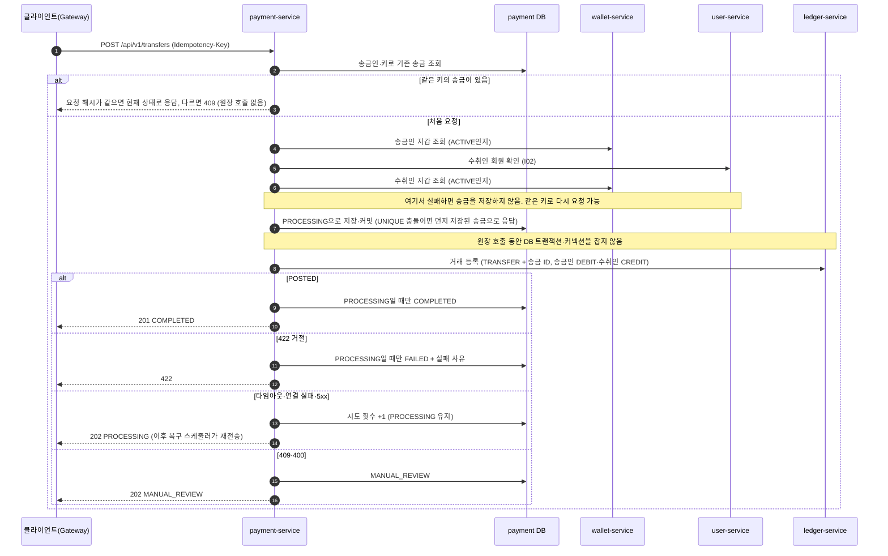
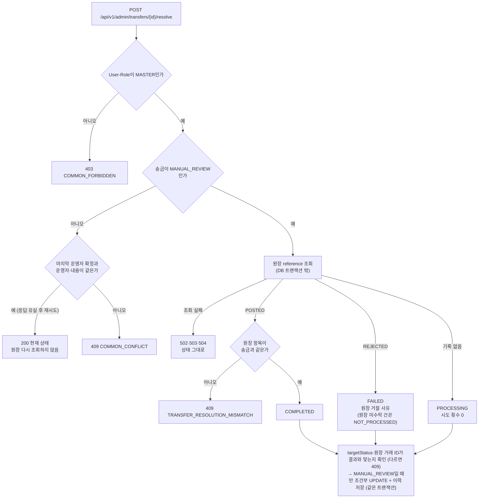
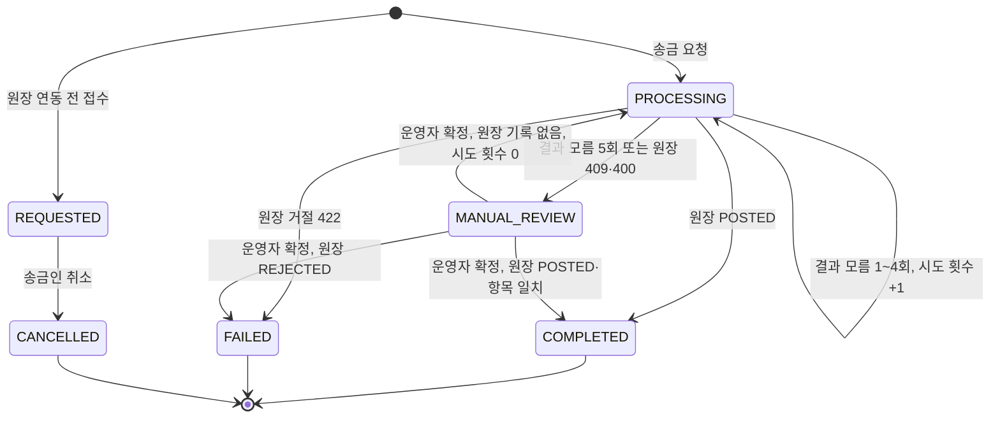
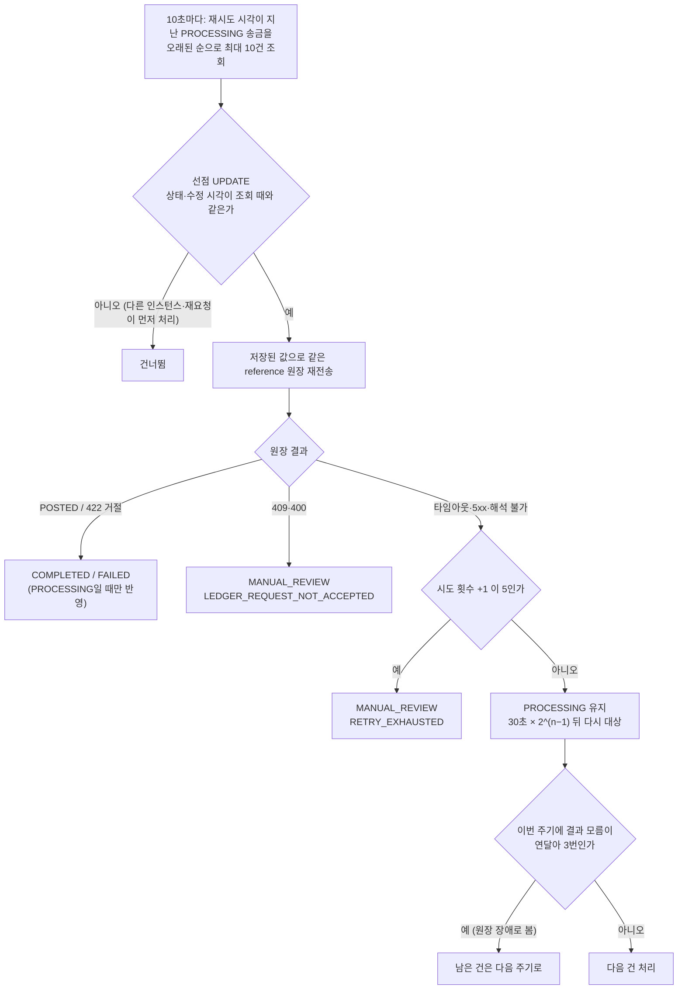
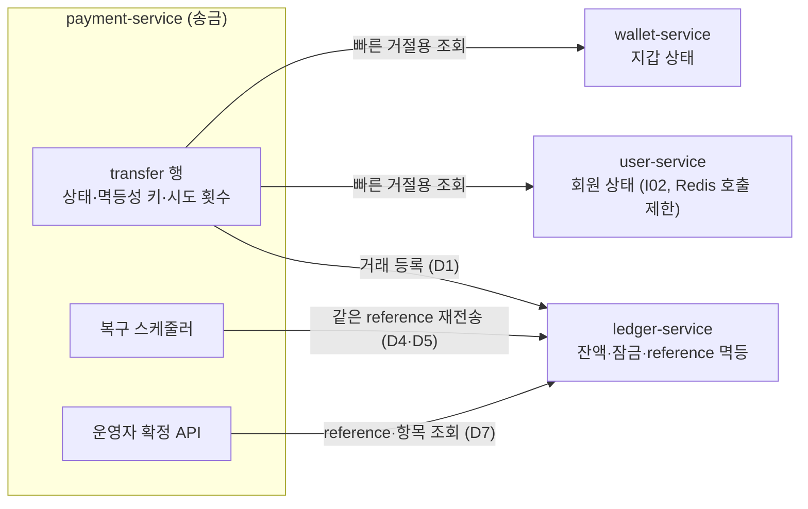

# 송금 실행·사용 가이드

송금은 별도 서비스가 아니라 payment-service 안의 기능입니다(`com.travelpay.payment.transfer`). 회원 사이의 같은 통화 지갑 송금을 접수하고, 원장(ledger-service)에 거래를 등록해 실제 자금을 옮기며, 송금 상태와 내역을 관리합니다. 잔액은 송금이 직접 바꾸지 않고 원장이 차감·입금을 한 거래로 처리합니다. 브라우저는 Gateway를 통해 호출합니다([Gateway 가이드](gateway.md)).

왜 이렇게 만들었는지(검토한 대안과 감수한 점)는 [설계 결정](#설계-결정) 절에 있습니다. 처리 흐름은 [송금 요청 처리 순서](#처리-순서), [송금 상태](#송금-상태), [복구 스케줄러](#복구-스케줄러), [MANUAL_REVIEW 확정](#manual_review-확정)의 다이어그램으로 볼 수 있습니다.

## 로컬 실행

필요한 것: JDK 21, Docker.

1. `.env.example`을 `.env`로 복사하고 비밀번호 값을 바꿉니다. 실제 값은 저장소에 올리지 않습니다.
2. DB를 실행합니다.

   ```bash
   docker compose up -d postgres
   ```

3. 송금은 다른 서비스를 호출하므로 아래 서비스가 함께 떠 있어야 합니다. 모두 Eureka(`8761`)에 등록된 이름으로 찾습니다.

   | 서비스 | 포트 | 송금에서 쓰는 곳 |
   |---|---|---|
   | eureka-server | 8761 | 서비스 찾기 |
   | user-service | 8081 | 수취인 회원 확인(I02) |
   | wallet-service | 8082 | 송금인·수취인 지갑 조회 |
   | ledger-service | 8085 | 원장 거래 등록(실제 자금 이동) |

4. Spring Boot는 `.env`를 직접 읽지 않으므로 환경 변수로 넘겨 실행합니다.

   ```bash
   set -a; source .env; set +a
   ./gradlew :payment-service:bootRun
   ```

   - 로컬 포트는 `8083`입니다. `GET http://localhost:8083/actuator/health`로 상태를 확인합니다.
   - `PAYMENT_DB_URL`이 비어 있으면 `'url' must start with "jdbc"`로 시작을 멈춥니다. `.env`를 불러오지 않은 터미널에서 실행한 경우입니다.
   - Eureka 대신 원장·회원 서비스를 직접 주소로 부를 때는 `LEDGER_SERVICE_URL`·`USER_SERVICE_URL`을 지정합니다(예: `http://localhost:8085`). 비우면 Eureka에서 찾습니다.
   - 배포 설정(`application-prod.yml`)은 `SPRING_CONFIG_NAME=application-prod`로 선택합니다.

5. 테이블은 앱이 시작할 때 Flyway가 만듭니다([DB 스키마](#db-스키마-flyway)).

API 문서는 로컬에서 Swagger UI `http://localhost:8083/swagger-ui.html`의 `transfer` 그룹(JSON `/v3/api-docs/transfer`)으로 볼 수 있습니다. 배포 설정에서는 꺼져 있습니다. Gateway 없이 직접 호출할 때는 Swagger에 표시된 `User-Id`·`User-Role` 헤더를 채웁니다.

## API 목록

| API | 설명 | 로그인 | CSRF 헤더 | `Idempotency-Key` | 성공 |
|---|---|---|---|---|---|
| `POST /api/v1/transfers` | 송금 요청 | 필요 | 필요 | 필수 | 201·202 |
| `GET /api/v1/transfers/{transferId}` | 송금 상세 조회 | 필요 | 불필요 | 없음 | 200 |
| `GET /api/v1/transfers` | 송금 내역 조회 | 필요 | 불필요 | 없음 | 200 |
| `GET /api/v1/transfers/recipients/{receiverId}` | 수취인 확인 | 필요 | 불필요 | 없음 | 200 |
| `POST /api/v1/transfers/{transferId}/cancel` | 송금 취소 | 필요 | 필요 | 없음 | 200 |

응답 본문은 `success`·`data`·`error` 공통 형식입니다([error-contract.md](error-contract.md)). ID는 모두 UUID이고, 금액은 통화별 최소 단위 정수(KRW 원, JPY 엔, CNY 펀)이며, 시각은 UTC ISO-8601입니다.

로그인·CSRF는 Gateway가 확인하고, payment-service는 Gateway가 넣어 준 `User-Id`·`User-Role` 헤더로 요청자를 정합니다. 요청 본문에 송금인 ID를 넣어도 쓰지 않습니다. 헤더가 없거나 일부만 있거나 형식이 잘못되면 `401 COMMON_UNAUTHORIZED`입니다.

## 호출 순서

로그인과 CSRF 토큰 받기는 [User 가이드](user-service.md#호출-순서)와 같습니다. 송금 화면에서는 아래 순서로 호출합니다.

```txt
1. GET  /api/v1/transfers/recipients/{receiverId} → 마스킹 이름과 송금 가능 여부 확인
2. POST /api/v1/transfers                         → Csrf-Token·Idempotency-Key 헤더 포함
   - 201 COMPLETED: 송금 완료
   - 202 PROCESSING: 결과 확인 중. 서버가 자동으로 다시 처리하므로 3번으로 상태 확인
   - 422: 잔액 부족 등으로 거절(송금은 FAILED로 기록)
3. GET  /api/v1/transfers/{transferId}            → 최종 상태 확인
4. GET  /api/v1/transfers?direction=SENT          → 보낸 내역
```

응답을 받지 못해 다시 보낼 때는 **같은 `Idempotency-Key`와 같은 본문**을 사용합니다. 그래야 송금이 두 번 되지 않습니다. 새 송금마다 새 키를 만듭니다(UUID 권장).

curl로 Gateway 없이 확인할 때는 회원 헤더를 직접 넣습니다. 아래 ID는 예시입니다.

```bash
BASE=http://localhost:8083
SENDER=550e8400-e29b-41d4-a716-446655440000
RECEIVER=4c6a0178-266b-4f1e-b811-a2767026be70

curl -s -H "User-Id: $SENDER" -H 'User-Role: USER' \
  "$BASE/api/v1/transfers/recipients/$RECEIVER"

curl -s -H "User-Id: $SENDER" -H 'User-Role: USER' \
  -H "Idempotency-Key: $(uuidgen)" -H 'Content-Type: application/json' \
  -d "{\"receiverId\":\"$RECEIVER\",\"amount\":10000,\"currency\":\"KRW\",\"memo\":\"저녁값\"}" \
  "$BASE/api/v1/transfers"

curl -s -H "User-Id: $SENDER" -H 'User-Role: USER' \
  "$BASE/api/v1/transfers?direction=SENT&page=0&size=20"
```

Git Bash에서 한글이 든 본문을 인자로 넘기면 글자가 깨져 400이 날 수 있습니다. 이때는 UTF-8 파일로 저장해 `--data-binary @body.json`으로 보냅니다.

## 송금 요청

### 요청

| 항목 | 규칙 |
|---|---|
| `Idempotency-Key` 헤더 | 필수. 공백 없는 ASCII 1~100자. 없거나 형식이 틀리면 400 `TRANSFER_INVALID_IDEMPOTENCY_KEY` |
| `receiverId` | 필수, UUID. 본인이면 400 `TRANSFER_SELF_TRANSFER` |
| `amount` | 필수, 0보다 큰 정수(통화별 최소 단위) |
| `currency` | 필수, `KRW`·`JPY`·`CNY`. 형식이 틀리면 400 `COMMON_INVALID_REQUEST`, 지원하지 않는 통화면 400 `TRANSFER_UNSUPPORTED_CURRENCY` |
| `memo` | 선택, 100자 이하. 앞뒤 공백은 지우고 빈 값은 없는 것으로 봅니다 |

```json
{
  "receiverId": "4c6a0178-266b-4f1e-b811-a2767026be70",
  "amount": 10000,
  "currency": "KRW",
  "memo": "저녁값"
}
```

### 처리 순서

1. 같은 송금인·같은 키의 송금이 이미 있으면 아래 [멱등성](#멱등성) 규칙으로 응답합니다.
2. 본인 송금·지원 통화를 확인합니다.
3. 송금인 지갑이 `ACTIVE`인지 확인합니다. 아니면 422 `TRANSFER_SENDER_WALLET_UNAVAILABLE`.
4. 수취인이 `ACTIVE` 회원인지(user-service I02), 수취인 지갑이 `ACTIVE`인지 확인합니다. 아니면 422 `TRANSFER_RECEIVER_UNAVAILABLE`.
5. 송금을 `PROCESSING`으로 저장(커밋)한 뒤 원장에 거래를 등록합니다. 원장 호출 중에는 DB 트랜잭션을 잡지 않습니다.
6. 원장 결과로 상태를 정하고 응답합니다([원장 연동](#원장-연동과-복구)).



회원당 지갑은 하나이고, 통화별 계정은 원장이 `walletId + currency`로 찾습니다. 지갑·회원 확인은 빠른 거절용이며 최종 판단(잔액, 계정 상태)은 원장 거래 등록 결과입니다.

### 응답

| 상태 | HTTP | 의미 |
|---|---|---|
| `COMPLETED` | 201 | 원장 반영 완료, 송금인 차감·수취인 입금 끝 |
| `PROCESSING` | 202 | 원장 결과를 확인하지 못함. 서버가 자동으로 다시 처리 |
| `MANUAL_REVIEW` | 202 | 자동 처리를 멈춤. 운영자 확인 필요 |
| `FAILED` | 422 | 원장이 거절(잔액 부족·계정 사용 불가). 오류 응답으로 반환되며 송금은 기록에 남음 |

```json
{
  "success": true,
  "data": {
    "transferId": "6dda1ae2-a470-4f32-84f9-8edaa4404ec5",
    "direction": "SENT",
    "senderId": "550e8400-e29b-41d4-a716-446655440000",
    "receiverId": "4c6a0178-266b-4f1e-b811-a2767026be70",
    "amount": 10000,
    "currency": "KRW",
    "status": "COMPLETED",
    "memo": "저녁값",
    "createdAt": "2026-11-02T01:02:03.123456Z"
  },
  "error": null
}
```

응답에는 지갑 ID·멱등성 키·실패 사유·수정 시각을 담지 않습니다. `direction`은 요청자 기준으로 `SENT`(보낸 송금) 또는 `RECEIVED`(받은 송금)입니다.

### 멱등성

| 상황 | 결과 |
|---|---|
| 같은 키·같은 본문, 송금 `COMPLETED` | 201, 같은 `transferId` |
| 같은 키·같은 본문, 송금 `FAILED` | 처음과 같은 422 |
| 같은 키·같은 본문, 송금 `PROCESSING`·`MANUAL_REVIEW` | 202, 현재 상태 |
| 같은 키·다른 본문 | 409 `TRANSFER_IDEMPOTENCY_KEY_REUSED` |
| 같은 키 동시 요청 | 하나만 저장되고 나머지는 위 규칙으로 응답 |

- 같은 본문인지는 `receiverId`·`amount`·`currency`·정규화한 `memo`의 SHA-256으로 비교합니다.
- 재요청은 원장을 다시 호출하지 않고 지갑·회원도 다시 조회하지 않습니다. 결과 모름 송금의 재전송은 [복구 스케줄러](#복구-스케줄러)만 합니다.
- 중복 방지는 DB `UNIQUE(sender_id, idempotency_key)`로 보장합니다. 키는 송금인별로 구분합니다.

## 조회·취소

상세 조회와 취소의 `data`는 송금 요청 응답과 같은 송금 객체이고, 내역 조회의 `data`는 송금 객체 목록을 담은 페이지입니다.

### 상세 조회

송금인 또는 수취인만 조회할 수 있습니다. 그 밖의 사용자에게는 송금이 없는 것과 같이 404 `TRANSFER_NOT_FOUND`를 반환해 존재 여부를 알리지 않습니다.

### 내역 조회

| 파라미터 | 규칙 |
|---|---|
| `direction` | `SENT` 보낸 내역, `RECEIVED` 받은 내역, 생략하면 둘 다. 그 밖의 값은 400 |
| `page` | 0부터, 기본 0. 0 미만은 400 |
| `size` | 기본 20, 1 미만은 400, 100을 넘으면 100으로 조회 |

정렬은 `createdAt desc, id desc`로 고정이며 요청자가 보내거나 받은 송금만 반환합니다. 응답은 common `PageResponse`입니다.

| 필드 | 내용 |
|---|---|
| `items` | 송금 객체 목록 |
| `page` | 현재 페이지(0부터) |
| `size` | 실제 조회한 페이지 크기(100을 넘겨 요청하면 100) |
| `totalElements` | 전체 건수 |
| `totalPages` | 전체 페이지 수 |

### 수취인 확인

송금 전 화면에서 수취인을 확인하는 용도입니다. 마스킹한 이름과 송금 가능 여부만 반환하고, 지갑 ID·지갑 상태 원문은 반환하지 않습니다.

```json
{
  "success": true,
  "data": {
    "receiverId": "4c6a0178-266b-4f1e-b811-a2767026be70",
    "receiverName": "홍*동",
    "transferable": true
  },
  "error": null
}
```

| 상황 | 결과 |
|---|---|
| 본인 ID | 400 `TRANSFER_SELF_TRANSFER` |
| 회원 없음·정지·종료 | 404 `TRANSFER_RECEIVER_NOT_FOUND` (지갑은 조회하지 않음) |
| 지갑 없음 | 404 `TRANSFER_RECEIVER_NOT_FOUND` |
| 지갑이 `ACTIVE`가 아님 | 200 `transferable: false` |
| 지갑 `ACTIVE` | 200 `transferable: true` |
| user-service 조회 한도 초과 | 429 `COMMON_TOO_MANY_REQUESTS` |

이름 마스킹은 1자 `*`, 2자 `홍*`, 3자 이상은 첫 글자와 끝 글자만 남깁니다(`홍*동`, `남**수`). 가운데 띄어쓰기도 가립니다. 확인 결과는 참고용이며 실제 송금 때 다시 검증합니다.

user-service I02는 요청자별 호출 한도(기본 60초 60회)가 있습니다. 송금 요청과 수취인 확인이 같은 한도를 씁니다([User 가이드](user-service.md#i02-요청자별-호출-제한)).

### 취소

| 상황 | 결과 |
|---|---|
| 송금인이 `REQUESTED` 송금 취소 | 200 `CANCELLED` |
| 이미 `CANCELLED` | 200, 현재 상태 그대로 |
| `PROCESSING`·`COMPLETED`·`FAILED`·`MANUAL_REVIEW` | 409 `COMMON_CONFLICT` |
| 수취인·제3자·없는 송금 | 404 `TRANSFER_NOT_FOUND` |

원장 연동 후 새 송금은 `PROCESSING`으로 시작하므로 취소할 수 있는 송금은 연동 전에 접수된 `REQUESTED` 송금뿐입니다. 취소는 조건부 UPDATE로 처리해 동시 요청에도 한 번만 바뀝니다.

## 관리자 조회

| API | 설명 | 성공 |
|---|---|---|
| `GET /api/v1/admin/transfers` | 모든 사용자의 송금 목록 | 200 |
| `GET /api/v1/admin/transfers/{transferId}` | 송금 상세(당사자 제한 없음) | 200 |
| `GET /api/v1/admin/transfers/{transferId}/resolution` | `MANUAL_REVIEW` 송금 확정 미리보기(상태 변경 없음) | 200 |
| `POST /api/v1/admin/transfers/{transferId}/resolve` | `MANUAL_REVIEW` 송금 확정 | 200 |
| `GET /api/v1/admin/transfers/{transferId}/history` | 상태 변경 이력 | 200 |

- 권한: `User-Role`이 `MASTER`가 아니면 `403 COMMON_FORBIDDEN`. 경로의 `admin`은 관리 기능 영역, `MASTER`는 허용 역할입니다.
- 목록 조건(모두 선택): `from`(포함)·`to`(미포함, ISO-8601, `from`이 `to`보다 앞서야 함), `currency`(KRW·JPY·CNY, 그 밖은 `400 TRANSFER_UNSUPPORTED_CURRENCY`), `status`, `userId`(송금인 또는 수취인), `orderType`(`LATEST` 기본 = 생성 시각 내림차순, `OLDEST` = 오름차순, 같은 시각은 ID로 같은 방향), `page`(0부터)·`size`(기본 20, 최대 100). 잘못된 값은 `400 COMMON_INVALID_REQUEST`
- 응답: `transferId`, `senderId`, `receiverId`, `sourceWalletId`, `targetWalletId`, `amount`, `currency`, `status`, `failureReason`(`FAILED`만), `reviewReason`(`MANUAL_REVIEW`만), `attemptCount`, `memo`, `createdAt`, `updatedAt`. `direction`·멱등성 키는 없음. 없는 송금은 `404 TRANSFER_NOT_FOUND`
- 조회 기록: 관리자 ID와 조건(목록)·송금 ID(상세)를 INFO 로그로 남깁니다.
- Swagger 그룹: `transfer-admin`(`/v3/api-docs/transfer-admin`)

### MANUAL_REVIEW 확정

운영 순서: 미리보기(`GET …/resolution`)로 원장 결과와 확정할 상태를 확인한 뒤, 그 값을 넣어 확정(`POST …/resolve`)합니다. 원장 조회는 내부 API(`/internal/v1`)라 운영자가 직접 원장 거래 ID를 얻을 수 없으므로 미리보기가 그 값을 알려 줍니다.

#### 미리보기

`GET /api/v1/admin/transfers/{transferId}/resolution`은 서버가 원장을 조회해 아래 확정 표를 적용한 결과를 돌려줍니다. 상태·이력은 바뀌지 않습니다.

```json
{
  "transferId": "…",
  "reviewReason": "RETRY_EXHAUSTED",
  "ledger": { "found": true, "transactionId": "…", "status": "POSTED", "rejectReason": null, "entriesMatch": true },
  "resolvable": true,
  "expectedStatus": "COMPLETED",
  "expectedFailureReason": null,
  "ledgerTransactionId": "…"
}
```

| 필드 | 의미 |
|---|---|
| `ledger.found` | 원장 거래가 있는지. 없으면 `transactionId`·`status`·`rejectReason`·`entriesMatch`도 없음 |
| `ledger.status`·`rejectReason` | 원장 거래 상태(`POSTED`·`REJECTED`)와 거절 사유(`REJECTED`만) |
| `ledger.entriesMatch` | 원장 항목이 송금과 같은지. `POSTED`일 때만 값이 있음 |
| `resolvable` | 확정할 수 있는지. `POSTED`인데 항목이 다르면 `false`(이때 `expectedStatus`·`ledgerTransactionId` 없음) |
| `expectedStatus`·`expectedFailureReason` | 확정할 상태와 `FAILED`일 때의 실패 사유 |
| `ledgerTransactionId` | 확정 요청에 넣을 원장 거래 ID(`COMPLETED`·`FAILED`만, `PROCESSING`은 없음) |

- `resolvable=true`이면 `expectedStatus`·`ledgerTransactionId`를 그대로 확정 요청에 넣습니다. 판단은 확정과 같은 코드(`TransferResolution`)를 씁니다
- 확정 때 서버가 원장을 다시 조회해 확인합니다. 미리보기 뒤 원장 결과가 바뀌었으면(예: 기록 없음 → POSTED) 확정은 `409 TRANSFER_RESOLUTION_MISMATCH`이며, 미리보기를 다시 봅니다
- `MANUAL_REVIEW`가 아니면 원장을 조회하지 않고 `409 COMMON_CONFLICT`. 권한·없는 송금·원장 조회 실패는 확정과 같음(`403`, `404 TRANSFER_NOT_FOUND`, `502`·`503`·`504`)
- 조회 기록은 INFO 로그(관리자 ID·송금 ID·예상 상태·원장 거래 ID)로만 남깁니다

#### 확정

요청 본문 `{targetStatus, reason(필수, ≤255자), ledgerTransactionId}`. 운영자 입력을 그대로 믿지 않고, 서버가 원장 `GET /internal/v1/ledger/transactions?referenceType=TRANSFER&referenceId={송금 ID}`로 결과를 조회해 맞는 확정만 반영합니다.

| 원장 결과 | 허용하는 `targetStatus` | 결과 |
|---|---|---|
| `POSTED` + 원장 항목이 송금과 같음 | `COMPLETED`(`ledgerTransactionId` = 원장 거래 ID) | `COMPLETED` |
| `REJECTED` | `FAILED`(`ledgerTransactionId` = 원장 거래 ID) | `FAILED`, 실패 사유는 원장 거절 사유(`INSUFFICIENT_BALANCE` / 그 밖 `ACCOUNT_UNAVAILABLE`). 원장 미수락 송금은 `NOT_PROCESSED` |
| 기록 없음(404 `LEDGER_TRANSACTION_NOT_FOUND`) | `PROCESSING`(`ledgerTransactionId` 없음) | 시도 횟수 0으로 되돌려 복구 스케줄러가 약 30초 뒤 같은 reference로 재전송 |



- `reason`에는 확정 판단 근거를 적습니다. 원장 조회 결과(상태·거래 ID), 거절 사유, `NOT_PROCESSED`로 확정한 이유처럼 나중에 이력만 보고도 판단을 다시 확인할 수 있는 내용을 씁니다(예: `원장 POSTED(c92b2030-…), 항목 일치 확인`, `원장 REJECTED(INSUFFICIENT_BALANCE), 원장 409로 미수락된 요청이라 NOT_PROCESSED로 확정`). 실패 사유는 `transfer.failure_reason`에만 저장되고 이력에는 별도 컬럼이 없으므로, 근거는 이 문장으로 남깁니다
- 맞지 않으면 `409 TRANSFER_RESOLUTION_MISMATCH`, `MANUAL_REVIEW`가 아니면 `409 COMMON_CONFLICT`. 형식 오류는 `400 COMMON_INVALID_REQUEST`
- 이미 확정된 송금에 같은 운영자가 같은 본문(`targetStatus`·`reason`·`ledgerTransactionId`)으로 다시 요청하면(응답 유실 후 재시도) 원장을 다시 조회하지 않고 현재 송금 상태를 200으로 돌려줍니다. 마지막 운영자 확정 이력과 비교하며, 다른 운영자·다른 내용이면 `409 COMMON_CONFLICT`입니다. `Idempotency-Key`는 받지 않습니다(자금을 직접 옮기지 않고 조건부 UPDATE로 한 번만 반영됨)
- 원장 `POSTED`이면 원장 조회 응답의 `entries`를 이 송금의 원장 요청 항목(송금인 지갑 DEBIT `TRANSFER_OUT`, 수취인 지갑 CREDIT `TRANSFER_IN`, 같은 통화·금액)과 비교합니다. 순서는 보지 않고, 항목이 빠지거나 더 있거나 값이 하나라도 다르면 `409 TRANSFER_RESOLUTION_MISMATCH`입니다(`reviewReason`과 관계없이). `POSTED`인데 항목이 없거나 값이 비어 있으면 `502`
- `reviewReason=LEDGER_REQUEST_NOT_ACCEPTED`(원장 409·400) 송금도 원장 `POSTED`이고 항목이 같으면 `COMPLETED`로 확정합니다(409는 `userId` 등 항목 밖의 값 차이로도 나며, 잔액은 항목으로만 바뀜). 원장 `REJECTED`이면 `FAILED`로 확정합니다. 자금은 이동하지 않았고 다시 보내도 계속 409라서입니다. 다만 원장 거절 기록은 이전에 들어온 다른 요청의 것일 수 있어 그 거절 사유를 쓰지 않고, 실패 사유를 `NOT_PROCESSED`로 정해 확정 이력과 같은 트랜잭션에 저장합니다
- 원장 조회 실패는 상태를 바꾸지 않고 503·504·502로 응답합니다
- 상태 변경은 `MANUAL_REVIEW`일 때만 바꾸는 조건부 UPDATE이며, 같은 트랜잭션에서 이력(`transfer_status_history`: 이전·이후 상태, 사유, 운영자 ID, 원장 거래 ID, 시각)을 저장합니다. 동시에 확정하면 한 건만 성공합니다
- 확정 뒤 송금인의 같은 키 재요청은 확정된 상태로 응답합니다(`COMPLETED` 201, `FAILED` 처음과 같은 사유의 422)
- Gateway `/api/v1/admin/transfers/**`는 payment-service로 라우팅됩니다(#155). 외부 호출은 MASTER 세션 쿠키, 확정(POST)은 CSRF가 필요합니다.

## 송금 상태



- 상태를 바꾸는 경로는 조건부 UPDATE뿐이고, 각 UPDATE의 시작 상태 조건이 위 전이만 허용합니다. DB CHECK는 상태와 사유 컬럼의 조합만 검사합니다.
- `COMPLETED`·`FAILED`·`CANCELLED`는 종료 상태로, 재요청·복구·취소·운영자 확정 어느 경로로도 바뀌지 않습니다.
- 전이표는 `TransferStatusTransitionIntegrationTest`(모든 조건부 UPDATE × 모든 시작 상태)로 고정되어 있습니다.

| 상태 | 의미 |
|---|---|
| `REQUESTED` | 원장 연동 전에 접수만 된 송금. 자금 이동 없음, 취소 가능 |
| `PROCESSING` | 원장 처리 결과 미확정. 복구 스케줄러가 다시 요청 |
| `COMPLETED` | 자금 이동 완료 |
| `FAILED` | 원장 거절. 실패 사유(`INSUFFICIENT_BALANCE`·`ACCOUNT_UNAVAILABLE`, 운영자 확정의 `NOT_PROCESSED`)를 DB에 저장 |
| `CANCELLED` | 접수 취소 |
| `MANUAL_REVIEW` | 자동 처리 중단. 사유(`RETRY_EXHAUSTED`·`LEDGER_REQUEST_NOT_ACCEPTED`)를 DB에 저장 |

## 원장 연동과 복구

### 원장 거래 등록

`POST /internal/v1/ledger/transactions`에 송금 하나를 한 거래로 보냅니다. 원장이 두 줄을 함께 반영하거나 함께 거절하므로 한쪽만 반영되지 않습니다.

| 항목 | 값 |
|---|---|
| reference | `referenceType=TRANSFER`, `referenceId=송금 ID`. 원장의 중복 처리 방지 기준 |
| `userId` | 송금인 ID(기록용, 계정 조회에 쓰지 않음) |
| 송금인 줄 | `USER`, 송금인 `walletId`, 통화, `DEBIT`, 금액, `TRANSFER_OUT` |
| 수취인 줄 | `USER`, 수취인 `walletId`, 통화, `CREDIT`, 금액, `TRANSFER_IN` |

`TRANSFER_OUT`·`TRANSFER_IN`은 원장 entry_type 허용 목록에 있는 값입니다.

요청은 저장된 송금 값으로만 만들기 때문에 재전송도 처음과 같은 내용입니다. 원장은 같은 reference를 한 번만 처리하므로 재전송해도 잔액은 한 번만 바뀝니다. `memo`는 원장에 보내지 않습니다.

| 원장 응답 | 송금 상태 | 클라이언트 응답 |
|---|---|---|
| 201·200 `POSTED` | `COMPLETED` | 201 |
| 422 `LEDGER_REJECTED_INSUFFICIENT_BALANCE` | `FAILED` | 422 `TRANSFER_INSUFFICIENT_BALANCE` |
| 422 `LEDGER_REJECTED_WALLET_SUSPENDED`·`_ACCOUNT_NOT_FOUND` | `FAILED` | 422 `TRANSFER_ACCOUNT_UNAVAILABLE` |
| 읽기 타임아웃·연결 실패·Eureka 미등록·5xx·해석 불가 응답 | `PROCESSING` 유지(결과 모름) | 202 |
| 409·400·알 수 없는 422 코드·그 밖의 4xx | `MANUAL_REVIEW` | 202 |

- 타임아웃이나 5xx는 원장이 이미 처리했을 수 있으므로 실패로 단정하지 않습니다.
- 원장이 바쁠 때(커넥션 대기 2초 초과, 거래 트랜잭션 3초 초과, 잠금 대기 중 교착·잠금 실패)는 원장이 트랜잭션을 롤백하고 503 `COMMON_SERVICE_UNAVAILABLE`(드물게 500)로 응답합니다. 원장에 아무것도 남지 않으므로 송금은 결과 모름(202 `PROCESSING`)으로 두고 복구 스케줄러가 같은 reference로 다시 보내도 안전합니다(원장 담당 확인, 2026-11-06).
- 409는 같은 reference의 원장 거래가 이미 있다는 뜻일 수 있어 `FAILED`로 끝내지 않습니다. 400·409는 송금 요청을 잘못 만든 버그나 계약 불일치로 보고 ERROR 로그를 남깁니다.
- 원장 Feign 호출은 자동 재시도를 끕니다. 타임아웃은 연결 1초, 읽기 6초입니다(원장 최대 응답 약 5초).

### 복구 스케줄러

`TransferRecoveryScheduler`가 결과 모름으로 남은 `PROCESSING` 송금을 같은 reference로 원장에 다시 보냅니다. 지갑 충전 복구와 같은 방식입니다.

| 항목 | 값 |
|---|---|
| 주기 | 10초마다(시작 10초 후부터) |
| 한 주기 처리량 | 재시도 시각이 지난 송금을 수정 시각 오래된 순으로 최대 10건 |
| 재시도 간격 | 결과 모름 횟수가 n이면 30초 × 2^(n−1) → 30초, 1분, 2분, 4분 |
| 한도 | 결과 모름 5회(첫 요청 포함)면 `MANUAL_REVIEW`(`RETRY_EXHAUSTED`) |
| 원장 장애 판단 | 한 주기에서 결과 모름이 연달아 3번이면 남은 건은 다음 주기로 |
| 끄기 | `transfer.recovery.enabled=false` (테스트·수동 확인용) |



원장 결과별 처리(팀 확정 복구 정책, 2026-11-09):

| 원장 상태 | 복구 결과 | 방법 |
|---|---|---|
| 같은 reference가 `POSTED` | `COMPLETED` | 재전송하면 원장이 기존 거래를 200 `POSTED`로 돌려줌 |
| 같은 reference가 `REJECTED` | `FAILED` + 실패 사유 | 재전송하면 원장이 기존 거절을 같은 422로 돌려줌 |
| 기록 없음 | 같은 내용으로 처음 처리 | 저장된 값(`LedgerTransactionRequest.of`)으로 재전송 |
| 응답 없음(타임아웃·연결 실패·5xx·해석 불가) | `PROCESSING` 유지, 대기 후 재시도 | 시도 횟수 +1, 30초 × 2^(n−1) 뒤 다시 대상 |
| 재시도 5회 소진 | `MANUAL_REVIEW`(`RETRY_EXHAUSTED`) | 자동 처리 중단 |
| 원장 400·409 등 요청 미수락 | `MANUAL_REVIEW`(`LEDGER_REQUEST_NOT_ACCEPTED`) | 다시 보내도 같으므로 바로 중단 |

- 원장을 먼저 조회(GET)하지 않고 같은 reference로 바로 다시 보냅니다. 원장은 같은 reference면 잔액을 확인하기 전에 기존 결과를 돌려주므로 조회 후 분기한 것과 결과가 같고, 호출은 한 번 적습니다. 같은 reference에 내용이 다른 거래가 있으면 재전송은 409로 드러나 `MANUAL_REVIEW`가 되지만, 조회만 하면 항목을 따로 대조하지 않는 한 `COMPLETED`로 잘못 확정할 수 있습니다([D5](#d5-복구는-선점-update-지수-백오프-시도-한도로)).
- 시간 제한(예: 24시간)은 두지 않지만 무한정 재시도하지도 않습니다. 결과 모름 5회를 소진하면 `MANUAL_REVIEW`로 넘깁니다. 정상이면 대기 합계 약 7.5분 안에 끝나므로, 오래 `PROCESSING`에 머무는 송금은 아래 `transfer.processing.stuck` 지표로 감지합니다.

- 선점: 조회한 송금의 상태·수정 시각이 그대로일 때만 조건부 UPDATE로 가져갑니다. 여러 인스턴스가 함께 돌아도 같은 송금을 동시에 처리하지 않고, 결과 반영도 `PROCESSING`일 때만 하므로 잔액·상태는 한 번만 바뀝니다. 분산 락은 쓰지 않습니다.
- 한 건의 오류는 로그만 남기고 다음 건을 계속 처리합니다.
- payment-service의 스케줄러 스레드는 2개입니다(`spring.task.scheduling.pool.size`). 결제 정산 복구와 서로의 원장 호출을 기다리지 않게 하기 위함입니다.

| 지표 | 의미 |
|---|---|
| `transfer.processing.stuck` | 생성 후 30분이 지나도 `PROCESSING`인 송금 수. 재시도 5회가 약 7.5분 안에 끝나므로 0보다 크면 복구가 돌지 않는 것(스케줄러 정지, 결과 모름 기록 실패 등)이고, ERROR 로그(오래된 순 ID 10개)도 남김. 알림 규칙은 아직 없음(값 수집만) |
| `transfer.manual_review` | 운영자 확인을 기다리는 `MANUAL_REVIEW` 송금 수 |

`MANUAL_REVIEW` 송금은 원장 reference 조회(`GET /internal/v1/ledger/transactions?referenceType=TRANSFER&referenceId=송금ID`)로 반영 여부를 확인해야 합니다. 특히 `RETRY_EXHAUSTED`는 원장에 이미 반영됐을 수 있습니다.

## 다른 서비스 호출

| 대상 | API | 송금 쪽 처리 |
|---|---|---|
| wallet-service | `GET /internal/v1/wallets?userId=` | `{walletId, status}`. `ACTIVE`만 송금 가능. 404 + `WALLET_NOT_FOUND`일 때만 지갑 없음 |
| user-service | `GET /internal/v1/users/{userId}/real-name` (I02) | 200이면 `ACTIVE` 회원. 404 + `USER_RECIPIENT_NOT_FOUND`일 때만 회원 아님. 응답 `userId`가 요청과 다르면 502 |
| ledger-service | `POST /internal/v1/ledger/transactions` | [원장 거래 등록](#원장-거래-등록) |

지갑·회원 호출은 결제와 같은 Feign 클라이언트(`WalletFeignApi`·`UserFeignApi`)를 쓰며 타임아웃은 연결 2초, 읽기 3초입니다. 사용자 요청 중의 호출에는 common `InternalHeaderRelayInterceptor`가 요청자의 `User-Id`·`User-Role`을 붙입니다. 지갑·회원 호출 실패는 common `FeignErrors.toCommonException()` 규칙을 따릅니다.

| 지갑·회원 호출 실패 | 송금 응답 |
|---|---|
| 연결 실패, Eureka 미등록, 상대 503 | 503 `COMMON_SERVICE_UNAVAILABLE` |
| 읽기 타임아웃, 상대 504 | 504 `COMMON_GATEWAY_TIMEOUT` |
| 상대 429 + `COMMON_TOO_MANY_REQUESTS` | 429 `COMMON_TOO_MANY_REQUESTS` |
| 위 목록에 없는 404·5xx, 해석할 수 없는 응답 | 502 `COMMON_BAD_GATEWAY` |

지갑·회원 확인 단계에서 실패하면 송금은 저장되지 않고 키도 사용되지 않습니다. 같은 키로 다시 요청할 수 있습니다.

## 오류 응답

| 상태 | 코드 | 상황 |
|---|---|---|
| 400 | `COMMON_INVALID_REQUEST` | 본문 검증 실패, 잘못된 `page`·`size`·`direction` |
| 400 | `TRANSFER_INVALID_IDEMPOTENCY_KEY` | `Idempotency-Key` 없음·형식 오류 |
| 400 | `TRANSFER_SELF_TRANSFER` | 본인에게 송금, 본인 수취인 확인 |
| 400 | `TRANSFER_UNSUPPORTED_CURRENCY` | KRW·JPY·CNY가 아닌 통화 |
| 401 | `COMMON_UNAUTHORIZED` | 회원 헤더 없음(Gateway 경유 시 세션 없음) |
| 403 | `COMMON_CSRF_INVALID` | Gateway 경유 변경 요청의 CSRF 토큰 없음·불일치 |
| 404 | `TRANSFER_NOT_FOUND` | 송금이 없거나 당사자가 아님(취소는 송금인이 아님) |
| 404 | `TRANSFER_RECEIVER_NOT_FOUND` | 수취인 확인에서 활성 회원이 아니거나 지갑 없음 |
| 409 | `TRANSFER_IDEMPOTENCY_KEY_REUSED` | 같은 키로 다른 본문 |
| 409 | `COMMON_CONFLICT` | 취소할 수 없는 상태 |
| 422 | `TRANSFER_SENDER_WALLET_UNAVAILABLE` | 송금인 지갑 없음·비활성 |
| 422 | `TRANSFER_RECEIVER_UNAVAILABLE` | 수취인이 활성 회원이 아니거나 지갑 없음·비활성 |
| 422 | `TRANSFER_INSUFFICIENT_BALANCE` | 원장 잔액 부족 거절(송금 `FAILED`) |
| 422 | `TRANSFER_ACCOUNT_UNAVAILABLE` | 원장 계정 정지·없음 거절(송금 `FAILED`) |
| 422 | `TRANSFER_NOT_PROCESSED` | 원장 미수락 송금을 운영자가 `FAILED`로 확정한 뒤의 같은 키 재요청 |
| 429 | `COMMON_TOO_MANY_REQUESTS` | user-service 수취인 조회 한도 초과 |
| 502 | `COMMON_BAD_GATEWAY` | 지갑·회원 서비스 응답 해석 불가 |
| 503 | `COMMON_SERVICE_UNAVAILABLE` | 지갑·회원 서비스 연결 불가 |
| 504 | `COMMON_GATEWAY_TIMEOUT` | 지갑·회원 서비스 응답 시간 초과 |

원장 장애는 오류가 아니라 202 `PROCESSING`으로 응답합니다. 장애 메시지나 상대 응답 본문은 클라이언트에 내보내지 않습니다.

## DB 스키마 (Flyway)

송금 테이블은 `payment_service.transfer`이며, 결제와 같은 `payment-service/src/main/resources/db/migration` 폴더를 씁니다. 파일 이름은 `V{yyyyMMdd}_{순번}__{설명}.sql`입니다. Hibernate는 검사만 합니다(`ddl-auto: validate`).

| 파일 | 내용 |
|---|---|
| `V20261028_1__create_transfer.sql` | 송금 테이블, 멱등성 UNIQUE, 금액·통화·당사자 CHECK, 목록 인덱스 |
| `V20261029_1__add_transfer_cancelled_status.sql` | `CANCELLED` 상태 |
| `V20261030_2__add_transfer_ledger_status.sql` | `PROCESSING`·`COMPLETED`·`FAILED`, `failure_reason` |
| `V20261102_1__add_transfer_manual_review.sql` | `MANUAL_REVIEW`, `attempt_count`, `review_reason`, 복구 대상 부분 인덱스 |
| `V20261104_1__create_transfer_status_history.sql` | 운영자 확정 이력 테이블 `transfer_status_history` |
| `V20261105_1__add_transfer_failure_reason_not_processed.sql` | 실패 사유 `NOT_PROCESSED` |

| 제약·인덱스 | 내용 |
|---|---|
| `uk_transfer_sender_id_idempotency_key` | `UNIQUE(sender_id, idempotency_key)` 중복 송금 방지 |
| `ck_transfer_amount` | `amount > 0` |
| `ck_transfer_currency` | 대문자 3자리 형식만 검사. 지원 통화(KRW·JPY·CNY)는 앱에서 검사 |
| `ck_transfer_sender_receiver`, `ck_transfer_source_target_wallet` | 송금인·수취인, 두 지갑이 서로 달라야 함 |
| `ck_transfer_failed_has_reason` | `FAILED`일 때만 `failure_reason`이 있음 |
| `ck_transfer_manual_review_has_reason` | `MANUAL_REVIEW`일 때만 `review_reason`이 있음 |
| `ix_transfer_sender_id_created_at`, `ix_transfer_receiver_id_created_at` | 보낸·받은 내역 목록 |
| `ix_transfer_processing_updated_at` | `PROCESSING` 송금 복구 대상 조회(부분 인덱스) |
| `fk_transfer_status_history_transfer` | 이력은 존재하는 송금에만 |
| `ck_transfer_status_history_actor_type`, `ck_transfer_status_history_reason` | 이력 작성자는 `OPERATOR`만, 사유는 공백일 수 없음 |
| `ix_transfer_status_history_transfer_id` | 송금별 이력 조회(`transfer_id, created_at, id`) |

- 회원·지갑은 다른 서비스 소유라 FK 없이 ID만 저장합니다. 송금인·수취인 ID와 두 지갑 ID를 모두 저장해 재전송 요청을 저장된 값만으로 만듭니다.
- 이미 적용한 파일은 고치지 않고 다음 날짜·순번의 새 파일을 추가합니다. 결제 쪽과 같은 날짜를 쓰면 순번이 겹치지 않게 맞춥니다.
- Flyway는 순서를 벗어난 적용을 허용하지 않습니다(`outOfOrder` 꺼짐). 다른 브랜치에서 나중 버전을 먼저 적용한 로컬 DB는 `Detected resolved migration not applied to database`로 시작을 멈춥니다. 이때 로컬에서만 한 번 `SPRING_FLYWAY_OUT_OF_ORDER=true`로 실행해 빠진 파일을 적용합니다. 설정 파일은 바꾸지 않습니다.

## 테스트

```bash
./gradlew :payment-service:test --tests "com.travelpay.payment.transfer.*"
```

- 단위 테스트는 DB 없이 실행됩니다. 원장은 테스트 안의 Mock으로 연결해 응답별 상태 처리, 재전송 때 잔액이 한 번만 바뀌는지, 복구 스케줄러 동작을 확인합니다.
- DB 통합 테스트(`TransferRepositoryIntegrationTest`, `TransferApiDocsIntegrationTest`, `integration` 패키지 등)는 Testcontainers로 PostgreSQL 컨테이너(`postgres:18.6-bookworm`)를 띄우고 Flyway 마이그레이션을 적용해 실행합니다. `.env`나 로컬 compose DB는 필요 없고 Docker만 실행 중이면 됩니다. Docker가 없으면 건너뜁니다.
  - 컨테이너는 테스트 실행마다 한 번만 띄워 여러 테스트 클래스가 함께 씁니다(`com.travelpay.payment.support.PostgresContainerSupport`). 새 DB 통합 테스트는 이 클래스를 상속합니다.
  - 테스트마다 롤백하고 복구·정산 스케줄러는 끈 상태로 돕니다. 예외는 `TransferConsistencyIntegrationTest`로, 동시 요청끼리 서로의 커밋을 봐야 해서 트랜잭션 없이 실행하고 테스트가 끝나면 만든 송금·이력을 지웁니다.
  - Gradle은 환경 변수를 테스트 입력으로 보지 않아 이전 결과를 재사용할 수 있습니다. 다시 실행하려면 `--rerun`을 붙입니다.
- 커버리지 리포트(JaCoCo)는 테스트 후 `payment-service/build/reports/jacoco/test/html/index.html`에 생성됩니다.
- 2026-11-06 기준(dev `9145ba9`) `transfer.*` 362건이 모두 통과합니다(실패·건너뜀 0).

### 테스트 구성

| 확인 대상 | 테스트 |
|---|---|
| 요청 검증, 멱등성(같은 키·다른 본문), 조회·취소 권한 | `TransferServiceTest`, `TransferControllerTest`, `TransferRequestHasherTest`, `RecipientNameMaskerTest` |
| 원장 응답별 상태, 재전송 시 잔액 1회 변경, 복구 백오프·한도 | `TransferLedgerFlowTest`, `TransferRecoverySchedulerTest` |
| 다른 서비스 응답 해석(오류 코드·5xx·타임아웃·429 매핑) | `TransferLedgerClientAdapterTest`, `TransferWalletReaderTest`, `TransferUserReaderTest` |
| 쿼리·DB 제약(UNIQUE, CHECK, 페이지 정렬, 복구 대상 선정) | `TransferRepositoryIntegrationTest` |
| 상태 전이 전체(조건부 UPDATE 10종 × 시작 상태 6개) | `TransferStatusTransitionIntegrationTest` |
| 동시 요청 정합성(아래 불변식) | `TransferConsistencyIntegrationTest` |
| 원장 장애·응답 유실·계정 정지, `MANUAL_REVIEW` 전환 | `TransferLedgerOutageIntegrationTest`, `TransferLedgerResponseLossIntegrationTest`, `TransferAccountSuspendedIntegrationTest`, `TransferManualReviewIntegrationTest`, `TransferRecoverySchedulerIntegrationTest` |
| 회원 헤더 인증, 목록 파라미터, I02 429 전달 | `TransferAuthHeaderIntegrationTest`, `TransferListApiIntegrationTest`, `TransferRateLimitIntegrationTest` |
| 관리자 조회·확정 미리보기·확정(원장 대조, 미리보기 → 확정 연계, 재요청, 동시 확정) | `AdminTransferApiIntegrationTest`, `AdminTransferResolveIntegrationTest` |
| Swagger 문서 | `TransferApiDocsIntegrationTest` |

`integration` 패키지 테스트는 실제 PostgreSQL·서비스·컨트롤러를 쓰고 Feign 인터페이스(`LedgerFeignApi`·`WalletFeignApi`·`UserFeignApi`)만 바꿔 끼웁니다(`TransferApiIntegrationSupport`).

### 정합성 불변식

정합성 테스트와 부하 측정 후 대사는 같은 기준으로 확인합니다.

1. `COMPLETED` 송금마다 원장 반영이 정확히 1번 있고, 항목은 송금인 지갑 DEBIT `TRANSFER_OUT`·수취인 지갑 CREDIT `TRANSFER_IN`·같은 통화·금액입니다.
2. `FAILED` 송금은 원장에 반영되지 않았습니다.
3. 같은 송금인·같은 `Idempotency-Key`의 송금은 1건입니다.
4. 지갑별 잔액은 시작 잔액에 완료 송금만 더하고 뺀 값이고, 음수가 없고, 합계가 보존됩니다.
5. 복구가 끝나면 `PROCESSING` 송금이 없습니다.
6. 상태와 사유 컬럼 조합이 DB CHECK를 어기지 않습니다.

`TransferConsistencyIntegrationTest`는 실제 스레드로 동시에 요청하고, 원장 자리에는 테스트용 원장을 둡니다(지갑별 잔액, 같은 reference는 처음 결과 반환, 잔액 부족이면 두 줄 모두 미반영, 등록 직렬화). 실제 원장의 잠금·멱등성은 아래 로컬 E2E와 부하 측정으로 확인했습니다.

| 시나리오 | 결과 |
|---|---|
| 같은 키·같은 본문 20건 동시 | 송금 1건, 원장 호출 1번, 모든 응답이 같은 `transferId` |
| 잔액 10,000에 1,000 × 20건(키 모두 다름) 동시 | `COMPLETED` 10·`FAILED`(잔액 부족) 10, 잔액 0 |
| A↔B 양방향 20건 동시 | 합계 보존, 지갑별 잔액 = 완료 송금 |
| 응답 유실된 `PROCESSING`에 복구 4번 + 같은 키 재요청 4번 동시 | 원장 재전송 1번, 반영 1번, `COMPLETED` |
| 같은 운영자·같은 내용 확정 8건 동시 | 모두 200 `COMPLETED`, 이력 1건 |
| 다른 운영자 확정 8건 동시 | 1건 성공·7건 409, 이력 1건 |
| 지갑 503 / 회원 503 / 수취인 지갑 시간 초과 | 503 / 503 / 504, 송금 미저장·원장 미호출, 장애 해소 후 같은 키로 `COMPLETED` |

### 장애 시나리오 검증 결과

단위·통합 테스트에 더해, 로컬에 전체 서비스를 띄우고 실제 원장·지갑·회원 서비스로 확인한 결과입니다(E2E). 모두 payment-service를 회원 헤더로 직접 호출했습니다.

| 장애 | 송금 동작 | 확인 |
|---|---|---|
| 원장 정지 | 202 `PROCESSING`, 같은 키 재요청도 202·원장 미호출, 취소 409. 원장 재기동 후 재요청 없이 약 30초 뒤 `COMPLETED`, 잔액 1회 변경 | 2026-11-04 E2E, `TransferLedgerOutageIntegrationTest` |
| 원장은 반영했는데 응답 유실(읽기 타임아웃 1ms로 재현) | 202 `PROCESSING` → 복구 스케줄러가 같은 reference로 재전송, 원장이 기존 거래를 돌려줘 `COMPLETED`, 잔액 1회 변경 | 2026-11-04 E2E, `TransferLedgerResponseLossIntegrationTest` |
| 원장 계정 정지 | 422 `TRANSFER_ACCOUNT_UNAVAILABLE`, `FAILED`, 같은 키 같은 422, 잔액 불변 | 2026-11-04 E2E, `TransferAccountSuspendedIntegrationTest` |
| 결과 모름 5번 / 원장 409·400 | `MANUAL_REVIEW`(`RETRY_EXHAUSTED` / `LEDGER_REQUEST_NOT_ACCEPTED`), 이후 자동 재전송 없음 | `TransferManualReviewIntegrationTest`, `TransferLedgerFlowTest` |
| 지갑·회원 서비스 장애 | 503·504, 송금 미저장, 같은 키로 다시 요청 가능 | 2026-10-29 E2E(지갑 정지), `TransferConsistencyIntegrationTest` |
| I02 호출 한도 초과 | 429 `COMMON_TOO_MANY_REQUESTS`, 송금 미저장, 한도 해제 후 같은 키로 201 | 2026-11-04·11-06 E2E, `TransferRateLimitIntegrationTest` |
| Redis 정지 | 수취인 확인·송금 요청 503 `COMMON_SERVICE_UNAVAILABLE`, 송금 미저장. 이미 `PROCESSING`인 송금은 복구 스케줄러가 계속 확정(I02를 부르지 않음). Redis 복구 후 같은 키로 201 | 2026-11-06 E2E |
| 잔액보다 많은 동시 송금(20건) / 양방향 동시 송금 | 잔액 음수 없음, 교착·결과 모름 없음 | 2026-11-02 E2E |

Redis 정지 시 503은 user-service의 의도된 정책입니다. 호출 횟수를 확인할 수 없으면 조회를 막습니다(fail-closed). Redis가 멈추면 Gateway 세션 인증도 같이 멈추므로 이 정책으로 추가로 잃는 가용성은 작습니다. Redis 장애 E2E는 Gateway를 빼고 payment-service를 직접 호출한 user-service I02 연동 장애 테스트이며, Gateway 경유 인증 확인(2026-11-03, 47건)과는 별개입니다.

## 부하 측정

테스트(기능·정합성 검증)와 별도로 k6로 처리량·지연을 잰 결과입니다. 스크립트·실행 방법·원본 결과는 [`payment-service/load-test/README.md`](../../payment-service/load-test/README.md)에 있습니다.

### 측정 조건

- 2026-11-06, 노트북 한 대에 전체 서비스(eureka·user·wallet·payment·ledger, Postgres·Redis 컨테이너), k6만 컨테이너
- Gateway 제외(payment 직접 호출), 측정 동안만 I02 호출 제한을 올림
- 동시 요청 20, 예열 15초 + 측정 60초, 각 1번 측정(중앙값 아님)
- 분산: 송금인 20명이 각자 다른 수취인에게 / 집중: 송금인 20명이 수취인 한 명에게

### 송금 요청

| 항목 | 송금인·수취인 분산 | 수취인 1명에 집중 |
|---|---|---|
| 성공 TPS | 161.3 | 93.5 |
| P95 / P99 (ms) | 163.8 / 210.0 | 631.4 / 837.0 |
| 오류 | 0 | 0 |
| 원장 잠금 대기 세션(평균) | 0 | 8.3 |
| 대사 위반 | 0 | 0 |

- 송금 요청 한 건의 서버 시간(분산, 평균 119.3ms): 원장 41.5(35%), 지갑 조회 2번 21.0(18%), I02 12.0(10%), payment 자체 약 45(38%, 송금 저장·결과 반영 커밋 2번, Feign, CPU 경합). 외부 호출이 약 62%입니다.
- 최대 응답은 분산 319ms(1초 초과 0건), 집중 2,271ms(1초 초과 33건)였습니다.
- 분산 측정은 PC CPU가 97.5%로 포화돼, TPS는 앱이 아니라 측정 환경의 한계입니다.
- payment 커넥션 풀은 분산 측정에서 순간 10개를 다 썼지만 대기는 최대 2였습니다. 원장 호출 동안 커넥션을 잡지 않으므로(D3) 지금은 문제가 아닙니다.
- 수취인 집중 시에는 원장이 거래마다 수취인 계정 행을 잠가(`FOR UPDATE`) 처리가 한 줄로 늘어섭니다. CPU 여유가 있는데도 TPS가 42% 줄고 P95가 3.9배가 됐습니다. 원장 커넥션 풀을 늘려도 대기만 늘어 효과가 없고, 개선은 원장 설계 변경 사항입니다.
- 집중 계정의 잠금 대기가 원장 커넥션 풀을 차지하므로, 몰리지 않은 다른 계정의 거래도 함께 느려집니다(결제에서 가맹점 집중으로 같은 현상 확인). 송금·결제·충전이 같은 원장 구조라 공통 과제로 보류했습니다. 송금은 개인 간 송금이라 한 수취인에 몰릴 가능성이 낮습니다.
- 대기가 원장 한도(커넥션 대기 2초, 트랜잭션 3초)를 넘으면 원장은 롤백 후 503으로 응답하고, 송금은 202 `PROCESSING` 뒤 복구 스케줄러가 확정합니다. 정합성은 유지되고 응답 의미만 바뀝니다.
- 두 측정 모두 송금·원장·잔액 대사가 맞았습니다([정합성 불변식](#정합성-불변식) 기준).

### 조회

송금 요청 측정 뒤 같은 데이터(송금 21,314건, 측정 송금인 한 명당 보낸 송금 약 1,400건)로 같은 조건에서 쟀습니다.

| 항목 | 목록(보낸 내역 첫 페이지) | 상세 | 반반 |
|---|---|---|---|
| 성공 TPS | 859.4 | 667.5 | 1,147.3 |
| P95 / P99 (ms) | 34.9 / 50.2 | 12.0 / 17.7 | 23.1 / 31.9 |
| 서버 평균 (ms) | 16.1 | 4.0 | 목록 11.4 / 상세 7.0 |
| 4xx·5xx | 0 | 0 | 0 |

- 응답 없음이 0.01~0.09% 있었는데, 모두 k6 컨테이너에서 PC로 새 연결을 맺다 실패한 것(`dial: i/o timeout`)이라 서버에 닿지 않은 요청입니다. 이 실패로 상세 측정은 가상 사용자가 몇 초씩 멈춰 TPS가 낮게 나왔으므로 상세는 서버 평균(4.0ms)으로 봅니다.
- 목록·반반 측정도 PC CPU가 98%로 포화됐습니다. payment 커넥션 풀이 찼지만 DB에서 실행 중인 쿼리는 평균 1개 미만이었습니다. 원인은 CPU이고 풀이 아닙니다.
- 쿼리 자체는 빠릅니다. 보낸 내역 첫 페이지 0.15ms, 건수 0.7ms(인덱스만 읽음). `direction`을 생략한 전체 조회는 두 인덱스를 합쳐 회원 송금을 모두 읽고 정렬해 6.2ms이며(부하 측정은 하지 않음), 건수 조회와 함께 회원 송금 수에 비례해 느려집니다.

### 개선 후보

측정에서 나온 후보입니다. 아직 구현한 것은 없습니다.

| 후보 | 담당 | 상태 |
|---|---|---|
| 집중 계정 대응(잠금 범위 축소, 수취 계정 분할, 입금 지연 반영 등) | 원장 | 보류. 송금·결제·충전 공통 원장 구조 과제. 결제도 가맹점 집중 시 같은 현상과 다른 가맹점으로 번지는 지연을 확인했으나, 목표 처리량 수준에서 단일 계정에 그만큼 몰릴 일이 적다고 봄 |
| 잠금·커넥션 대기 한도 초과 시 원장 응답 확인 | 원장 | 확인 완료(2026-11-06). 롤백 후 503(드물게 500)이라 송금은 결과 모름으로 받고 재전송이 안전함([원장 거래 등록](#원장-거래-등록)) |
| 지갑 조회 2번·I02 1번 병렬 호출 | 송금 | 보류. 최대 약 20ms 절감 추정이지만 오류 우선순위(송금인 지갑 → 수취인 회원 → 수취인 지갑)가 바뀌고 스레드 사용이 늘어남 |
| 앱 처리량 상한 재측정 | 측정 | 미진행. 서비스를 다른 머신에 두거나 CPU가 포화되지 않는 동시 요청 수로 |
| `direction` 생략 목록을 두 인덱스에서 20건씩 읽어 합치기(UNION ALL + LIMIT) | 송금 | 보류. 회원별 송금이 수천 건을 넘을 때 검토 |
| 목록 건수 조회 생략·상한 | 송금 | 하지 않음. `totalElements`·`totalPages`를 바꾸는 계약 변경 |
| 조회 측정의 `dial: i/o timeout` | 측정 | 미진행. k6를 PC에서 직접 실행하거나 서비스와 같은 컨테이너 네트워크에 두면 사라지는지 확인 |

## 설계 결정

송금을 만들면서 내린 주요 결정입니다. 각 결정마다 상황, 결정, 검토한 대안, 감수한 점, 근거(테스트·검증)를 적습니다. 팀 최종 확정 전에 정한 결정은 (임시)로 표시합니다.

| # | 결정 | 한 줄 요약 |
|---|---|---|
| D1 | [잔액 변경은 원장에 맡긴다](#d1-잔액-변경은-원장에-맡긴다) | 송금 하나 = 원장 거래 하나(차변·대변 두 줄), 분산 트랜잭션 없음 |
| D2 | [멱등성은 송금 테이블의 UNIQUE와 요청 해시로](#d2-멱등성은-송금-테이블의-unique와-요청-해시로) | 키와 송금이 한 행이라 "키만 저장된" 상태가 없음 |
| D3 | [원장 호출 전에 PROCESSING으로 커밋하고, 호출은 트랜잭션 밖에서](#d3-원장-호출-전에-processing으로-커밋하고-호출은-트랜잭션-밖에서) | 어느 시점에 죽어도 송금 행이 먼저 남아 복구 대상이 됨 |
| D4 | [결과 모름은 실패로 보지 않는다](#d4-결과-모름은-실패로-보지-않는다) | 타임아웃·5xx는 202 `PROCESSING`, 재전송은 스케줄러만 |
| D5 | [복구는 선점 UPDATE, 지수 백오프, 시도 한도로](#d5-복구는-선점-update-지수-백오프-시도-한도로) | 분산 락 없이 중복 처리 무해, 끝나지 않는 건은 사람에게 넘김 |
| D6 | [상태 변경은 조건부 UPDATE로만](#d6-상태-변경은-조건부-update로만) | 허용 전이가 WHERE 조건에 드러나고 테스트로 고정됨 |
| D7 | [운영자 확정은 서버가 원장을 직접 대조한다](#d7-운영자-확정은-서버가-원장을-직접-대조한다) | 운영자 입력을 믿지 않고 원장 항목과 맞을 때만 확정 |
| D8 | [도입하지 않은 것](#d8-도입하지-않은-것) | Kafka·Outbox, Saga, Redis 멱등성, 분산 락, 잔액 사전 조회 |



### D1. 잔액 변경은 원장에 맡긴다

- **상황**: 서비스마다 DB가 따로 있고, 잔액은 ledger-service가 가집니다(wallet-service는 지갑 상태만 가짐). 송금인 차감과 수취인 입금이 한쪽만 반영되면 안 됩니다.
- **결정**: 송금 하나를 원장 거래 하나로 등록합니다. 송금인 지갑 DEBIT `TRANSFER_OUT`과 수취인 지갑 CREDIT `TRANSFER_IN` 두 줄을 reference `TRANSFER + 송금 ID`로 보내면, 원장이 한 DB 트랜잭션에서 잔액 확인·잠금·반영을 하거나 둘 다 거절합니다. 송금은 잔액을 직접 바꾸지 않고 상태만 관리합니다. 지갑·회원 조회는 빠른 거절용이고, 최종 판단은 원장 결과입니다. (임시)
- **검토한 대안**:
  - 지갑 차감 API와 입금 API를 따로 부르고 실패하면 보상(Saga): 차감만 된 구간이 생기고, 보상이 실패했을 때의 처리가 또 필요합니다.
  - 송금이 잔액을 먼저 조회하고 차감: 조회와 차감 사이에 다른 송금이 끼어들어 동시성을 보장하지 못합니다.
- **감수한 점**: 원장 응답을 받지 못하면 결과를 모르는 구간이 생깁니다(D3·D4). 한 계정에 거래가 몰리면 원장 행 잠금으로 처리가 직렬화됩니다([부하 측정](#부하-측정)).
- **근거**: 잔액보다 많은 동시 송금·양방향 동시 송금에서 음수·교착 없음(2026-11-02 E2E), 부하 측정 후 송금·원장·잔액 대사 위반 0.

### D2. 멱등성은 송금 테이블의 UNIQUE와 요청 해시로

- **상황**: 금전 POST는 `Idempotency-Key`가 필수입니다. 같은 키·같은 내용은 같은 결과, 같은 키·다른 내용은 409여야 하고, 동시에 들어온 중복도 막아야 합니다.
- **결정**: 송금 행에 `idempotency_key`와 `request_hash`(수취인·금액·통화·정규화한 메모의 SHA-256)를 저장하고 `UNIQUE(sender_id, idempotency_key)`를 둡니다. 먼저 조회하고, 동시 요청이 UNIQUE에 걸리면 먼저 저장된 송금을 다시 읽어 응답합니다.
- **검토한 대안**:
  - 별도 멱등성 테이블: 팀 공통 정책이 없었고, 송금 행과 따로 두면 "키는 있는데 송금은 없는" 상태를 다뤄야 합니다.
  - Redis에 키 저장: 만료나 Redis 장애 때 중복 송금 경로가 생기고, 거래 기록을 Redis에만 두지 않는다는 원칙에 어긋납니다.
  - 조회만으로 판단: 조회와 저장 사이에 같은 키 요청이 끼어듭니다.
- **감수한 점**: 키는 송금인 범위로만 구분하고 만료가 없습니다(송금 행과 수명이 같음).
- **근거**: 같은 키 20건 동시 요청 → 송금 1건, 원장 호출 1번(`TransferConsistencyIntegrationTest`). 지갑·회원 확인에서 실패하면 저장 전이라 같은 키를 다시 쓸 수 있습니다.

### D3. 원장 호출 전에 PROCESSING으로 커밋하고, 호출은 트랜잭션 밖에서

- **상황**: 원장 호출은 최대 약 6초 걸릴 수 있고, 호출 도중 payment-service가 죽거나 응답이 사라질 수 있습니다.
- **결정**: 송금을 `PROCESSING`으로 저장·커밋한 뒤 DB 트랜잭션 없이 원장을 부르고, 결과는 `PROCESSING`일 때만 바꾸는 조건부 UPDATE로 반영합니다.
- **검토한 대안**:
  - 한 트랜잭션 안에서 원장 호출: 원장을 기다리는 동안 DB 커넥션을 잡고, 롤백되면 원장은 반영했는데 송금 기록이 사라져 추적할 수 없습니다.
  - 원장 호출 뒤에 저장: 저장 전에 죽으면 원장 거래만 남고 송금이 없습니다.
- **감수한 점**: 요청당 커밋이 2번입니다. 처음부터 `PROCESSING`이라 접수 직후 취소는 할 수 없습니다(원장 호출과 취소가 겹치는 경합을 막기 위해 의도한 것).
- **근거**: 원장 반영 후 기록 실패를 결과 모름으로 처리해 복구(`TransferLedgerFlowTest`). 수취인 집중 부하 측정에서 원장 처리 시간이 평균 166ms로 늘어도 payment 커넥션 사용은 평균 1.1개, 대기 0이었습니다.

### D4. 결과 모름은 실패로 보지 않는다

- **상황**: 타임아웃·연결 실패·5xx는 원장이 이미 처리했을 수도 있습니다. 실패로 응답하면 사용자가 새 키로 다시 보내 이중 송금이 될 수 있습니다.
- **결정**: 송금을 `PROCESSING`으로 두고 202로 응답합니다. 같은 키 재요청은 원장을 다시 부르지 않고 현재 상태로 응답하며, 재전송은 복구 스케줄러만 합니다. 원장은 같은 reference를 한 번만 처리하므로(잔액 확인 전에 기존 거래를 돌려줌) 재전송해도 잔액은 한 번만 바뀝니다.
- **바뀐 점**: 처음에는 같은 키 재요청이 원장에 재전송했습니다. 재요청이 없으면 영원히 `PROCESSING`으로 남고, 클라이언트 재시도가 몰리면 원장 부하가 커져 재전송을 스케줄러 하나로 모았습니다.
- **검토한 대안**: 503·504 응답(이중 송금 위험), 요청 안에서 자동 재시도(응답 시간이 길어지고 원장 장애 때 부하 증폭, Feign 재시도는 끔).
- **근거**: 원장 정지 → 202 → 원장 재기동 후 재요청 없이 약 30초 뒤 `COMPLETED`, 응답 유실(읽기 타임아웃 1ms) → 재전송 → 잔액 1회 변경(2026-11-04 E2E).

### D5. 복구는 선점 UPDATE, 지수 백오프, 시도 한도로

- **상황**: 여러 인스턴스와 같은 키 재요청이 같은 송금을 동시에 다룰 수 있습니다. 원장 장애가 길면 재전송이 원장을 더 누르고, 끝나지 않는 송금도 생깁니다.
- **결정**:
  - 선점: 조회 때의 상태·수정 시각이 그대로일 때만 조건부 UPDATE로 가져갑니다. 결과 반영도 `PROCESSING`일 때만 합니다.
  - 간격: 30초 × 2^(n−1)(30초, 1분, 2분, 4분). 한 주기에서 결과 모름이 연달아 3번이면 원장 장애로 보고 남은 건을 미룹니다.
  - 한도: 결과 모름 5번이면 `MANUAL_REVIEW`(`RETRY_EXHAUSTED`). 원장 409·400은 다시 보내도 같으므로 바로 `MANUAL_REVIEW`(`LEDGER_REQUEST_NOT_ACCEPTED`)이며 `FAILED`로 끝내지 않습니다. 409는 같은 reference 거래가 이미 있다는 뜻일 수 있어서입니다. 간격·한도는 충전 복구와 같은 값이며 팀 복구 정책으로 확정했습니다(2026-11-09).
  - 원장 결과 확인: 조회(GET) 대신 같은 reference 재전송으로 합니다. `POSTED`면 `COMPLETED`, `REJECTED`면 `FAILED`, 기록이 없으면 처음 처리, 응답이 없으면 대기 후 재시도라는 팀 정책과 결과가 같습니다([원장 결과별 처리](#복구-스케줄러)).
  - 장시간 `PROCESSING`: 시간 제한은 두지 않고, 5회 한도로 끝나지 않은 송금은 `transfer.processing.stuck` 지표(30분)로 감지합니다.
- **검토한 대안**:
  - 원장 조회 후 분기: 결과는 같은데 기록이 없으면 호출이 2번이고, 같은 reference에 내용이 다른 거래가 있을 때 항목 대조 없이는 `COMPLETED`로 잘못 확정합니다. 재전송은 이 경우 409로 드러납니다.
  - 24시간까지 재시도 연장: 충전은 외부 은행 때문에 횟수로 제한했고, 송금은 원장만 상대하므로 같은 방식이 맞다고 팀에서 정했습니다. 오래 걸리는 건은 자동 재시도보다 지표로 사람이 보는 편이 낫습니다.
  - 분산 락(ShedLock 등): 의존성이 늘고, 선점 UPDATE·원장 reference 멱등·조건부 반영으로 겹쳐도 결과가 한 번만 반영되므로 필요 없습니다.
  - 고정 1분 간격: 원장이 회복될 때 재전송이 한꺼번에 몰립니다.
  - 한도 없는 재시도: 400·409처럼 다시 보내도 같은 건이 영원히 돌고 사람이 알 수 없습니다.
- **감수한 점**: 결과 모름 횟수를 올리는 UPDATE 자체가 계속 실패하면 한도에 닿지 않습니다([알려진 한계](#알려진-한계)). 30분 넘은 `PROCESSING` 지표로 드러납니다.
- **근거**: `TransferRecoverySchedulerIntegrationTest`, 복구 4번 + 재요청 4번 동시 → 재전송 1번(`TransferConsistencyIntegrationTest`).

### D6. 상태 변경은 조건부 UPDATE로만

- **상황**: 송금 요청, 복구 스케줄러, 취소, 운영자 확정이 같은 송금 행을 바꿀 수 있습니다.
- **결정**: 모든 상태 변경을 시작 상태를 조건으로 건 UPDATE(`WHERE id = ? AND status = ?` 등)로 합니다. 0행이면 다른 경로가 먼저 바꾼 것이므로 다시 읽은 상태를 따릅니다.
- **검토한 대안**:
  - JPA 낙관적 락(`@Version`): 충돌을 예외로 받아 다시 처리해야 하는데, 여기서 필요한 것은 누가 먼저 바꿨는지뿐입니다.
  - 비관적 락(`SELECT ... FOR UPDATE`): 원장 호출 동안 잠금을 쥐거나, 잠금과 호출 경계를 따로 관리해야 합니다.
- **이유**: 확인과 변경이 한 문장이라 원자적이고 잠금 대기가 없습니다. 허용 전이가 WHERE 조건에 그대로 드러나 테스트로 고정하기 쉽습니다.
- **근거**: 조건부 UPDATE 10가지 × 시작 상태 6개 = 60건(`TransferStatusTransitionIntegrationTest`), 운영자 동시 확정 8건 → 이력 1건.

### D7. 운영자 확정은 서버가 원장을 직접 대조한다

- **상황**: `MANUAL_REVIEW`는 자동으로 끝나지 않습니다. 특히 `RETRY_EXHAUSTED`는 원장에 이미 반영됐을 수 있어, 근거 없이 상태만 바꾸면 잔액과 송금 상태가 어긋납니다.
- **결정**: 확정 API가 원장 reference를 직접 조회합니다. `POSTED`이고 원장 항목(지갑·방향·통화·금액·entryType)이 송금과 같으면 `COMPLETED`, `REJECTED`면 `FAILED`, 기록이 없으면 시도 횟수 0의 `PROCESSING`으로 돌려 재처리합니다. 운영자 입력(`targetStatus`·원장 거래 ID)이 원장 결과와 다르면 409입니다. 상태 변경과 이력 저장은 한 트랜잭션입니다. 이력은 운영자 확정만 남깁니다. (임시)
- **세부 판단**:
  - 원장 409로 미수락된 송금인데 원장에 `REJECTED`가 있으면, 그 거절은 이전의 다른 요청 것일 수 있어 원장 사유를 쓰지 않고 `NOT_PROCESSED`로 확정합니다. (임시)
  - `Idempotency-Key` 대신 마지막 운영자 이력과 비교해 같은 요청이면 200을 돌려줍니다. 자금을 직접 옮기지 않고 조건부 UPDATE로 한 번만 반영되기 때문입니다.
- **검토한 대안**: 운영자가 상태만 바꾸는 API(빠르지만 잘못 확정할 수 있음), 운영자가 근거를 입력하고 서버는 저장만 하는 방식(입력 오류를 막지 못함).
- **미리보기**: 원장 거래 ID는 내부 API로만 알 수 있어, 확정 판단을 상태 변경 없이 보여 주는 미리보기 API를 둡니다. 확정은 미리보기 결과를 믿지 않고 원장을 다시 조회해 같은 판단(`TransferResolution`)으로 확인합니다. 운영자가 원장 거래 ID를 넣는 확정 계약은 그대로 두어, "운영자가 확인한 근거"와 서버 판단을 대조하는 구조를 유지합니다.
- **근거**: `AdminTransferResolveIntegrationTest`(원장 결과별 확정·미리보기, 항목 불일치 9종 × 사유 2종, 미리보기 → 확정 연계, 미리보기 뒤 원장 변경, 동시 확정, 재요청).

### D8. 도입하지 않은 것

| 후보 | 도입하지 않은 이유 |
|---|---|
| Kafka·Outbox | 송금 완료 이벤트를 구독할 서비스가 없습니다. 원장 결과는 응답에 바로 필요해 비동기로 바꿀 이유도 없습니다. 수취인 알림 같은 요구가 생기면 Outbox로 검토합니다 |
| Saga·분산 트랜잭션 | 원장이 두 줄을 한 거래로 처리해 서비스 간 보상이 필요 없습니다(D1) |
| Redis 멱등성 키·캐시 | DB UNIQUE가 기준이고, Redis 만료·장애 때 중복 경로만 늘어납니다(D2) |
| 분산 락 | 선점 UPDATE와 원장 멱등으로 충분합니다(D5) |
| 송금 쪽 호출 제한 구현 | 수취인 대량 조회는 user-service I02의 Redis 호출 제한(요청자별 60초 60회)이 이미 막습니다. 송금은 429를 그대로 전달합니다. Redis가 멈추면 I02가 503으로 막으며(fail-closed), 이미 `PROCESSING`인 송금의 복구는 I02를 부르지 않아 계속 돕니다 |
| 잔액 사전 조회 | 원장 호출이 한 번 늘고, 조회와 차감 사이 경합 때문에 최종 판단은 어차피 원장 거래 등록 결과입니다 |

## 알려진 한계

| 항목 | 내용 | 드러나는 방법 |
|---|---|---|
| 결과 모름 기록 실패 | 결과 모름 횟수를 올리는 UPDATE 자체가 계속 실패하면(DB 부분 장애) `attempt_count`가 늘지 않아 `MANUAL_REVIEW`로 넘어가지 않고 약 30초마다 재전송합니다. 원장 멱등성 덕분에 잔액은 한 번만 바뀝니다 | `transfer.processing.stuck` 지표와 ERROR 로그(30분) |
| 원장 반영 후 기록 실패 | 원장은 `POSTED`인데 송금 결과 반영이 5번 실패하면 잔액은 옮겨졌는데 `MANUAL_REVIEW`가 됩니다 | `transfer.manual_review` 지표, 운영자 확정으로 `COMPLETED` 처리 |
| 수취인 집중 | 한 수취인에게 송금이 몰리면 원장 계정 잠금으로 직렬화됩니다. 측정 최대 응답 2.27초로 원장 커넥션 대기 한도(2초)·거래 트랜잭션 한도(3초)에 가깝고, 넘으면 원장이 롤백 후 503으로 응답해 송금은 202 `PROCESSING`이 되고, 복구 스케줄러가 확정합니다. 잠금 대기가 원장 커넥션 풀을 차지해 다른 계정 거래도 느려집니다(원장 공통 과제로 보류) | 202 비율, 원장 잠금 대기 |
| 요청 전체 기한 없음 | 외부 호출 타임아웃을 모두 채우면 한 요청이 최대 약 22초(지갑 (2+3)초 × 2, 회원 2+3초, 원장 1+6초) 스레드를 잡습니다 | 응답 시간 지표 |
| 송금이 많은 회원의 목록 | 건수 조회와 `direction` 생략 조회가 회원 송금 수에 비례해 느려집니다(약 1,400건에서 0.7ms·6.2ms) | 목록 조회 응답 시간 |
| 측정 신뢰도 | 부하 측정은 노트북 한 대·각 1번이며 앱 처리량 상한은 재지 못했습니다. 조회 측정은 k6 컨테이너 → PC 연결 실패가 섞여 있습니다 | — |

## Gateway 연결과 신뢰 경계

- 외부 요청은 Gateway `/api/v1/transfers/**` 라우트로 들어옵니다. Gateway는 세션·CSRF를 확인하고, 클라이언트가 보낸 `User-Id`·`User-Role`을 지운 뒤 검증한 값으로 다시 설정합니다. 위조한 헤더는 무시되고 세션 회원으로 처리됩니다.
- payment-service는 회원 헤더를 믿고 요청자를 정하므로, 배포에서는 payment-service 포트를 외부에 열지 않아야 합니다. 직접 접근할 수 있으면 헤더를 위조할 수 있습니다.
- 수취인 확인의 대량 조회는 user-service I02의 요청자별 한도로 막습니다.

## 고려 중

아래 항목은 아직 정해지지 않았습니다. 정해지면 해당 절로 옮깁니다.

| 항목 | 현재 동작 | 정할 것 |
|---|---|---|
| 1회 최대 송금 금액 | 0보다 큰지만 검사 | 통화별(KRW·JPY·CNY 최소 단위) 한도 값과 오류 코드. 지갑·환전·결제 담당자와 함께 정함 |
| 완료된 송금 취소(자금 복구) | `REQUESTED`만 취소, 그 밖의 상태는 409 | 취소 가능 조건·기한, 수취인 잔액 부족 시 처리, 원장 분개(referenceType·entryType, 원거래 연결), 상태와 `Idempotency-Key` 적용 여부 |
| 상태 변경 이력 범위 | 운영자 확정만 `transfer_status_history`에 기록 | 자동 처리(원장 응답·스케줄러) 전이도 기록할지 |
| 연동 전 `REQUESTED` 송금 | 그대로 남아 있고 취소만 가능 | 그대로 둘지, 일괄 취소할지, 재처리할지 |
| 원장 연동 롤백 시 `PROCESSING` 송금 | 원장 구현이 없으면 복구가 돌지 않아 202만 반복되고 취소도 409 | 롤백할 때 남은 건의 처리 절차 |
| 잔액 사전 조회 | 하지 않음. 잔액 부족은 원장 거절로만 판단 | 원장 잔액 조회로 빠르게 거절할지 |
| `MASTER` 역할 | payment-service가 `User-Role`을 검사하지 않아 송금 API 사용 가능(wallet-service는 403) | 송금에서 차단할지 |
| 송금 API 호출 제한 | 없음 | Gateway 또는 송금 API에서 사용자 단위 제한을 둘지 |
